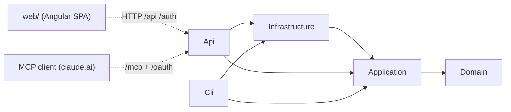

# 專案盤點（階段 1）

> 範圍：整個 repo，排除 `tests/`、`node_modules`。只讀結構性檔案，未深讀業務邏輯。
> 盤點日期：2026-11-14（commit `f181aaf`）。領域用語以 `CONTEXT.md` 為準。

## 方案結構

方案檔：`SixJars.slnx`（src 5 個專案、tests 6 個專案）。共用設定：`Directory.Build.props`（`net10.0`、Nullable、ImplicitUsings）、`Directory.Packages.props`（Central Package Management）、`global.json`（SDK `10.0.401`、test runner `Microsoft.Testing.Platform`）。

| 專案 | 類型 | TargetFramework | 職責（一句話） | 依賴的專案 | 主要套件 |
|------|------|-----------------|----------------|------------|----------|
| `SixJars.Domain` | Class library | net10.0 | 帳本、交易／分錄、財務規劃、報表樹與餘額計算等純領域模型，無外部套件 | — | （無） |
| `SixJars.Application` | Class library | net10.0 | 每個 use case 一個 MediatR request＋handler，含授權／驗證 pipeline、稽核、匯入／備份邏輯 | Domain | EF Core 10.0.13、MediatR 14.2.0、FluentValidation 12.1.1 |
| `SixJars.Infrastructure` | Class library | net10.0 | EF Core＋Npgsql 持久層、帳本快取、SQL 月報彙總、Excel 讀取、CSV/XLSX 匯出 | Application | Npgsql.EFCore.PostgreSQL 10.0.3、ExcelDataReader 3.9.0、ClosedXML 0.105.1、DataProtection.EFCore |
| `SixJars.Api` | ASP.NET Core Web（Minimal API） | net10.0 | Web API＋BFF 登入＋SPA hosting＋唯讀遠端 MCP 與內建 OAuth 授權伺服器 | Application、Infrastructure | OpenIdConnect 10.0.13、ModelContextProtocol.AspNetCore 2.3.0 |
| `SixJars.Cli` | Console（Exe） | net10.0 | 管理工具：匯入舊帳本、成員／建立者管理、撤銷 MCP 授權、還原備份 | Application、Infrastructure | System.CommandLine 2.0.12 |

證據：各 `src/*/​*.csproj`。另 `SixJars.Application.csproj` 以 `InternalsVisibleTo` 開放給 `SixJars.Cli`（CLI 專用 internal request），`SixJars.Api.csproj` 帶 `UserSecretsId`。

### Composition root 與 DI 註冊

| 位置 | 註冊內容 | 證據 |
|------|----------|------|
| Api | `AddSixJarsInfrastructure`、`AddSixJarsApplication`、`ICurrentUser`→`HttpCurrentUser`(Scoped)、`TimeProvider.System`(Singleton)、ProblemDetails＋`ApiExceptionHandler`、JSON enum 字串化、`AddSixJarsAuthentication`、Antiforgery、ForwardedHeaders、`AddSixJarsMcp` | `src/SixJars.Api/Program.cs` |
| Application | MediatR（pipeline 依序 `BookAccessBehavior` → `ValidationBehavior`）、所有 validator（含 internal）、`IAuditTrail`→`AuditTrail`(Scoped) | `src/SixJars.Application/DependencyInjection.cs` → `AddSixJarsApplication` |
| Infrastructure | `SixJarsDbContext`（Npgsql、全域 SplitQuery、自動掛 DI 中的 `IInterceptor`）、`ISixJarsDbContext`(Scoped)、MemoryCache、`IBookReader`→`CachedBookReader`(Scoped)、`ILedgerSummaryQuery`→`SqlLedgerSummaryQuery`(Scoped)、兩個 `ITransactionSheetWriter`（CSV／XLSX，Singleton） | `src/SixJars.Infrastructure/DependencyInjection.cs` → `AddSixJarsInfrastructure` |
| Api / MCP | `McpTokens`(Singleton)、`AuthorizeRequestValidator`(Scoped)、`McpOAuthOptions`、typed HttpClient `ClientMetadataFetcher`（timeout 5s、不跟隨 redirect）、`McpBearer` scheme＋SDK `AddMcp` scheme、`Mcp` authorization policy、`AddMcpServer`（stateless HTTP、`LedgerTools`、`ReconcilePrompt`） | `src/SixJars.Api/Mcp/McpSetup.cs` → `AddSixJarsMcp` |
| Api / Auth | Cookie（預設 scheme）＋條件式 Google OIDC、`GoogleSignInValidator`(Scoped)、DataProtection keys 存 DB | `src/SixJars.Api/Infrastructure/AuthenticationSetup.cs` → `AddSixJarsAuthentication` |
| Cli | 自建 host（`CliApp.RunAsync`），連線字串由環境變數字典傳入 | `src/SixJars.Cli/Program.cs`、`src/SixJars.Cli/CliApp.cs` |

### Middleware 管線（依序）

`UseForwardedHeaders` → `UseExceptionHandler` → `UseSpaHosting`（路徑改寫＋靜態檔快取策略）→ `UseAuthentication` → `UseAuthorization`。證據：`src/SixJars.Api/Program.cs`。

### 對外入口（路由總表）

| 群組 | 路由 | 授權 | 證據 |
|------|------|------|------|
| Health | `GET /health`、`GET /health/ready`（有未套用 migration 時 503） | 匿名 | `Endpoints/HealthEndpoints.cs` |
| Auth | `GET /auth/login`、`POST /auth/logout`、OIDC callback `/auth/callback` | 匿名／cookie | `Endpoints/AuthEndpoints.cs`、`Infrastructure/AuthenticationSetup.cs` |
| `/api`（`RequireAuthorization` + `AntiforgeryFilter`） | `/antiforgery/token`、`/me`、`/books`（含 accounts／planning-funds／categories／tags／lock-date／deletion-preview）、`/books/{id}/transactions`、`/planned-expenses`（含 generate／refresh／pay）、`/recurring-planned-expenses`、`/budgets`（default／overrides）、`/summary`、`/reports/monthly`、`/reports/yearly`、`/audit`、`/export/backup.json`、`/export/transactions.csv`、`/export/transactions.xlsx` | Cookie | `src/SixJars.Api/Endpoints/*.cs`、`Program.cs` |
| MCP | `/mcp`（Streamable HTTP，tools：`list_books`、`list_accounts`、`list_account_transactions`；prompt：`ReconcilePrompt`） | `Mcp` policy（`McpBearer` + scope `ledger:read`） | `Mcp/McpSetup.cs`、`Mcp/LedgerTools.cs` |
| OAuth | `GET /.well-known/oauth-authorization-server`、`GET/POST /oauth/authorize`、`POST /oauth/token`、SDK 提供的 `/.well-known/oauth-protected-resource/mcp` | 匿名 | `Mcp/OAuth/OAuthEndpoints.cs` |
| SPA | 其他 GET/HEAD 且非後端前綴、無副檔名 → 改寫為 `/index.html` | 匿名 | `Infrastructure/SpaHosting.cs` → `UseSpaHosting` |

### CLI 指令

`import-legacy`（`--file`、`--book-name`、`--owner-email`、`--into`、`--dry-run`、`--adjust`）、`add-member`、`add-creator`、`remove-creator`、`revoke-mcp-access`、`restore-backup`。證據：`src/SixJars.Cli/CliApp.cs` → `ImportLegacyCommand` 等。

### Application 功能資料夾（只列檔名，未深讀）

| 資料夾 | 檔案數 | 代表檔案 |
|--------|--------|----------|
| `Books` | 19 | `CreateBook`、`DeleteBook`、`UpdateSettings`、`SetLockDate`、`IBookReader` |
| `Transactions` | 9 | `CreateTransaction`、`UpdateTransaction`、`DeleteTransaction`、`ListTransactions`、`TransactionBuilder` |
| `Planning` | 16 | `CreatePlannedExpense`、`PayPlannedExpense`、`GeneratePlannedExpenses`、`RefreshPlannedExpenses`、`BudgetCommands`、`RecurringPlannedExpenseCommands` |
| `Ledger` | 5 | `GetLedgerSummary`、`ILedgerSummaryQuery`、`BalanceCutoff` |
| `Reports` | 2 | `GetMonthlyReport`、`GetYearlyReport` |
| `Auditing` | 6 | `IAuditTrail`、`AuditTrail`、`GetAuditHistory` |
| `Members` | 7 | `GetMe`、`AddOwner`、`AddBookCreator`、`RemoveBookCreator`、`RevokeMcpAccess` |
| `Exports` | 4 | `ExportTransactions`、`ITransactionSheetWriter` |
| `Backup` | 4 | `ExportBackup`、`RestoreBackup` |
| `LegacyImport` | 13 | `ImportLegacyBook`、`PrependLegacyYear`、`LegacyWorkbookMapper`、`MappingSession.*` |
| `Common` | 11 | `BookAccessBehavior`、`ValidationBehavior`、`IBookScoped`、`ICliOnlyRequest`、`ISixJarsDbContext`、`TaipeiTime` |

Domain 資料夾：`Books`、`Transactions`、`Ledger`、`Planning`、`Reports`、`Members`、`Common`。

## 前端

| 應用 | Angular 版本 | 架構（standalone / NgModule） | 主要路由 |
|------|--------------|-------------------------------|----------|
| `web/` | `@angular/*` ^22.2（Material／CDK 22.2、chart.js 4.5、TypeScript ~6.0） | Standalone（`app.config.ts` 用 `provideRouter`／`provideHttpClient`，無 AppModule） | `''`（Home）、`denied`、`books/:bookId/` 底下 lazy：`transactions`、`summary`、`planned-expenses`、`budgets`、`reports/monthly`、`reports/yearly`、`settings` |

- Guards：`authGuard`、`bookGuard`。證據：`web/src/app/app.routes.ts`。
- HTTP interceptors（依序）：`loadingInterceptor`、`apiErrorInterceptor`。證據：`web/src/app/app.config.ts`。
- API 呼叫層：`web/src/app/core/api/*-api.ts`（book、budget、planned-expense、recurring-planned-expense、report、session、summary、transaction），DTO 集中於 `core/api/dto.ts`。
- PWA：`provideServiceWorker`（非 dev mode 啟用）、`ngsw-config.json` 排除 `/auth/**`、`/api/**`、`/health`、`/oauth/**` 的 navigation。
- 環境檔：**無** `src/environments/`；dev server 走 `proxy.conf.json`（`/api`、`/auth` → `https://localhost:5001`），`ng serve` 啟用 SSL、port 4300（`web/angular.json`）。
- 測試：Vitest（`@angular/build:unit-test`）＋ Playwright e2e（`web/e2e/*.spec.ts`）。
- 部署方式：Docker build 時 `ng build`，輸出複製到 Api 的 `/app/wwwroot`，由 `UseSpaHosting` 同源提供（`Dockerfile`）。

## 資料儲存

| 儲存 | 用途 | 存取位置（證據） |
|------|------|------------------|
| SQL Server | 未使用 | — |
| PostgreSQL（Neon，ADR 0007） | 全部業務資料、稽核、MCP 授權、DataProtection keys | `src/SixJars.Infrastructure/Persistence/SixJarsDbContext.cs`；`DependencyInjection.cs` → `UseNpgsql` |
| MongoDB | 未使用 | — |
| Redis | 未使用；帳本唯讀快取改用 process 內 `IMemoryCache`（key `book:{bookId}`、sliding 1 小時，以 Books 的 `xmin` 判斷過期） | `src/SixJars.Infrastructure/Persistence/CachedBookReader.cs` → `CacheKey`、`EntryOptions` |

### EF Core 實體與資料表

| Aggregate / DbSet | Owned collections（資料表） | 特性 | 證據 |
|-------------------|------------------------------|------|------|
| `Books` | `Accounts`、`PlanningFunds`、`Categories`、`Tags` | `xmin` 版本；只改 owned 設定時強制 touch Books 列 | `BookConfiguration.cs`、`SixJarsDbContext.TouchBooksWithChangedSettings` |
| `Transactions` | `Postings`、`TransactionTags` | 軟刪除 query filter（`DeletedAt == null`） | `TransactionConfiguration.cs` |
| `PlannedExpenses` | — | 軟刪除 query filter | `PlannedExpenseConfiguration.cs` |
| `RecurringPlannedExpenses` | — | | `RecurringPlannedExpenseConfiguration.cs` |
| `CategoryBudgets` | `CategoryBudgetOverrides` | | `CategoryBudgetConfiguration.cs` |
| `AuditEntries` | — | | `AuditEntryConfiguration.cs` |
| `BookMembers` | — | 登入白名單（ADR 0005） | `BookMemberConfiguration.cs` |
| `BookCreators` | — | 建立者名單（ADR 0011） | `BookCreatorConfiguration.cs` |
| `McpGrants` | — | MCP 授權、可撤銷 | `McpGrantConfiguration.cs` |
| `DataProtectionKeys` | — | cookie 加密金鑰 | `SixJarsDbContext.DataProtectionKeys` |

- 強型別 Id 以 value converter 對應（`ValueConverters.cs`），`decimal` 統一 `(18,4)`（`SixJarsDbContext.ConfigureConventions`）。
- 並行控制：PostgreSQL `xmin`（`ExpectVersion` / `GetVersion`）；另有 `pg_advisory_xact_lock`（`AcquireTransactionLockAsync`）。
- 月報彙總走原生 SQL：`src/SixJars.Infrastructure/Ledger/SqlLedgerSummaryQuery.cs`。
- Migrations（15 個，2026-10-03 ～ 2026-10-30）：`InitialLedger` → `AddConcurrencyTokens` → `AddSoftDelete` → `AddAuditEntries` → `AddLockDate` → `AddBookMembers` → `AddDataProtectionKeys` → `AddSettingsOrderAndArchive` → `AddRecurringPlannedExpenses` → `AddCategoryBudgets` → `AddBookCreators` → `AddTags` → `AddMcpGrants` → `McpGrantConcurrency` → `BookConcurrencyToken`。證據：`src/SixJars.Infrastructure/Persistence/Migrations/`。App 啟動不自動 migrate（`/health/ready` 檢查 pending migration）。
- Design-time：`DesignTimeDbContextFactory.cs`（不實際連線，依 CLAUDE.md 描述）。

## 外部整合

| 系統 | 協定 | 呼叫位置 |
|------|------|----------|
| Google 帳號 | OIDC authorization code flow（Authority `https://accounts.google.com`、scope `email`、callback `/auth/callback`） | `src/SixJars.Api/Infrastructure/AuthenticationSetup.cs` → `ConfigureGoogle` |
| MCP client（預設 claude.ai，可由 `Mcp:AllowedClientIdHosts` 覆寫） | MCP Streamable HTTP（入站）＋ OAuth 2.1（CIMD、S256 PKCE） | `src/SixJars.Api/Mcp/McpSetup.cs` |
| MCP client 的 CIMD 文件 | HTTPS GET（出站，typed HttpClient，5s timeout、不跟隨 redirect） | `src/SixJars.Api/Mcp/OAuth/ClientMetadataFetcher.cs` |
| Neon PostgreSQL | Npgsql（SSL） | `src/SixJars.Infrastructure/Persistence/SixJarsConnectionString.cs` |
| 舊 Excel 記帳本（.xlsm） | 本機檔案讀取（ExcelDataReader，CLI 用） | `src/SixJars.Infrastructure/LegacyExcel/ExcelLegacyWorkbookReader.cs` |
| GCP（Artifact Registry、Cloud Run、Secret Manager） | GitHub Actions + WIF | `.github/workflows/deploy.yml`、`scripts/setup-gcp.ps1` |

## 背景工作

| 名稱 | 觸發方式 | 位置 |
|------|----------|------|
| （無） | src 內找不到 `IHostedService` / `BackgroundService` / `AddHostedService` | grep `src/**/*.cs` |
| 週期性預計支出產生 | 使用者明確觸發（`POST /planned-expenses/generate`、`/refresh`），非排程（ADR 0009） | `Endpoints/PlannedExpensesEndpoints.cs` |
| DB migration | 使用者本機執行 migration bundle | `docs/deploy.md`（依 CLAUDE.md） |

## 設定管理

- repo 內**沒有** `appsettings*.json`、`launchSettings.json`、`docker-compose*.yml`；設定全由環境變數提供（`.env.example` 為 placeholder）。
- 設定鍵：`ASPNETCORE_ENVIRONMENT`、`ConnectionStrings__SixJars`（`<REDACTED>`）、`Authentication__Google__ClientId`／`ClientSecret`（`<REDACTED>`）、`MediatR__LicenseKey`（`<REDACTED>`）、`Mcp__AllowedClientIdHosts__N`。證據：`.env.example`、`Program.cs`、`AuthenticationSetup.cs`、`McpSetup.cs`。
- 非 Development 環境缺 Google 設定時啟動即失敗（`AuthenticationSetup.AddSixJarsAuthentication`）。

## 基礎設施與 CI/CD

| 項目 | 內容 | 證據 |
|------|------|------|
| Docker | 3 階段：`node:24-alpine` build 前端 → `dotnet/sdk:10.0` publish Api → `dotnet/aspnet:10.0` runtime，非 root、port 8080 | `Dockerfile` |
| .dockerignore | 排除 `reference/`、`*.xlsm`/`*.xlsx`、`.env*`、tests、docs 等 | `.dockerignore` |
| CI | PR／push master：backend（build + test，Testcontainers）、frontend（build、Vitest、Playwright） | `.github/workflows/ci.yml` |
| Deploy | push `v*.*.*` tag → 驗證 tag 在 master → 重跑 CI → build/push image → 檢查時區檔與無個資 → `gcloud run deploy`（asia-east1、min 0／max 2、512Mi、startup probe `/health/ready`）→ smoke test | `.github/workflows/deploy.yml` |

## 建議模組切分

依「對外入口＋資料 aggregate」切，Domain／Application／Infrastructure 中同一功能的檔案放在同一模組文件，避免按層切造成同一流程散在多份文件。

1. **ledger-core（帳本與交易）**：Domain `Books`、`Transactions`、`Ledger`、`Common`；Application `Books`、`Transactions`、`Ledger`；Infrastructure `Persistence`（DbContext、`CachedBookReader`、`LedgerSnapshotLoader`、configurations）、`Ledger/SqlLedgerSummaryQuery`；Api `BooksEndpoints`、`TransactionsEndpoints`、`SummaryEndpoints`。理由：核心 aggregate、分錄展開、餘額計算、快取與並行控制都在這裡，是其他模組的基礎。
2. **planning（財務規劃：預計支出／週期／預算）**：Domain `Planning`；Application `Planning`；Api `PlannedExpensesEndpoints`、`RecurringPlannedExpensesEndpoints`、`BudgetsEndpoints`。理由：獨立的 aggregate 群與明確觸發的產生流程（ADR 0009）。
3. **reporting-export（報表、匯出、備份）**：Domain `Reports`；Application `Reports`、`Exports`、`Backup`；Infrastructure `Exports`；Api `ReportsEndpoints`、`ExportsEndpoints`。理由：皆為唯讀彙總／序列化輸出（備份還原寫入部分由 CLI 觸發，一併說明）。
4. **identity-access（認證授權、成員、稽核）**：Domain `Members`；Application `Members`、`Auditing`、`Common/BookAccessBehavior`、`IBookScoped`、`ICliOnlyRequest`；Api `Infrastructure/*`（Auth、Antiforgery、ExceptionHandler、ForwardedHeaders、SpaHosting）、`AuthEndpoints`、`MeEndpoints`、`AuditEndpoints`、`HealthEndpoints`。理由：橫切的安全邊界與 Api 主機設定集中檢視。
5. **remote-mcp（遠端 MCP＋內建 OAuth）**：Api `Mcp/**`、Domain `McpGrant`、Application `RevokeMcpAccess`。理由：自成一套協定與安全模型（ADR 0013），風險面獨立。
6. **legacy-import-cli（舊帳本匯入與 CLI）**：Application `LegacyImport`；Infrastructure `LegacyExcel`；`SixJars.Cli`。理由：第二個 composition root，與 Web 路徑完全不同的入口與交易邊界。
7. **web-frontend（Angular SPA）**：`web/src/app/**`、`ngsw-config.json`、`proxy.conf.json`。理由：獨立技術堆疊，需檢查路由、狀態、interceptor 與 DTO 型別漂移。
8. **（選擇性）deployment-ops**：`Dockerfile`、`.github/workflows`、`scripts/setup-gcp.ps1`、`docs/deploy.md`。理由：若不獨立成模組，可併入階段 3 的 `01-overview.md` 部署拓樸。
