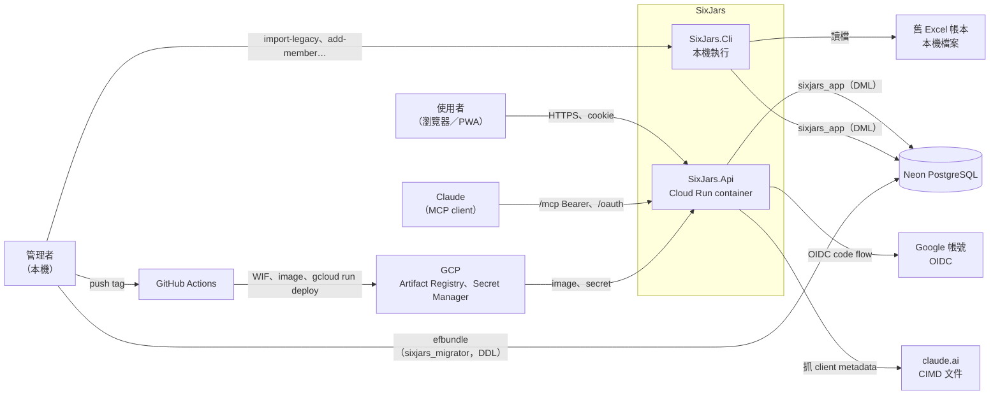
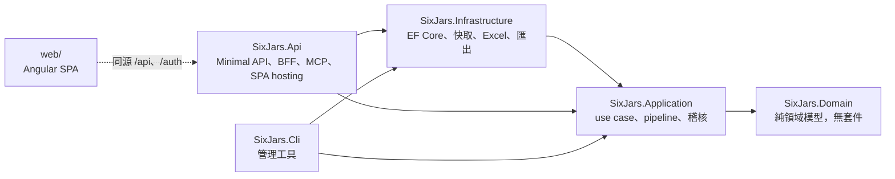
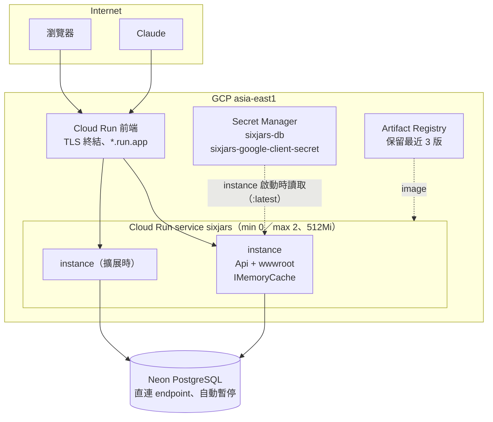

# 系統總覽

> 階段 3 整合，commit `f181aaf`，2026-11-14。資料來源是 `00-inventory.md` 與 `10`～`17` 八份模組文件；跨模組的推論另外回頭以 grep 驗證原始碼（會在文中註明）。領域用語以 `CONTEXT.md` 為準。
> 各節的細節與證據在對應的模組文件裡，本文只放結論與指引。

## 系統目的

SixJars 記帳本是個人／家庭用的記帳 Web 應用，從「富朋友理財記帳本」Excel（`.xlsm`）移植而來。證據：專案 `CLAUDE.md`；`src/SixJars.Infrastructure/LegacyExcel/ExcelLegacyWorkbookReader.cs`（「儲存格位址依 2026 年版記帳本查證」）。

它保留了 Excel 的記帳模型，主要的使用情境如下：

| 能力 | 說明 | 模組 |
|---|---|---|
| 記帳 | 13 種交易類型各自展開成 0～2 筆分錄（ADR 0001），帳本是沒有年度結轉的連續時間軸（ADR 0002） | `10` ledger-core |
| 可用現金與月可用餘額 | 由分錄、期初與未付預定支出計算；財務規劃帳戶是信封、不是帳戶（ADR 0003） | `10` |
| 財務規劃 | 預定支出（逐月、可付款）、週期預定支出（需明確產生，ADR 0009）、浮動支出的預算 | `11` planning |
| 報表、匯出、備份 | 月報／年報（顯示支出，不顯示可支配餘額，ADR 0008）、CSV／xlsx 明細、整本帳的 JSON 備份 | `12` reporting-export |
| 多人共用 | 以帳本成員表作為登入白名單（ADR 0005），獲准的建立者可以自己建帳本（ADR 0011） | `13` identity-access |
| 給 AI 讀取 | 唯讀的遠端 MCP，主要用途是讓使用者自己的 Claude 做信用卡帳單對帳（ADR 0013） | `14` remote-mcp |
| 搬家 | 只能用 CLI 把舊 Excel 匯入成新帳本，或把更早的年度補匯到既有帳本前面 | `15` legacy-import-cli |

規模假設：帳本只供個人或家庭使用，註解估計一年約 2,000 筆交易，正式環境最多 2 個 instance。證據：`10` 風險 #9；`.github/workflows/deploy.yml`（`--max-instances 2`）。後文許多「低嚴重度」的判斷都建立在這個假設上，假設改變時要一起重新評估（見 `90-tech-debt.md`）。

## 技術堆疊

| 層 | 技術 | 證據 |
|---|---|---|
| 後端 | .NET 10（SDK `10.0.401`）、ASP.NET Core Minimal API、MediatR 14、FluentValidation 12 | `global.json`、`Directory.Packages.props` |
| 資料 | PostgreSQL（Neon）、EF Core 10＋Npgsql；process 內的 `IMemoryCache` | `00-inventory.md`「資料儲存」 |
| 認證 | Cookie＋Google OIDC（BFF 模式）；MCP 用內建的 OAuth 授權伺服器，token 以 DataProtection 保護 | `13`、`14` |
| 檔案 | ExcelDataReader（讀舊帳本）、ClosedXML（匯出 xlsx） | `00-inventory.md` |
| CLI | System.CommandLine | `15` |
| 前端 | Angular 22（standalone、signals、全部 `OnPush`）、Angular Material、chart.js、PWA（ngsw） | `16` |
| 測試 | xUnit v3＋Testcontainers（`postgres:17-alpine`）、Vitest、Playwright | `17`「CI」 |
| 部署 | 單一 Docker image（前後端合一）→ GCP Cloud Run `asia-east1`；GitHub Actions＋WIF | `17` |

**沒有使用**的技術：SQL Server、MongoDB、Redis、訊息佇列、背景工作（`IHostedService`）、外部 LLM API、IaC。證據：`00-inventory.md`；`17`「職責」。

## Context 圖

證據：`13`「對外介面」、`14`「內部結構」、`15`「職責」、`17`「身分與信任邊界」。

## 專案結構與分層

- **兩個 composition root 共用同一組 Application command**，CLI 不另寫寫入邏輯。CLI 專用的 request 宣告為 `internal`＋`ICliOnlyRequest`，Api 在編譯期就參考不到，並由慣例測試守住。證據：`13`「授權模型」。
- **規則集中在 Domain**：分錄展開只寫在 `TransactionFactory` 一處；週期項目產生（`RecurringPlanner`）、預算表（`BudgetSheet`）、報表歸組（`ReportTree`）都是純函式。例外是餘額計算，有三份實作，見 `90-tech-debt.md`。
- **Application 依功能分資料夾**，每個 use case 一個檔案，request 用 record、handler 是 `internal`。

### 模組對照

| 模組文件 | 涵蓋範圍 | 一句話 |
|---|---|---|
| [`10-module-ledger-core.md`](10-module-ledger-core.md) | 帳本、交易、餘額、持久層、快取 | 系統核心，其他模組都重用它的 `TransactionBuilder`、`IBookReader`、`ILedgerSummaryQuery` |
| [`11-module-planning.md`](11-module-planning.md) | 預定支出、週期預定支出、預算 | 由使用者明確觸發的產生流程，付款時建立交易 |
| [`12-module-reporting-export.md`](12-module-reporting-export.md) | 月報、年報、匯出、備份與還原 | API 端全部唯讀；還原只能從 CLI 執行，而且一律經 Domain 重建 |
| [`13-module-identity-access.md`](13-module-identity-access.md) | 認證、白名單、授權、XSRF、稽核、Api 主機設定 | 「誰能存取哪些帳本」只有一個定義：`BookMembership.OwnedBookIds` |
| [`14-module-remote-mcp.md`](14-module-remote-mcp.md) | `/mcp`、內建 OAuth、`McpGrant` | 唯讀；token 只代表「使用者同意過」，能讀哪些帳本每次重新查 |
| [`15-module-legacy-import-cli.md`](15-module-legacy-import-cli.md) | 舊 Excel 匯入、補匯舊年度、CLI 主機 | 第二個 composition root；儲存格位址寫死 |
| [`16-module-web-frontend.md`](16-module-web-frontend.md) | Angular SPA | 沒有 store，狀態由 signal service、網址參數與元件 signal 三種來源組成 |
| [`17-module-deployment-ops.md`](17-module-deployment-ops.md) | Docker、CI/CD、GCP、維運手冊 | 用 tag 部署；migration、資料庫授權、secret 都由人在本機操作 |

## 部署拓樸

| 特性 | 內容 | 證據 |
|---|---|---|
| 單一服務 | 前端 build 輸出放在 Api 的 `wwwroot`，由 `UseSpaHosting` 同源提供；沒有 CDN、load balancer、自訂網域 | `Dockerfile`；ADR 0012；`17` |
| 無狀態 instance | 唯一的 process 內狀態是帳本唯讀快取，以 `Books.xmin` 比對版本來判斷是否過期，不需要跨 instance 失效 | `10`「快取策略」 |
| 登入狀態跨 instance | DataProtection 金鑰存在資料庫 | `13`「認證設定重點」 |
| MCP 跨 instance | Streamable HTTP 採 stateless 模式；token 自包含，每次請求查一次撤銷狀態 | `14` |
| 閒置成本 | min instances 0 搭配 Neon 自動暫停，刻意不定時 ping；代價是冷啟動要等數秒 | `17`「閒置策略」；ADR 0007 |
| 不在 container 裡的工作 | migration、資料庫授權、CLI 管理操作都在使用者本機執行 | `17`「職責」第 5 點 |

### 發版流程摘要

`merge 到 master` → 本機 `efbundle`（migrator 角色）→ `push tag vX.Y.Z` → `verify-tag` → 重跑 CI → build image、檢查時區檔與個資 → `gcloud run deploy` → startup probe `/health/ready`（有未套用的 migration 時回 503，舊 revision 繼續服務）→ smoke test。完整的 sequence diagram 見 `17`「發版（含 schema 變更）」。

## 關鍵架構決策

| ADR | 決策 | 影響最大的模組 |
|---|---|---|
| 0001 | 交易展開成分錄 | `10` |
| 0002 | 帳本是連續時間軸，沒有年度結轉 | `10`、`12`（資料只增不減） |
| 0003 | 財務規劃帳戶是信封，不是帳戶 | `10` |
| 0004 → 0007 | Cloud Run 台灣區；資料庫由 Supabase 改為 Neon | `17` |
| 0005 | BFF cookie 登入，白名單就是帳本成員表 | `13` |
| 0006 | 明確寫入的快照稽核＋軟刪除 | `13`、各寫入 handler |
| 0008 | 報表顯示支出，不顯示可支配餘額 | `12` |
| 0009 | 週期預定支出只能明確產生 | `11` |
| 0010 | 刪除帳本是硬刪除 | `10`、`13`、`17` |
| 0011 | 獲准的建立者可以自己建立帳本 | `13` |
| 0012 | 以版本 tag 經 GitHub Actions 部署 | `17` |
| 0013 | 遠端 MCP＋內建 OAuth | `14` |
| 0015 | 標籤可多選，金額不疊加 | `10` |

證據：`docs/adr/` 檔名（`00-inventory.md`）。ADR 0014 在 repo 中不存在，見 `99-open-questions.md`。

## 延伸閱讀

- 關鍵業務流程與資料儲存對照：[`02-data-flow.md`](02-data-flow.md)
- 認證授權、錯誤處理、設定、logging 等橫切面：[`03-cross-cutting.md`](03-cross-cutting.md)
- 技術債：[`90-tech-debt.md`](90-tech-debt.md)
- 待確認問題：[`99-open-questions.md`](99-open-questions.md)
