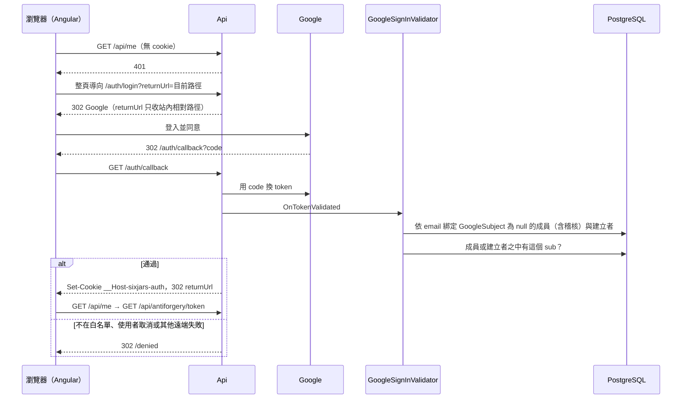
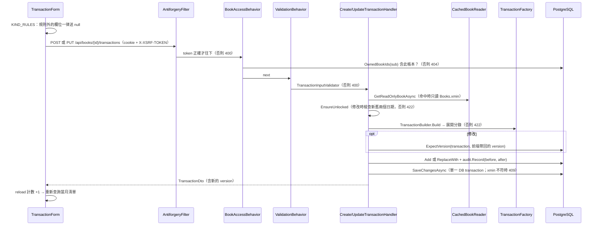
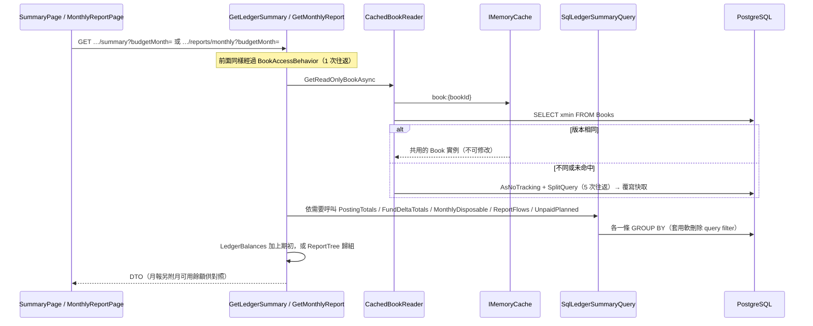
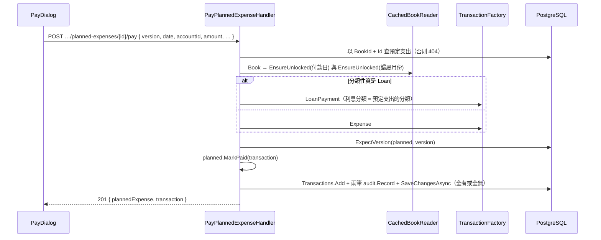
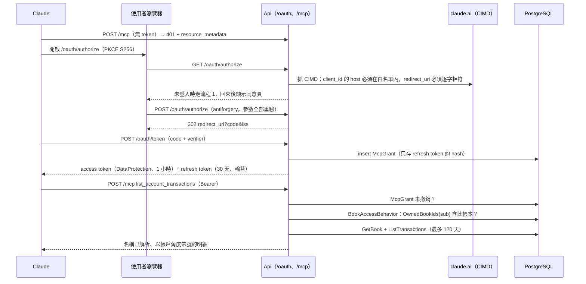

# 資料流

> 階段 3 整合，commit `f181aaf`，2026-11-14。每條流程只畫跨模組的主線；細部分支、錯誤路徑與證據見各模組文件的「關鍵流程」。

## 選了哪五條流程

| # | 流程 | 為什麼選它 | 跨越的模組 |
|---|---|---|---|
| 1 | 登入與首次綁定 | 所有存取的起點，也是白名單、cookie、XSRF 三件事的交會點 | `16` → `13` |
| 2 | 新增／修改交易 | 最頻繁的寫入，示範所有寫入共用的慣例（授權 → 驗證 → 鎖帳日 → 展開分錄 → 稽核 → 樂觀並行） | `16` → `13` → `10` |
| 3 | 讀取總覽與報表 | 最頻繁的讀取，示範帳本快取與 SQL 彙總的分工 | `16` → `10` → `12` |
| 4 | 預定支出付款 | 唯一一條跨兩個 aggregate、同一次存檔寫入兩種實體的 Web 流程 | `11` → `10` |
| 5 | MCP 授權與 tool 呼叫 | 第二種身分來源，走另一套 scheme，最後收斂到同一條授權規則 | `14` → `13` → `10` |

沒有畫成 sequence diagram、但同樣關鍵的流程：
- CLI 匯入與補匯：`15`「關鍵流程」
- 備份還原：`12`「還原備份（CLI）」
- 發版與 migration：`17`「發版（含 schema 變更）」

## 流程 1：登入與首次綁定

重點：
- 第一次登入以「已驗證的 email」綁定 `sub`，之後只認 `sub`。
- 前端不經手 token，401 一律整頁導向。
- XSRF token 在 `/api/me` 成功後取一次。

證據：`13`「白名單與 sub 綁定規則」、`16`「進入應用程式」。

## 流程 2：新增／修改交易（寫入的共同慣例）

| 慣例 | 套用範圍 | 證據 |
|---|---|---|
| 非成員一律 404，而且授權在驗證之前 | 所有 `IBookScoped` request | `13`「授權模型」 |
| 查詢同時帶 `BookId` 條件 | 每個 handler 自己負責（pipeline 只驗帳本） | `13` 風險 #6 |
| 先檢查鎖帳日 | 交易、預定支出；週期項目與預算不檢查 | `10`、`11`「鎖帳日」 |
| `ExpectVersion` 樂觀並行 | 交易、預定支出、週期項目；帳本設定與預算不帶前端版本 | `10`、`11`「並行控制」 |
| 稽核與業務資料同一次 `SaveChanges` | 所有 Web 寫入；匯入只留摘要 | `13`「稽核」、`15` |
| 軟刪除 | 交易、預定支出；帳本是硬刪除（ADR 0010），週期項目也是硬刪除 | `10`、`11` |

## 流程 3：讀取總覽與報表

重點：
- 帳本設定走快取。金額一律在資料庫端彙總，不把交易載入記憶體。
- 多條查詢不在同一個 snapshot 裡（`10` 風險 #12）。
- 「今天」由後端以台北時間決定（`asOf` 省略時）。

證據：`10`「帳務摘要」「快取策略」、`12`「月報」。

## 流程 4：預定支出付款

這條流程存在反向的不對稱：
- **刪除**付款交易時，`DeleteTransactionHandler` 會把預定支出改回未付。
- **修改**付款交易時，不會同步預定支出（`11` 風險 #1）。

舊帳本匯入的制式表格用相同規則建立付款交易（`15`「轉換規則」）。

## 流程 5：MCP 授權與 tool 呼叫

重點：
- `/mcp` 只認 `McpBearer`，`/api` 只認 cookie，兩者互不相通。
- 兩種身分最後都收斂到同一個 `ICurrentUser.Subject` 和同一條授權規則。

證據：`14`「首次連線與授權」「Tool 呼叫」、`13`「三種身分來源」。

## 資料儲存對照表

### 儲存體

| 儲存 | 是否使用 | 用途 |
|---|---|---|
| PostgreSQL（Neon） | 是，唯一的持久儲存 | 全部業務資料、稽核、授權、DataProtection 金鑰 |
| SQL Server | 否 | — |
| MongoDB | 否 | — |
| Redis | 否；以 process 內的 `IMemoryCache` 代替 | 帳本唯讀快取 |
| 瀏覽器 `localStorage`／IndexedDB | 否 | 前端不保存業務資料（`16`「資料存取」） |
| Service worker cache | 是 | 只快取靜態資源，不快取 API（`16`「PWA」） |

### PostgreSQL 資料表：誰寫、誰讀

| 資料表（owned 表縮排） | 寫入者 | 讀取者 | 刪除方式 | 模組 |
|---|---|---|---|---|
| `Books` | Web 設定 handler、`CreateBook`、`DeleteBook`；CLI 匯入、補匯、還原 | 所有帳本範圍 request（經快取） | 硬刪除（`DeleteBook`） | `10` |
| └ `Accounts`、`PlanningFunds`、`Categories`、`Tags` | 同上（透過 `Book` aggregate） | 同上 | 設定可封存；未被引用時可刪除；隨帳本 cascade | `10` |
| `Transactions` | Web 交易 CRUD、`PayPlannedExpense`；CLI 匯入、補匯、還原 | 清單、摘要、報表、預算 actual、匯出、備份、MCP | 軟刪除；隨帳本硬刪 | `10` |
| └ `Postings`、`TransactionTags` | 同上（由 `TransactionFactory` 展開） | SQL 彙總 | 隨交易 | `10` |
| `PlannedExpenses` | Web CRUD、Pay、Generate、Refresh；交易刪除時改回未付；CLI 匯入、還原 | 清單、摘要（未付占用）、月報、備份 | 軟刪除 | `11` |
| `RecurringPlannedExpenses` | Web CRUD；CLI 還原 | Generate／Refresh、備份 | 硬刪除（曾產生過就不能刪） | `11` |
| `CategoryBudgets` | Web 預算寫入；CLI 還原 | 預算表、備份 | 預設值與覆寫值都清空時刪除整筆 | `11` |
| └ `CategoryBudgetOverrides` | 同上 | 同上 | 同上 | `11` |
| `AuditEntries` | 各 Web 寫入 handler、首次登入綁定、CLI `add-member`、匯入、還原 | `GET /audit`（前端沒有畫面）、備份 | 只有 `DeleteBook` 會清除（ADR 0010）；正式環境的 app 角色**沒有** DELETE 權限（已在正式環境確認，見 `90-tech-debt.md` TD-01） | `13` |
| `BookMembers` | `CreateBook`、首次登入綁定、CLI `add-member`、匯入、還原 | 每個帳本範圍 request（`BookAccessBehavior`）、`/me`、`/books` | 只隨 `DeleteBook`；沒有移除成員的入口 | `13` |
| `BookCreators` | CLI `add-creator`／`remove-creator`、首次登入綁定 | `CreateBook`、`/me`、登入白名單 | CLI 移除 | `13` |
| `McpGrants` | `/oauth/token`（新增、輪替、重放撤銷）、CLI `revoke-mcp-access` | 每個 `/mcp` 請求 | 永不刪除（撤銷只寫 `RevokedAt`） | `14` |
| `DataProtectionKeys` | ASP.NET Core DataProtection | cookie、OAuth code、access token 的加解密 | 框架管理 | `13`、`14` |
| `__EFMigrationsHistory` | `efbundle.exe`（migrator 角色，本機） | `/health/ready`（app 角色） | — | `17` |

證據：各模組「資料存取」表；`DeleteBook.cs` 第 47 行與 `docs/deploy.md` 第 231 行已在階段 3 以 grep 重新確認。

### 不在資料庫裡的資料

| 資料 | 位置 | 寫入者 | 讀取者 |
|---|---|---|---|
| 帳本唯讀快取 | 各 Cloud Run instance 的 `IMemoryCache`（`book:{bookId}`，sliding 1 小時） | `CachedBookReader` | 同上 |
| 備份 JSON | 使用者自己的儲存位置 | 瀏覽器下載 `/export/backup.json` | CLI `restore-backup` |
| CSV／xlsx 明細 | 使用者自己的儲存位置 | 瀏覽器下載 | 使用者（不能還原） |
| 舊 Excel 帳本 | 使用者本機的 `reference/`（gitignore、dockerignore） | — | CLI `import-legacy`、Acceptance 測試 |
| 連線字串、Google client secret | Secret Manager | 使用者以 `gcloud` 寫入 | Cloud Run instance 啟動時 |
| migrator 連線字串 | 只存在使用者本機的 shell | — | `efbundle.exe` |

### 一致性邊界速查

| 寫入 | 邊界 | 防重複或競態的最後防線 |
|---|---|---|
| 一般 Web 寫入 | 單次 `SaveChangesAsync` | `xmin`（有帶版本的實體） |
| 建立帳本 | 明確 transaction＋`pg_advisory_xact_lock("create-book:{sub}")` | advisory lock |
| 刪除帳本 | 明確 transaction，依序執行 `ExecuteDeleteAsync` | 沒有（`10` 風險 #2） |
| 產生預定支出 | 單次存檔 | 唯一索引 `(SourceId, BudgetMonth)` |
| MCP code 兌換、refresh 輪替 | 單次存檔 | 唯一索引 `AuthorizationCodeId`、`xmin` |
| CLI 匯入、還原 | 明確 transaction，內含多次 `SaveChanges` | 同名、同 Id 檢查（無鎖） |
| CLI 補匯 | 明確 transaction，單次存檔 | `Books.xmin` |

`Transactions` 對帳本設定（帳戶、分類、財務規劃帳戶、標籤）和 `Books` 都沒有 DB 層的外鍵，參照完整性只靠應用程式的檢查。這是 `10`、`11`、`12` 多項風險的共同根源，見 `90-tech-debt.md` TD-04。
