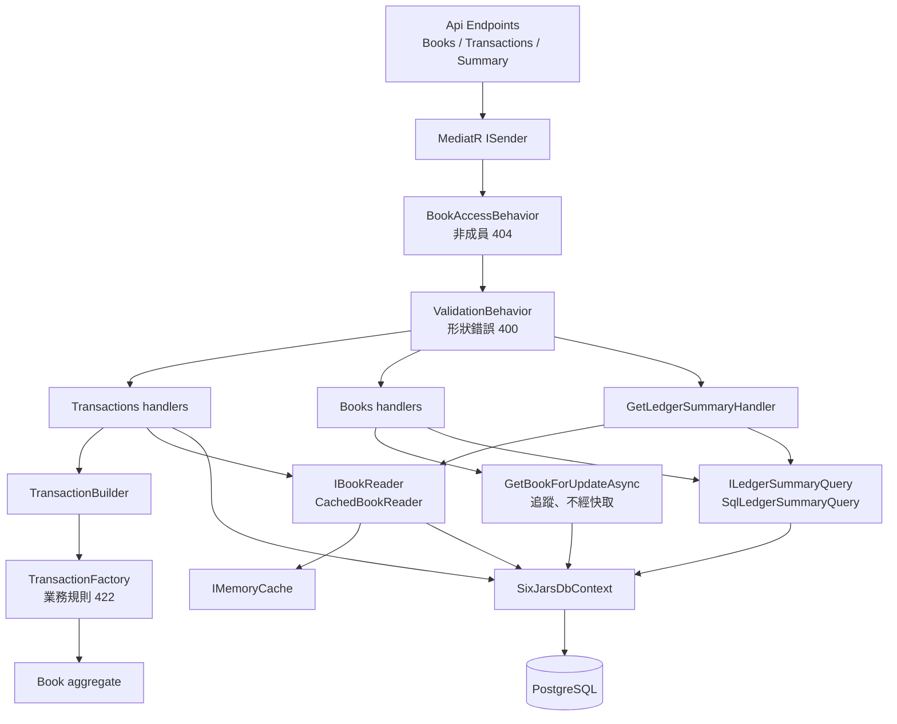
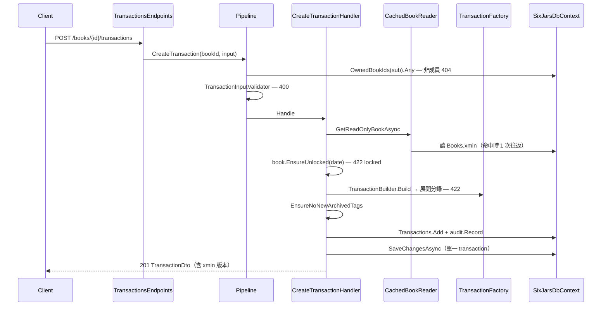
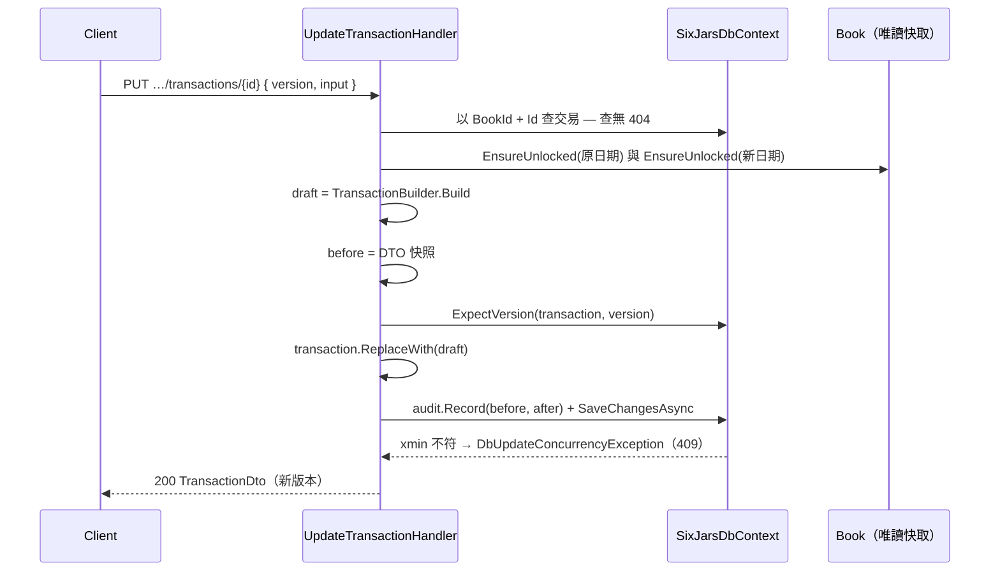
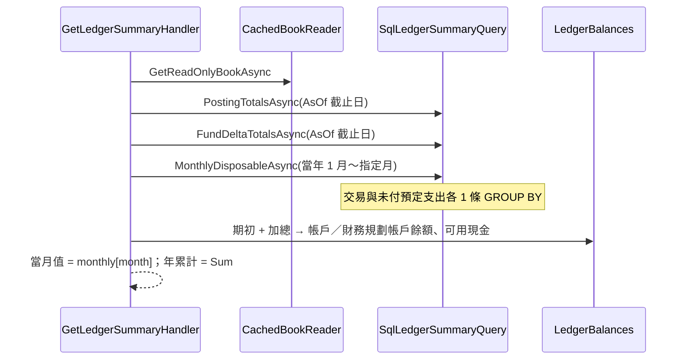

# 模組：ledger-core（帳本與交易）

> 階段 2 深讀，commit `f181aaf`，2026-11-14。領域用語以 `CONTEXT.md` 為準。
> **深讀範圍**（55 個原始檔）：Domain `Books`／`Transactions`／`Ledger`／`Common/Ids`；Application `Transactions` 全部、`Ledger` 全部（`LedgerSummaryDto` 除外）、`Books` 全部（`SettingKind` 除外）、`Common/BookAccessBehavior`、`ISixJarsDbContext`；Infrastructure `SixJarsDbContext`、`CachedBookReader`、`LedgerSnapshotLoader`、`BookConfiguration`、`TransactionConfiguration`、`SqlLedgerSummaryQuery`；Api 三個 endpoint 檔。
> **未深讀**（本文相關敘述一律標【推論】）：`LedgerSummaryDto`、`SettingKind`、`BookMembership`（`OwnedBookIds`）、`BudgetMonth`、`Tag`、各 enum、`ValidationBehavior`、tests。

## 職責

1. **帳本 aggregate**：`Book` 是帳戶、財務規劃帳戶、分類、標籤的聚合根，負責名稱唯一、兩層分類、排序連續、封存／刪除前置條件、鎖帳日。證據：`src/SixJars.Domain/Books/Book.cs` → `Book`。
2. **交易 → 分錄展開**：13 種 `TransactionKind` 各由 `TransactionFactory` 的一個方法驗證帳戶類型與分類種類，並產生 0～2 筆 `Posting`。展開規則只存在 factory 一處，修改交易也是「重新建一筆 draft 再 `ReplaceWith`」。證據：`src/SixJars.Domain/Transactions/TransactionFactory.cs`、`Transaction.cs` → `ReplaceWith`。
3. **餘額與月可用餘額**：正式路徑由 `SqlLedgerSummaryQuery` 在 PostgreSQL 端 `GROUP BY`，Application 的 `LedgerBalances` 加上期初。Domain 的三個 calculator 在 `src/` 內沒有任何呼叫端（grep `src/**` 只找到定義），【推論】只作為測試的 oracle（`ILedgerSummaryQuery` 註解：「由 oracle 測試鎖住」）。
4. **持久化與並行控制**：`xmin` 樂觀並行、軟刪除 query filter、帳本唯讀快取。

## 對外介面

全部掛在 `/api`（Cookie + `AntiforgeryFilter`，見 `00-inventory.md`），handler 一律經 MediatR pipeline `BookAccessBehavior` → `ValidationBehavior`。

| Endpoint / 入口 | 說明 | 證據 |
|---|---|---|
| `GET /books` | 目前使用者所屬的帳本（`{ id, name }`，依名稱排序）。沒有 `BookId`，不是 `IBookScoped`；以 `OwnedBookIds(user.Subject)` 篩選，與 `/api/me` 共用同一個查詢 | `Books/ListBooks.cs` → `ListBooksHandler`、`MemberBooks.ListMemberBooksAsync` |
| `POST /books` | 建立空白帳本，建立者成為 Owner；不是 `IBookScoped`，權限在 handler 內檢查（403） | `Application/Books/CreateBook.cs` → `CreateBookHandler` |
| `GET /books/{bookId}` | 帳本與設定，走快取 | `Books/GetBook.cs` |
| `GET /books/{bookId}/deletion-preview` | 刪除前統計 | `Books/GetBookDeletionPreview.cs` |
| `DELETE /books/{bookId}` | 硬刪除整本帳本，body 帶 `confirmName` | `Books/DeleteBook.cs` → `DeleteBookHandler` |
| `POST /books/{bookId}/{accounts\|planning-funds\|categories\|tags}` | 新增設定項目，回 201 `{ id }`。四個 handler 同一個形狀：`GetBookForUpdateAsync` → `Book.Add*` → `audit.Record(Create)` → 單次 `SaveChangesAsync`。名稱重複由 Domain 擋（422）。`AddCategory` 依 `ParentId`／`Kind` 分派到子分類、收入主分類、支出主分類，支出主分類必須帶 `Nature`（400） | `Books/AddAccount.cs`、`AddPlanningFund.cs`、`AddCategory.cs`、`AddTag.cs` |
| `PUT /books/{bookId}/{…}/{id}` | 改名／改色／改支出性質／是否計入可用現金 | `Books/UpdateSettings.cs` |
| `POST …/{id}/archive`、`/unarchive`；`DELETE …/{id}`；`PUT …/order` | 四種設定共用動作。排序一次送出整組新順序（含已封存）；排序主分類時 body 必須帶 `kind`（400）。稽核只記錄 `SortOrder` 有變的項目（前後 `BookDto` 比對） | `BooksEndpoints.cs` → `MapSettingActions`；`ArchiveSetting.cs`、`RemoveSetting.cs`、`ReorderSettings.cs` → `RecordMoved` |
| `PUT /books/{bookId}/lock-date` | 設定／清除鎖帳日 | `Books/SetLockDate.cs` |
| `POST /books/{bookId}/transactions` | 新增交易，body 為平面 `TransactionInput` | `Transactions/CreateTransaction.cs` |
| `GET /books/{bookId}/transactions` | 清單，篩選 `from`／`to`／`budgetMonth`／`accountId`／`tagId`／`categoryId`，不分頁 | `Transactions/ListTransactions.cs` |
| `GET /books/{bookId}/transactions/{id}` | 單筆 | `Transactions/GetTransaction.cs` |
| `PUT /books/{bookId}/transactions/{id}` | 修改，body `{ version, input }` | `Transactions/UpdateTransaction.cs` |
| `DELETE /books/{bookId}/transactions/{id}?version=` | 軟刪除，連帶把預定支出改回未付 | `Transactions/DeleteTransaction.cs` |
| `GET /books/{bookId}/summary?budgetMonth=&asOf=` | 月可用餘額、年累計、可用現金、各帳戶與財務規劃帳戶餘額 | `Ledger/GetLedgerSummary.cs` |

路由慣例：`bookId` 與被修改項目的 Id 一律以路由覆寫 body（`command with { BookId = bookId, … }`）。證據：`BooksEndpoints.cs` 第 29、38 行註解。

本模組沒有 gRPC、訊息佇列 consumer、背景工作。其他模組（planning、reporting、MCP `LedgerTools`、CLI 匯入／還原）會重用 `TransactionBuilder`、`ILedgerSummaryQuery`、`IBookReader`（`TransactionBuilder.Build` 的 `fixedId` 參數與 `ILedgerSummaryQuery` 的報表方法即為此而設）。

## 內部結構

### 交易類型與分錄展開

| Kind | `AccountId`／`CounterAccountId` | 分錄 | 金額規則 |
|---|---|---|---|
| Income、Expense | 方式帳戶／— | 1 筆：方式帳戶 `+amount` | 非 0，帶號（支出為負） |
| Transfer、Withdrawal、CardPayment、TopUp、LoanDisbursement、CashDeposit | 見 `Transaction` 的 remarks | 2 筆（`Move`） | 必須 > 0 |
| LoanPayment | 付款帳戶／貸款 | 付款帳戶 `-total`；本金 > 0 時再加貸款 `+principal` | 0 ≤ 本金 ≤ 總額；利息不進任何帳戶 |
| FundAllocation | 轉入帳戶／轉出帳戶（可 null） | 有轉出帳戶且不同才 2 筆，否則 **0 筆** | > 0 |
| FundWithdrawal | 方式帳戶（可為信用卡） | 1 筆 `-amount` | > 0 |
| FundReturn | 方式帳戶 | 1 筆 `+amount` | > 0 |
| BalanceAdjustment | 帳戶調整 1 筆；財務規劃帳戶調整 **0 筆**（只有 `FundDelta`） | — | 非 0；API validator 一律拒絕，只由補匯／還原產生 |

證據：`TransactionFactory.cs` 各方法；`TransactionInputValidator.cs`（`BalanceAdjustment` 規則）；`Transaction.cs` → `FundDelta`。

三層驗證的分工：`TransactionInputValidator`（欄位必填／不使用必須為 null → 400）→ `TransactionBuilder`（缺欄位 → `DomainException`，為 CLI 還原不經 validator 而設）→ `TransactionFactory`（帳戶類型、分類種類、正負號 → 422）。

### 輸出 DTO

- `BookDto`：帳戶、財務規劃帳戶、標籤各依 `SortOrder`；分類是扁平清單、樹的前序（收入主分類在前，每個主分類後接子分類），記帳頁下拉選單直接用這個順序。證據：`Books/BookDto.cs` → `From`、`InTreeOrder`。
- `TransactionDto`：輸入欄位加上 `Id`、展開後的 `Postings`、`LoanInterest`、`Version`（`xmin`）；`TagIds` 依 Guid 值排序。證據：`Transactions/TransactionDto.cs` → `From`。
- 這些 record 同時擔任三個角色：API 回應、稽核快照（`audit.Record` 的 before／after）、備份格式（`TransactionDto.ToInput` 供還原重建；`Tags`／`TagIds`／`SortOrder`／`ArchivedAt` 的預設值是為了讀舊版備份）。證據：`BookDto.cs` 第 13、30 行註解、`TransactionDto.cs` 第 45 行。

## 資料存取

| 資料 | 儲存 | 讀/寫 | 交易邊界 | 證據 |
|---|---|---|---|---|
| `Books` ＋ owned `Accounts`／`PlanningFunds`／`Categories`／`Tags` | PostgreSQL | 寫：設定類 handler 經 `GetBookForUpdateAsync`（追蹤） | 單次 `SaveChangesAsync`（含稽核記錄） | `Books/BookLoading.cs`、`UpdateSettings.cs`、`ArchiveSetting.cs`、`RemoveSetting.cs`、`SetLockDate.cs` |
| 同上 | PostgreSQL＋`IMemoryCache` | 讀：`IBookReader.FindAsync`（`AsNoTracking`、SplitQuery） | 無 transaction | `Persistence/CachedBookReader.cs` |
| `Transactions` ＋ owned `Postings`／`TransactionTags` | PostgreSQL | 寫：Create／Update／Delete | 單次 `SaveChangesAsync`：交易、（刪除時）預定支出解除連結、稽核記錄一起成功或失敗 | `CreateTransaction.cs`、`UpdateTransaction.cs`、`DeleteTransaction.cs` |
| `Transactions`（彙總） | PostgreSQL | 讀：EF LINQ `GROUP BY`，依賴 global query filter 排除軟刪除 | 無 transaction，摘要為 4 條獨立查詢（另加帳本讀取） | `Ledger/SqlLedgerSummaryQuery.cs`、`GetLedgerSummary.cs` |
| 建立帳本：`Books`＋`BookMembers`＋`AuditEntries` | PostgreSQL | 寫 | 明確 transaction ＋ `pg_advisory_xact_lock("create-book:{sub}")`，先鎖再檢查名單、額度（5 本）、名稱重複 | `CreateBook.cs` → `CreateBookHandler` |
| 刪除帳本：7 張表 `ExecuteDeleteAsync` ＋ 1 筆刪除摘要稽核 | PostgreSQL | 寫 | 明確 transaction；owned 表靠 DB FK cascade | `DeleteBook.cs` → `DeleteBookHandler` |

### 並行控制

- **交易**：`xmin` 當 row version（`TransactionConfiguration.cs`）。前端帶回 `version`，`ExpectVersion` 設 `OriginalValue` 並把整筆標為 `Modified`，理由是只改 owned 分錄時 EF 不更新 owner、也就不檢查版本。衝突 → `DbUpdateConcurrencyException` → 409。證據：`SixJarsDbContext.cs` → `ExpectVersion`。
- **帳本**：`Books` 也有 `xmin` row version（`BookConfiguration.cs`），且 `SaveChanges` 前 `TouchBooksWithChangedSettings` 會把「只有 owned 設定異動」的 `Book` 標成 `Modified`。效果有二：快取看得到版本變化；【推論】兩個同時進行的設定修改，後存檔者的 `UPDATE … WHERE xmin = 載入時的值` 會落空而得到 409。但設定類 request **沒有帶前端版本**，所以只擋「同時」、不擋「使用者 A 看到舊畫面後才送出」。
- **建立帳本**：advisory lock 序列化同一使用者的請求。

### 快取策略（`CachedBookReader`）

- 型態：process 內 `IMemoryCache`，key `book:{bookId}`，sliding 1 小時，無容量上限。
- 讀取順序：命中時先花 1 次往返讀 `Books.xmin`，相同就回快取實例；不同或未命中則 `AsNoTracking` 重新載入（SplitQuery，5 次往返）並覆寫。版本為 null（帳本已刪）時移除並回 null。
- 失效方式：**不做寫入時失效**，完全靠版本比對。理由寫在類別註解：Cloud Run 多 instance、CLI 是另一個 process，寫入端清不到別人的快取。
- 重新載入時版本與集合不是同一個 snapshot：註解論證「集合只可能比版本新」，最壞是下次多載入一次。
- DI lifetime：`CachedBookReader` 為 Scoped、持有同一 scope 的 `SixJarsDbContext`，`IMemoryCache` 為 Singleton，方向正確（沒有 Singleton 持有 Scoped）。證據：`00-inventory.md` DI 表、`CachedBookReader.cs` 建構子。

### 錯誤處理

本模組的 handler 不寫 try-catch，全部交給 `ApiExceptionHandler`（屬 identity-access 模組，未深讀）。對應規則依專案 `CLAUDE.md`：`NotFoundException` 404、`DomainException` 422、`DbUpdateConcurrencyException` 409、validation 400、`ForbiddenException` 403。沒有 Polly 或重試。

## 關鍵流程

### 新增交易

### 修改交易（樂觀並行）

### 帳務摘要

`asOf` 省略時取 `TaipeiTime.DateOf(clock.GetUtcNow())`。證據：`GetLedgerSummary.cs` → `Handle`。

## 風險與觀察

| # | 項目 | 嚴重度 | 證據 | 說明 |
|---|---|---|---|---|
| 1 | 交易對帳本設定沒有 DB 層參照完整性，且「檢查 → 寫入」之間沒有鎖 | 中 | `SixJarsDbContextModelSnapshot.cs` 全檔只有一個非 owned FK（`PlannedExpenses.SourceId`）；`RemoveSetting.cs`、`SettingReferences.cs`、`CreateTransaction.cs` | `RemoveSetting` 先查 `IsAccountReferencedAsync` 再刪；`CreateTransaction` 用（可能是剛驗證過版本的）唯讀帳本驗證帳戶後才 insert。兩者交錯時可能留下指向已刪除帳戶／分類／財務規劃帳戶／標籤的交易。後果：`Book.GetAccount` 類查找擲 `DomainException`，備份還原（以 Domain 重建）會失敗。`Transactions.BookId` 同樣沒有 FK，見 #2。個人／家庭帳本的併發量低，發生機率低但後果難修。 |
| 2 | 刪除帳本與同時寫入的競態 | 低 | `DeleteBook.cs` → `Handle`（依序 `ExecuteDeleteAsync`） | READ COMMITTED 下，`Transactions` 那條 DELETE 執行後、commit 前，另一個 request 仍可 insert 該帳本的交易（成員檢查與帳本讀取都早於刪除 commit）。因無 FK，會留下孤兒交易與稽核記錄。 |
| 3 | 鎖帳日是 check-then-act | 低 | `CreateTransaction.cs`、`UpdateTransaction.cs`、`DeleteTransaction.cs` → `EnsureUnlocked`；`SetLockDate.cs` | 鎖帳日讀自唯讀帳本，交易寫入不更新也不鎖 `Books` 列，所以同時「設定鎖帳日」與「新增鎖定區間內的交易」兩者都會成功。 |
| 4 | 設定類修改沒有前端版本 | 低 | `AddAccount.cs` 等四個新增、`UpdateSettings.cs`、`ArchiveSetting.cs`、`RemoveSetting.cs`、`ReorderSettings.cs` 的 request record 都沒有版本欄位；`BookDto.cs` 也不輸出帳本版本；`BookConfiguration.cs` 的 `xmin` | 見「並行控制」。兩位擁有者先後改同一項目時後者靜默覆寫；`Reorder` 另有「清單必須等於目前成員」的檢查可擋掉漏項（`Book.cs` → `Reorder`）。 |
| 5 | `SetLockDate` 的註解與現況不符 | 低 | `SetLockDate.cs` 類別註解「帳本沒有樂觀並行版本，同時設定時以最後一次為準」對照 `BookConfiguration.cs`「同時讓帳本的修改有樂觀並行（409）」與 migration `BookConcurrencyToken` | 【推論】註解寫於加上 `xmin` 之前；現在真正同時的兩次設定，後者應得到 409 而非覆寫。未以測試驗證。 |
| 6 | 快取回傳的 `Book` 是可變物件，跨 request 共用，不可修改只靠註解約束 | 中 | `IBookReader.cs` 註解、`CachedBookReader.cs` → `FindAsync`、`Book.cs` 的公開 mutator | 一旦有 handler 對 `GetReadOnlyBookAsync` 的結果呼叫 `Rename*`／`SetLockDate`／`PrependHistory`，會污染所有 request 看到的帳本且不會存檔，版本不變所以不會自動修復（要等 1 小時 sliding 到期或真的有寫入）。目前讀到的 handler 都遵守；是否有測試或 analyzer 守住，未確認。 |
| 7 | 同一組計算規則存在三處 | 中 | `Domain/Ledger/*Calculator.cs`、`SqlLedgerSummaryQuery.cs` → `Impact`／`FundDeltaTotalsAsync`、`LedgerBalances.cs`、`Transaction.cs` → `FundDelta` | 月可用餘額的正負號、電子錢包排除、`FundDelta` 符號、可用現金篩選各寫兩份。新增 `TransactionKind` 時要同步改，`switch` 的 `_ => 0m` 不會讓編譯器提醒。一致性依賴 oracle 測試（未讀，【推論】存在）。Domain calculator 與 `LedgerSnapshotLoader` 在 `src/` 無呼叫端。 |
| 8 | `ListTransactions` 不分頁，且為了讀 `xmin` 用追蹤查詢 | 低 | `ListTransactions.cs` → `Handle`（註解「要追蹤變更，db.GetVersion 才讀得到版本」） | 不帶篩選時會把整本帳本的交易連同分錄、標籤載入 change tracker。帳本是連續時間軸（ADR 0002），資料只增不減。現況靠前端依月份查詢（註解所述，前端未驗證）。 |
| 9 | 交易查詢缺少以日期為主的索引 | 低 | `TransactionConfiguration.cs` 只有 `(BookId, BudgetMonth)`、`Postings.AccountId`、`TransactionTags.TagId` | `PostingTotalsAsync` 的 `AsOf` 截止與 `ListTransactions` 的 `from`／`to` 都以 `Date` 篩選。【推論】目前資料量（註解估一年約 2,000 筆）下不是問題。 |
| 10 | 金額沒有小數位數驗證 | 低 | `TransactionInputValidator.cs`（無 `Amount` 規則）、`AddAccount.cs`／`AddPlanningFund.cs`（validator 無 `OpeningBalance` 規則）、`SixJarsDbContext.cs` → `HavePrecision(18, 4)`、`TransactionDto.cs` → `From` | 回應與稽核快照的 DTO 取自記憶體中的實體（`TransactionDto.From(transaction, …)`）。【推論】超過 4 位小數時 PostgreSQL `numeric(18,4)` 會四捨五入，回應與稽核快照就和實際存入值不同；資料庫端的行為未以測試驗證。 |
| 11 | 每個帳本範圍 request 固定多 1～2 次往返 | 低 | `BookAccessBehavior.cs`（成員檢查）、`CachedBookReader.cs`（版本檢查） | 已是有意識的取捨（兩處註解都有寫）。Neon 冷啟動或跨區延遲高時才值得再看。 |
| 12 | 摘要的多條查詢不在同一個 snapshot | 低 | `GetLedgerSummary.cs` → `Handle` | 讀取期間有寫入時，帳戶餘額與月可用餘額可能來自不同時點；重新整理即一致。 |
| 13 | 同一組 DTO 兼任 API 回應、稽核快照與備份格式 | 低 | `BookDto.cs`（第 13、30 行註解）、`TransactionDto.cs` → `ToInput` | 為 API 改欄位會同時改變備份 schema 與既有稽核快照的可讀性；目前以「新欄位給預設值」維持舊備份相容。新增必填欄位時要記得這個約束。 |

## 待確認問題

1. #1／#2：`Transactions` 不對 `Books`／`Accounts`／`Categories`／`PlanningFunds` 建 FK，是受 EF「不能指向 owned type」的限制（`TransactionConfiguration.cs` 對 `TagId` 有這樣寫），還是對 `BookId` 也是刻意的？ADR 是否有記錄？
2. #5：`SetLockDate` 同時設定的預期行為是「後者 409」還是「以最後一次為準」？兩處註解互相矛盾。
3. #6：有沒有測試或其他機制防止修改 `IBookReader` 回傳的 `Book`？
4. #7：Domain 的 calculator 與 `LedgerSnapshotLoader` 是否確定只給測試（oracle、驗收）使用？若是，是否考慮在文件或命名上標明。
5. #8：前端是否所有呼叫 `GET /transactions` 的地方都帶月份或日期範圍？（留待 web-frontend 模組確認）
