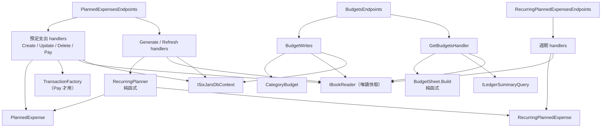
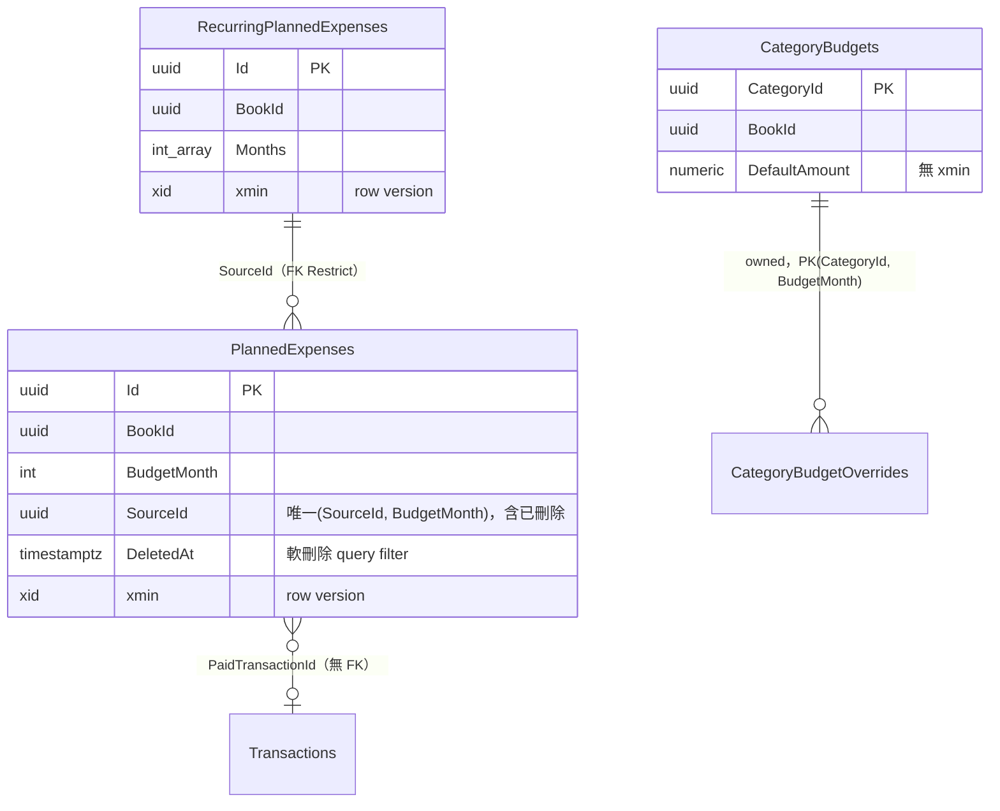
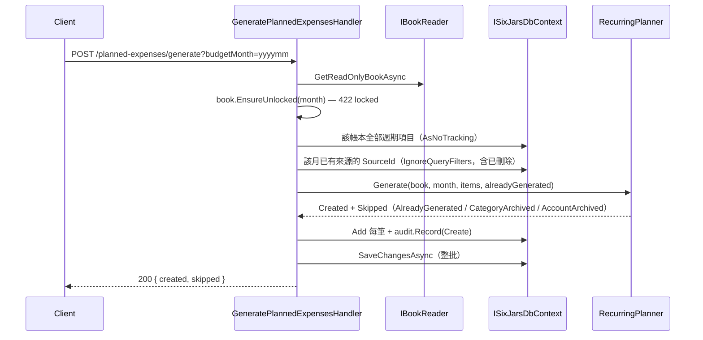
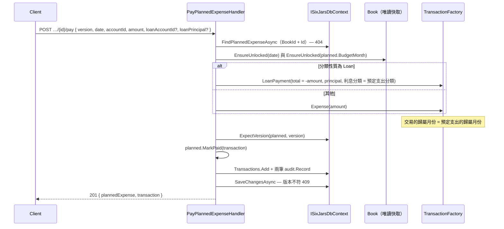
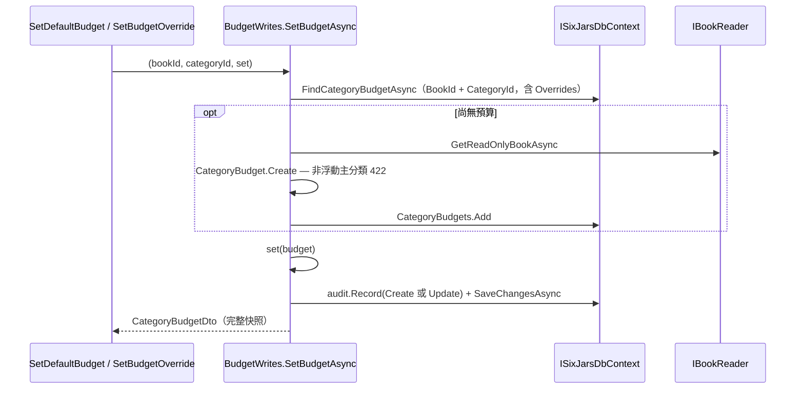

# 模組：planning（財務規劃：預定支出／週期預定支出／預算）

> 階段 2 深讀，commit `f181aaf`，2026-11-14。領域用語以 `CONTEXT.md` 為準；共用機制（pipeline、`IBookReader` 快取、`xmin` 版本、稽核、例外對應）見 `10-module-ledger-core.md`，本文不重複。
> **深讀範圍**（29 個原始檔）：Domain `Planning` 全部（5 檔）、`Common/BudgetMonth`；Application `Planning` 全部（16 檔）、`Common/BudgetMonthRules`；Infrastructure `PlannedExpenseConfiguration`、`RecurringPlannedExpenseConfiguration`、`CategoryBudgetConfiguration`；Api `PlannedExpensesEndpoints`、`RecurringPlannedExpensesEndpoints`、`BudgetsEndpoints`。
> **未深讀**（相關敘述標【推論】）：`ApiExceptionHandler`、`AuditTrail`、`LegacyImport/MappingSession.Templates`、備份還原、前端、tests。

## 職責

1. **預定支出（`PlannedExpense`）**：歸屬於某月的固定／貸款／特別支出預計項目。未付時以預估金額占用月可用餘額；付款後連結到實際交易，改以交易金額為準。證據：`src/SixJars.Domain/Planning/PlannedExpense.cs` 類別註解；占用的計算在 `SqlLedgerSummaryQuery.MonthlyDisposableAsync`（`PaidTransactionId == null` 的 `EstimatedAmount` 加總）。
2. **週期預定支出（`RecurringPlannedExpense`）**：每月或每年指定月份的範本，只限固定／貸款性質。**不會自動產生**預定支出，必須由使用者對某月明確「產生」或「以現值更新」（ADR 0009）。規則集中在純函式 `RecurringPlanner`。證據：`RecurringPlannedExpense.cs`、`RecurringPlanner.cs`。
3. **預算（`CategoryBudget`）**：浮動支出主分類的預設值＋各月覆寫值（正數上限，未用完不累積）。預算表由純函式 `BudgetSheet.Build` 組出，actual 來自 `ILedgerSummaryQuery.ExpenseTotalsByCategoryAsync`。證據：`CategoryBudget.cs`、`BudgetSheet.cs`、`Application/Planning/GetBudgets.cs`。

三者的支出性質分工：預定支出＝固定／貸款／特別；週期＝固定／貸款；預算＝浮動。`Book.ChangeExpenseNature` 與 `Book.RemoveCategory` 以呼叫端傳入的 `hasPlannedExpenses`／`hasRecurringPlannedExpenses`／`hasBudget` 反向守住這個分工（見 ledger-core）。

## 對外介面

全部掛在 `/api/books/{bookId}`，request 皆為 `IBookScoped`。

| Endpoint / 入口 | 說明 | 證據 |
|---|---|---|
| `POST /planned-expenses` | 新增，body `PlannedExpenseInput`；檢查歸屬月份的鎖帳日 | `Planning/CreatePlannedExpense.cs` |
| `GET /planned-expenses?budgetMonth=` | 清單；`budgetMonth` 省略時回全部月份，不分頁 | `Planning/ListPlannedExpenses.cs` |
| `GET /planned-expenses/{id}` | 單筆 | `Planning/GetPlannedExpense.cs` |
| `PUT /planned-expenses/{id}` | 修改未付項目，body `{ version, input }`；原月份與新月份都檢查鎖帳日 | `Planning/UpdatePlannedExpense.cs` |
| `DELETE /planned-expenses/{id}?version=` | 軟刪除；已付款也可刪，付款交易與連結保留 | `Planning/DeletePlannedExpense.cs`、`PlannedExpense.Delete` |
| `POST /planned-expenses/{id}/pay` | 付款：建立 `Expense` 或 `LoanPayment` 交易並連結；回 201 `{ plannedExpense, transaction }` | `Planning/PayPlannedExpense.cs` |
| `POST /planned-expenses/generate?budgetMonth=` | 對某月產生到期的週期項目；冪等 | `Planning/GeneratePlannedExpenses.cs` |
| `POST /planned-expenses/refresh?budgetMonth=` | 以週期項目現值更新該月未付、有來源的預定支出 | `Planning/RefreshPlannedExpenses.cs` |
| `GET /recurring-planned-expenses` | 清單（含已結束），依建立順序 | `Planning/RecurringPlannedExpenseCommands.cs` → `ListRecurringPlannedExpensesHandler` |
| `POST`／`PUT /recurring-planned-expenses[/{id}]` | 新增／修改（修改帶 `version`）；不檢查鎖帳日，修改不回寫已產生的預定支出 | 同上 → `Create…Handler`、`Update…Handler` |
| `DELETE /recurring-planned-expenses/{id}?version=` | 硬刪除；曾產生過預定支出（含已軟刪除）則 422 `in-use` | 同上 → `DeleteRecurringPlannedExpenseHandler`、`RecurringPlannedExpense.EnsureRemovable` |
| `GET /budgets?budgetMonth=` | 預算表：每個浮動主分類一列＋合計 | `Planning/GetBudgets.cs` |
| `PUT`／`DELETE /budgets/{categoryId}/default` | 設定／清除預設值 | `Planning/BudgetCommands.cs` → `BudgetWrites` |
| `PUT`／`DELETE /budgets/{categoryId}/overrides/{budgetMonth}` | 設定／清除某月覆寫值 | 同上 |

`generate`／`refresh` 的 `budgetMonth` 與 `DELETE` 的 `version` 都走 query string（`PlannedExpensesEndpoints.cs`）。本模組沒有背景工作：週期產生完全由使用者觸發。

## 內部結構

證據：`PlannedExpenseConfiguration.cs`、`RecurringPlannedExpenseConfiguration.cs`、`CategoryBudgetConfiguration.cs`；`PaidTransactionId` 無 FK 依 `SixJarsDbContextModelSnapshot.cs` 只有一個非 owned FK（`SourceId`）。

### 領域規則重點

- **`PlannedExpense`**：已付款不可修改；已刪除不可修改、付款、再刪除；有來源的不能改歸屬月份（否則原月份可再產生、或撞上唯一索引）。證據：`PlannedExpense.cs` → `Update`、`MarkPaid`、`EnsureNotDeleted`。
- **`RecurringPlanner.Generate`**：只處理 `IsDueIn(month)` 的項目；已產生（含已刪除）→ `AlreadyGenerated`，否則分類或帳戶已封存 → `CategoryArchived`／`AccountArchived`，其餘建立。「刪除代表使用者決定這個月沒有這筆」，所以刪掉後不會重新產生。
- **`RecurringPlanner.Refresh`**：只處理該月未付、未刪除、有來源者；來源在該月不適用 → `NotDue`；內容沒變不列入 `Updated`。
- **`CategoryBudget`**：只在建立時驗證分類是浮動支出主分類；金額不可為負；預設值與覆寫值都清空時整筆刪除。`AmountFor` 覆寫值優先。
- **`BudgetSheet.Build`**：actual＝主分類加子分類支出加總取負號（退款抵銷）；已封存分類只在該月有支出或覆寫值時列出；合計只算有設預算的列。

## 資料存取

| 資料 | 儲存 | 讀/寫 | 交易邊界 | 證據 |
|---|---|---|---|---|
| `PlannedExpenses` | PostgreSQL | 寫：Create／Update／Delete | 單次 `SaveChangesAsync`（含稽核） | `CreatePlannedExpense.cs`、`UpdatePlannedExpense.cs`、`DeletePlannedExpense.cs` |
| `PlannedExpenses`＋`Transactions`＋`Postings` | PostgreSQL | 寫：Pay | 單次 `SaveChangesAsync`：新交易、付款連結、兩筆稽核一起成功或失敗 | `PayPlannedExpense.cs` → `Handle` |
| `PlannedExpenses`（批次） | PostgreSQL | 寫：Generate／Refresh | 單次 `SaveChangesAsync`，整批全有或全無 | `GeneratePlannedExpenses.cs`、`RefreshPlannedExpenses.cs` |
| `RecurringPlannedExpenses` | PostgreSQL | 寫：Create／Update／硬刪除；Generate／Refresh 以 `AsNoTracking` 讀 | 單次 `SaveChangesAsync` | `RecurringPlannedExpenseCommands.cs` |
| `CategoryBudgets`＋`CategoryBudgetOverrides` | PostgreSQL | 寫：`SetBudgetAsync`／`RemoveBudgetValueAsync`；讀：`GetBudgets`（`AsNoTracking`） | 單次 `SaveChangesAsync` | `BudgetCommands.cs` → `BudgetWrites` |
| `Transactions`（支出彙總） | PostgreSQL | 讀 | 無 transaction | `GetBudgets.cs` → `ExpenseTotalsByCategoryAsync` |

本模組沒有明確的 `BeginTransactionAsync`，也沒有 advisory lock。

### 並行控制

| 對象 | 機制 | 證據 |
|---|---|---|
| 預定支出 Update／Delete／Pay | 前端 `version` → `ExpectVersion`（`xmin`），衝突 409 | 三個 handler；`PlannedExpenseConfiguration.cs` |
| 週期項目 Update／Delete | 同上 | `RecurringPlannedExpenseCommands.cs`；`RecurringPlannedExpenseConfiguration.cs` |
| Refresh | 不帶前端版本；追蹤載入，存檔時以載入當下的 `xmin` 檢查 | `RefreshPlannedExpenses.cs`（註解「存檔時以 xmin 做並行檢查」） |
| Generate | 先查已產生來源，最後防線是唯一索引 `(SourceId, BudgetMonth) WHERE SourceId IS NOT NULL` | `GeneratePlannedExpenses.cs`、`PlannedExpenseConfiguration.cs` |
| 預算 | **刻意不做**樂觀並行、不檢查鎖帳日；覆寫值一個月份一列，同時改不同月份不互相覆蓋 | `BudgetCommands.cs` 檔頭註解、`CategoryBudgetConfiguration.cs` |

### 鎖帳日

預定支出以歸屬月份最後一天判斷（`Book.EnsureUnlocked(BudgetMonth)`）。Create、Update（新舊月份）、Delete、Generate、Refresh 都檢查；Pay 同時檢查付款日期與歸屬月份。週期項目與預算不檢查。

## 關鍵流程

### 產生某月的預定支出

### 預定支出付款

反向流程在 ledger-core：`DeleteTransactionHandler` 刪除付款交易時把未刪除的預定支出 `MarkUnpaid`，且該預定支出的歸屬月份被鎖住時不能刪（`Transactions/DeleteTransaction.cs`）。

### 設定預算

## 風險與觀察

| # | 項目 | 嚴重度 | 證據 | 說明 |
|---|---|---|---|---|
| 1 | 修改付款交易不會同步預定支出 | 中 | `Transactions/UpdateTransaction.cs`（handler 完全沒有碰 `PlannedExpenses`）對照 `DeleteTransaction.cs`（有處理連結）；`PayPlannedExpense.cs` | 付款交易之後可被改成任何類型、分類、歸屬月份，連結仍在。預定支出依舊算「已付」而不占用原月份，交易卻計入另一個月份或不再是支出，月可用餘額與「以實際金額為準」的語意就對不上。是否為刻意允許，程式碼看不出來。 |
| 2 | 手動預定支出的 `EstimatedAmount` 沒有正負號與非零檢查 | 中 | `PlannedExpenseInput.cs` → `PlannedExpenseInputValidator`（無金額規則）、`PlannedExpense.Create`／`Update`（只驗分類與帳戶）；對照 `RecurringPlannedExpenseInputValidator`（`DefaultAmount < 0`） | 註解約定為負數，但正數或 0 會被接受；未付時 `MonthlyDisposableAsync` 直接加總，正數會**增加**月可用餘額。週期項目有擋、手動新增沒擋，兩者不一致。 |
| 3 | 資料庫約束違反沒有對應成 409／422 | 低 | `GeneratePlannedExpenses.cs`（唯一索引）、`BudgetWrites.SetBudgetAsync`（PK `CategoryId`、`(CategoryId, BudgetMonth)`）、`DeleteRecurringPlannedExpenseHandler`（FK Restrict）；專案 `CLAUDE.md` 的例外對應表只列 `DbUpdateConcurrencyException` | 兩個請求同時產生同一個月、同時第一次設定同一分類的預算、或刪除週期項目的同時產生，敗者會得到 `DbUpdateException`。【推論】`ApiExceptionHandler` 沒有對應，回 500。資料本身正確（約束擋住了），只是回應不友善。 |
| 4 | 預算沒有並行保護時的遺失更新 | 低 | `CategoryBudgetConfiguration.cs`（無 `xmin`，註解 Q3）、`BudgetWrites.RemoveBudgetValueAsync`（清空即刪整筆） | 刻意的取捨。殘餘情境：A 清除最後一格（刪除整筆）與 B 設定另一個月的覆寫值同時發生，B 的新列可能被 cascade 刪掉或撞 FK。【推論】依 commit 順序而定，未驗證。 |
| 5 | 預算與分類性質的 check-then-act | 低 | `BudgetWrites.SetBudgetAsync`（已有預算時不載入帳本；新建時用唯讀快取帳本）、`Books/UpdateSettings.cs` → `UpdateCategoryHandler`（先查 `HasBudgetAsync` 再改性質）、`CategoryBudgetConfiguration.cs`（不能對 owned 分類建 FK） | 與 ledger-core 風險 #1 同類。交錯後可能留下掛在非浮動分類上的預算：`BudgetSheet.Build` 只列浮動主分類所以看不到，但 `Book.RemoveCategory` 會以「請先清除預算」擋下刪除。 |
| 6 | 封存只在「產生／更新」時檢查 | 低 | `RecurringPlanner.UnusableReason` 對照 `PlannedExpense.Validate`、`PayPlannedExpenseHandler.BuildPayment`、`TransactionFactory.RequireAccount`（都不看 `IsArchived`） | 手動新增預定支出、付款、新增交易都能使用已封存的分類或帳戶；伺服器端只有標籤擋封存（`TransactionBuilder.EnsureNoNewArchivedTags`）。【推論】其餘靠前端不顯示選項。 |
| 7 | 付款規則與舊帳本匯入重複 | 低 | `PayPlannedExpense.cs` 類別註解「規則同 P1 制式表格匯入，見 MappingSession.Templates」 | 【推論】「性質為貸款 → `LoanPayment`，否則 `Expense`」存在兩處（另一處未讀），修改時要同步。 |
| 8 | `GET /planned-expenses` 不分頁、追蹤查詢 | 低 | `ListPlannedExpenses.cs`（「要追蹤變更，db.GetVersion 才讀得到版本」） | 與 ledger-core 風險 #8 同型；不帶月份時回整本帳本。資料量遠小於交易。 |
| 9 | Generate 每次載入該帳本全部週期項目 | 低 | `GeneratePlannedExpenses.cs`（`Where(r => r.BookId == book.Id)`，未以起訖月份篩選） | 已結束的項目也載入後才由 `IsDueIn` 過濾。【推論】項目數很少，不成問題。 |
| 10 | DTO 兼任 API 回應、稽核快照與備份格式 | 低 | `CategoryBudgetDto.cs` 註解（「寫入 API 的回傳、稽核快照與備份 v4 共用」）、`PlannedExpenseDto.cs`（`SourceId` 預設值為舊備份而設） | 同 ledger-core 風險 #13。 |

## 待確認問題

1. #1：預定支出付款後，是否允許自由修改那筆付款交易（改類型、分類、歸屬月份、金額正負）？若允許，預定支出是否應維持「已付」？
2. #2：手動新增的預定支出允許正數或 0 的預估金額是刻意的（例如預期退款），還是漏了與週期項目相同的 `< 0` 檢查？
3. #3：`ApiExceptionHandler` 對 `DbUpdateException`（唯一索引、PK、FK 違反）目前回什麼？留待 identity-access 模組確認。
4. #6：已封存的帳戶與分類在伺服器端可用於新交易與新預定支出，是否符合預期？
5. #7：`MappingSession.Templates` 的付款規則留待 legacy-import-cli 模組比對是否與 `PayPlannedExpenseHandler.BuildPayment` 一致。
