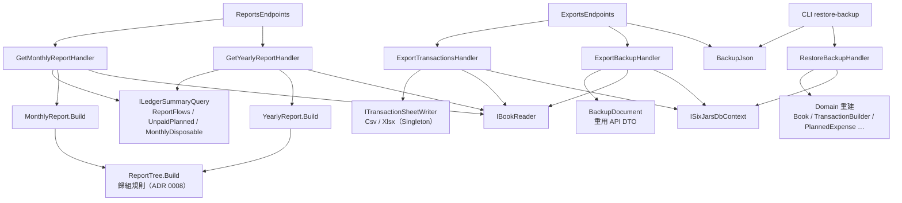
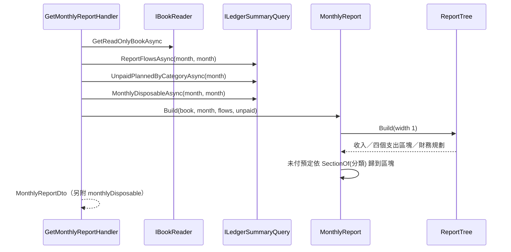
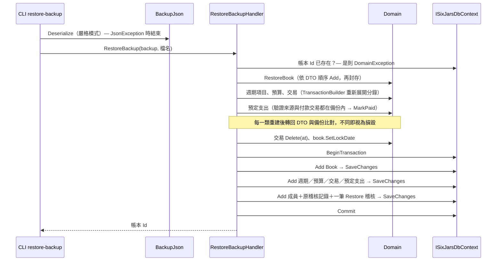

# 模組：reporting-export（報表、匯出、備份）

> 階段 2 深讀，commit `f181aaf`，2026-11-14。領域用語以 `CONTEXT.md` 為準；共用機制（pipeline、`IBookReader` 快取、`ILedgerSummaryQuery`、例外對應）見 `10-module-ledger-core.md`，預定支出與預算見 `11-module-planning.md`。
> **深讀範圍**（18 個原始檔＋1 段）：Domain `Reports` 全部（4 檔）；Application `Reports`（2）、`Exports`（4）、`Backup`（4）；Infrastructure `Exports`（2）；Api `ReportsEndpoints`、`ExportsEndpoints`；`SixJars.Cli/CliApp.cs` 只讀 `RestoreBackupCommand` 一段。
> **未深讀**（相關敘述標【推論】）：`AuditEntryDto`／`AuditTrail`、`BookMember.Restore`、`ApiExceptionHandler`、`AntiforgeryFilter`、CLI 其餘部分、前端、tests。

## 職責

1. **月報／年報**：把 `ILedgerSummaryQuery.ReportFlowsAsync` 的 `GROUP BY` 結果歸組成「收入＋四個支出區塊（浮動／固定／貸款／特別）＋財務規劃」的樹。歸組規則只有一份（`ReportTree`），月報 1 格、年報 12 格共用。證據：`src/SixJars.Domain/Reports/ReportTree.cs` → `Build`。
2. **交易明細匯出**：CSV 或 xlsx，Id 換成名稱，只含未刪除的交易，**不可還原**。證據：`Application/Exports/ExportTransactions.cs`。
3. **備份與還原**：整本帳的 JSON 備份（含已軟刪除的資料、成員、稽核記錄），由 API 下載；還原只能由 CLI 執行，且一律經 Domain 重建驗證。證據：`Application/Backup/ExportBackup.cs`、`RestoreBackup.cs`。

本模組的 API 路徑全部唯讀；唯一的寫入是 CLI 的 `restore-backup`。

## 對外介面

| Endpoint / 入口 | 說明 | 證據 |
|---|---|---|
| `GET /api/books/{bookId}/reports/monthly?budgetMonth=` | 月報：各區塊小計、未付預定小計、財務規劃三向金額，另附與 `/summary` 同一方法算出的月可用餘額供對照 | `Reports/GetMonthlyReport.cs` |
| `GET /api/books/{bookId}/reports/yearly?year=` | 年報：1～12 月、年總計、占收入比、月平均；只列實際交易，不列未付預定 | `Reports/GetYearlyReport.cs` |
| `GET /api/books/{bookId}/export/transactions.csv?from=&to=` | 交易明細 CSV（UTF-8 with BOM、CRLF） | `Exports/ExportTransactions.cs`、`Infrastructure/Exports/CsvTransactionWriter.cs` |
| `GET /api/books/{bookId}/export/transactions.xlsx?from=&to=` | 交易明細 xlsx（工作表「交易」） | 同上、`XlsxTransactionWriter.cs` |
| `GET /api/books/{bookId}/export/backup.json` | 完整備份；以 `BackupJson` 的設定序列化，不用 API 預設 JSON 設定 | `Endpoints/ExportsEndpoints.cs`、`Backup/ExportBackup.cs` |
| CLI `restore-backup --file <json>` | 還原成一本帳；資料庫已有同 Id 的帳本時拒絕 | `SixJars.Cli/CliApp.cs` → `RestoreBackupCommand`；`Backup/RestoreBackup.cs` |

五個 API request 都是 `IBookScoped`（非成員 404）。`RestoreBackup` 是 `internal` 的 `ICliOnlyRequest`，Api 專案參考不到。檔名日期一律取台北時間（`sixjars-transactions-yyyyMMdd.*`、`sixjars-backup-yyyyMMdd.json`）。

## 內部結構

### 報表歸組規則（`ReportTree`）

| 交易類型 | 歸到哪裡 | 口徑 |
|---|---|---|
| Income（有分類） | 收入區，依分類 | `+Amount` |
| Expense（有分類） | 依**主分類**的支出性質分到四區 | `-Amount`（退款抵銷） |
| LoanPayment | 貸款區，依貸款帳戶（`CounterAccountId`）列出，附本金；利息＝總額−本金 | 繳款總額 |
| FundAllocation／FundWithdrawal／FundReturn | 財務規劃，依財務規劃帳戶 | 各自的 `Amount` |
| 其他類型 | 不出現（`ReportFlowsAsync` 已先篩掉） | — |

- 貸款繳款的利息分類、出資金帶的分類**不參與**歸組，所以預算的 actual 恆等於浮動主分類的小計。證據：`ReportTree.cs` 類別註解與 `Build` 的 `switch`。
- 主分類同時有子分類列與直接掛在主分類的金額時，多一列「（未分子類）」；全為 0 的列不輸出。證據：`ReportTree.CategoryLines`、`ReportNode.IsEmpty`。
- 電子錢包的消費**計入**報表（與月可用餘額不同），所以報表合計刻意不等於月可用餘額（ADR 0008）。證據：`SqlLedgerSummaryQuery.ReportFlowsAsync` 註解、`MonthlyReportDto` 的 `MonthlyDisposable` 註解。
- 月報的未付預定小計只出現在固定／貸款／特別三區，不計入區塊合計。證據：`MonthlyReport.Build`。
- 年報的月平均分母：開帳那一年從開帳月份起算；今年算到「本月」與「最後一個有交易的歸屬月份」較晚者；未來的年份與開帳前為 null。占收入比四捨五入到小數 4 位，收入為 0 時為 null。證據：`YearlyReport.AverageMonths`、`Figures`。

### 匯出格式

- 欄位順序由 `TransactionExportRow.Headers` 定義，CSV 與 xlsx 共用；交易類型用 `TransactionKindNames` 的中文名稱；標籤依設定排序、以「、」串接。
- 公式注入防護（`SpreadsheetText.IsFormulaLike`：以 `= + - @`、tab、CR 開頭）：CSV 在文字前加 `'` 再依 RFC 4180 加引號；xlsx 以 `SetValue` 寫成文字並設 quote prefix，不使用 `FormulaA1`。數字欄位一律寫成數字。證據：`ITransactionSheetWriter.cs`、`CsvTransactionWriter.Text`、`XlsxTransactionWriter.Text`。

### 備份格式

- `BackupDocument`：`FormatVersion`（目前 5）、`ExportedAt`、`Book`、`Transactions`（含 `DeletedAt`）、`PlannedExpenses`（含 `DeletedAt`）、`Members`（Id、email、Google sub、角色、加入時間）、`AuditEntries`、`RecurringPlannedExpenses`、`Budgets`。內容直接重用 API 的 DTO；還原接受 v1～v5。證據：`Backup/BackupDocument.cs`。
- **不在備份內**：`BookCreators`、`McpGrants`、`DataProtectionKeys`（`BackupDocument` 沒有對應欄位）。【推論】這三者不屬於單一帳本，災難復原時建立者名單要另外用 CLI 補回。
- `BackupJson.Options`：camelCase、列舉為字串、縮排、中文不跳脫；讀取時 `RespectNullableAnnotations`＋`RespectRequiredConstructorParameters`，缺欄位或不該為 null 的欄位直接 `JsonException`。新增欄位因此必須給預設值才讀得了舊備份。證據：`Backup/BackupJson.cs`。

## 資料存取

| 資料 | 儲存 | 讀/寫 | 交易邊界 | 證據 |
|---|---|---|---|---|
| `Transactions`（報表彙總） | PostgreSQL | 讀：月報 4 條查詢、年報 1 條（另加帳本讀取） | 無 transaction | `GetMonthlyReport.cs`、`GetYearlyReport.cs` 的類別註解 |
| `Transactions`（匯出） | PostgreSQL | 讀：`AsNoTracking`、套用 query filter、不分頁 | 無 transaction | `ExportTransactions.cs` → `Handle` |
| 整本帳（備份） | PostgreSQL＋帳本快取 | 讀：6 條獨立查詢；交易、預定支出、週期項目為**追蹤查詢**（為了讀 `xmin`），前兩者 `IgnoreQueryFilters` | 無 transaction | `ExportBackup.cs` → `Handle` |
| 整本帳（還原） | PostgreSQL | 寫：`Books` → 週期項目／預算／交易／預定支出 → 成員／稽核記錄 | 一個明確的 DB transaction，內含 3 次 `SaveChangesAsync`，任一段失敗整個回滾 | `RestoreBackup.cs` → `Handle` |

- 快取：只透過 `IBookReader` 取帳本，本模組自己沒有快取。
- DI lifetime：兩個 `ITransactionSheetWriter` 為 Singleton 且無狀態（`00-inventory.md` DI 表、兩個 writer 類別沒有欄位）；handler 以 `IEnumerable<ITransactionSheetWriter>` 注入後依 `Format` 取一個。
- 檔案全部在記憶體中產生：writer 回 `byte[]`，備份也是 `SerializeToUtf8Bytes` 後交給 `Results.File`。證據：`ITransactionSheetWriter.Write` 註解、`ExportsEndpoints.cs`。
- 錯誤處理：API 路徑不寫 try-catch。CLI 只攔 `JsonException`（印檔名與 JSON 路徑，不印完整路徑與內容）；`DomainException` 等【推論】由 CLI 的全域處理印出（未讀）。

## 關鍵流程

### 月報

### 還原備份（CLI）

還原的設計重點（皆出自 `RestoreBackup.cs` 註解）：分錄不採用備份裡的，由 factory 重新展開；刪除放在付款連結之後，照實際發生順序重建；鎖帳日最後才設定；稽核記錄原樣寫回（Id、時間、操作者、快照不變）。

## 風險與觀察

| # | 項目 | 嚴重度 | 證據 | 說明 |
|---|---|---|---|---|
| 1 | 備份不是一致的 snapshot，而還原對不一致零容忍 | 中 | `ExportBackup.cs` → `Handle`（帳本來自快取，加上 6 條各自獨立的查詢，沒有 transaction）；`RestoreBackup.RestorePlannedExpenses`（「付款交易不在備份中」「來源週期項目不在備份中」即擲例外） | 匯出期間若有寫入（例如另一位成員剛好付款、產生預定支出、新增帳戶後記帳），備份可能含有指向不存在資料的參照。這種備份下載時看不出問題，要到還原那一刻才整份被拒絕。併發量低所以機率低，但備份是唯一的災難復原手段。 |
| 2 | 還原以**現行** Domain 規則重新驗證舊備份 | 中 | `RestoreBackup.cs` 的 remarks（「一律經過 Domain 重新建立與驗證」「重建的結果與備份不同也視為損毀」） | 好處是擋下損毀資料。代價是日後只要收緊任何 Domain 規則（帳戶類型限制、名稱規則、金額檢查），在舊規則下合法的備份就會還原失敗。目前只有「格式版本」的相容機制，沒有「規則版本」的。ledger-core 風險 #1 的孤兒參照也會在這裡爆發。 |
| 3 | 備份與匯出整份在記憶體中組成，且隨帳本無限成長 | 中 | `ExportBackup.cs`（全部交易、預定支出、**全部稽核記錄**一次載入並追蹤）、`ExportsEndpoints.cs`（`SerializeToUtf8Bytes`）、`ITransactionSheetWriter.Write`（`byte[]`）；Cloud Run 512Mi（`00-inventory.md`） | 稽核記錄每筆帶前後完整快照，成長最快。備份同時存在實體、DTO、`byte[]` 三份。帳本是連續時間軸（ADR 0002），沒有年度切分可以縮小範圍。【推論】依註解估的一年約 2,000 筆交易，短期內不會碰到上限；xlsx 匯出不帶日期範圍時 ClosedXML 的記憶體用量也會跟著成長。 |
| 4 | 備份為了無意義的 `Version` 付出追蹤查詢的成本 | 低 | `ExportBackup.cs`（「用追蹤查詢，才能經由 GetVersion 讀到 xmin」）對照 `BackupDocument.cs`（「Version 只反映匯出當下的資料庫，還原後會不同，不具意義」） | 與風險 #3 相乘。源頭是 DTO 兼任 API 回應與備份格式（ledger-core 風險 #13）。 |
| 5 | 孤兒參照在報表與匯出的表現不一致 | 低 | `ReportTree.Build`（金額累加進 `byCategory`，但 `CategoryLines` 只走訪帳本現有分類）；`MonthlyReport.Build` → `ReportTree.SectionOf`（`book.GetCategory` 會擲例外）；`ExportTransactionsHandler.ToRow`（`GetAccount`／`GetCategory`／`GetTag`／`GetPlanningFund`） | 交易指向已不存在的分類時：報表**靜默漏算**該筆金額；月報若有同樣情況的未付預定則整份 422；匯出只要有一筆就整份失敗。前提是 ledger-core 風險 #1 的競態真的發生。 |
| 6 | 下載備份與匯出不留稽核記錄 | 低 | `ExportBackupHandler`、`ExportTransactionsHandler` 都沒有注入 `IAuditTrail` | 備份含全部成員的 email 與 Google sub、完整稽核歷史，任何一位擁有者都能下載，事後查不到誰下載過。是否需要記錄取決於使用情境。 |
| 7 | 報表多條查詢不在同一個 snapshot | 低 | `GetMonthlyReport.cs` → `Handle` | 與 ledger-core 風險 #12 相同；月報上方的月可用餘額與下方明細可能來自不同時點。 |
| 8 | 年報把已經限定年份的結果再篩一次 | 低 | `GetYearlyReport.cs`（查詢範圍已是該年 1～12 月）與 `YearlyReport.Build`（`flows.Where(f => f.Month.Year == year)`） | 無害的重複；【推論】Domain 端是為了不信任呼叫端而保留。 |
| 9 | CSV 的公式防護會改變內容 | 低 | `CsvTransactionWriter.Text`（前面加 `'`）對照 `XlsxTransactionWriter` 的 remarks（「儲存格內容維持原樣」） | 以 `-`、`+`、`=`、`@` 開頭的備註或名稱在 CSV 會多一個 `'`，用程式讀回時要自行去掉；xlsx 沒有這個副作用。已是刻意取捨，列出供使用 CSV 做後處理的人注意。 |

## 待確認問題

1. #1：備份是否需要保證一致性（例如包在單一 repeatable-read transaction）？或是否有「下載後立即驗證可還原」的流程（測試、CI、人工演練）？
2. #2：Domain 規則變更時，舊備份的相容性由誰把關？是否有保存舊版備份樣本做回歸測試？（需讀 `tests/` 確認）
3. #3：目前正式環境一份備份的實際大小與稽核記錄筆數是多少？用來判斷記憶體風險的急迫性。
4. #6：下載備份／匯出是否需要留稽核記錄？
5. 備份不含 `BookCreators` 與 `McpGrants`，災難復原的完整步驟是否記錄在 `docs/deploy.md`？（留待 deployment-ops 或階段 3 確認）
6. CLI 對 `RestoreBackup` 擲出的 `DomainException`／validation 錯誤如何呈現與 exit code，留待 legacy-import-cli 模組確認。
