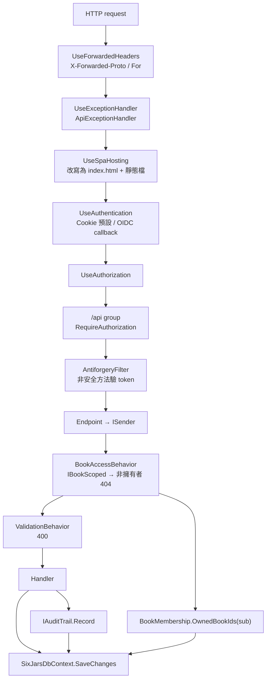
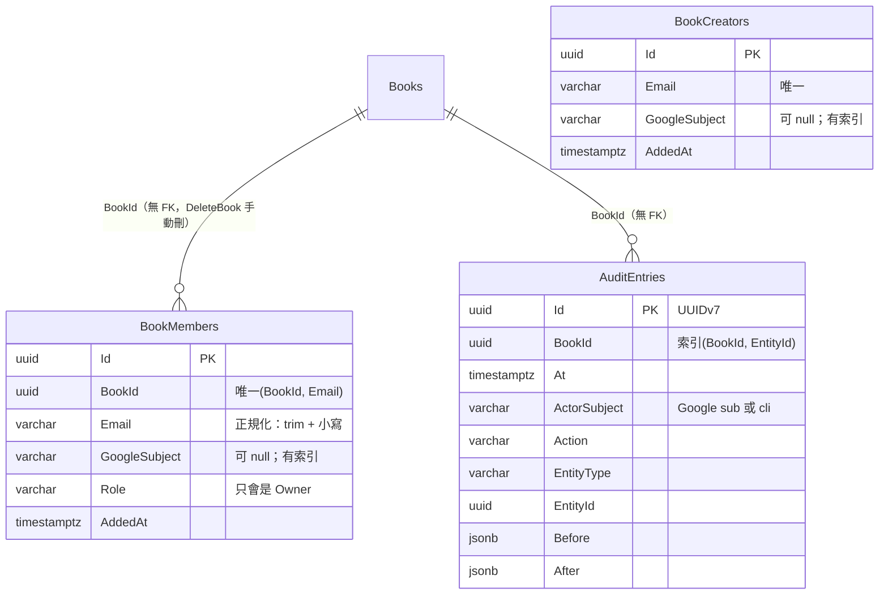
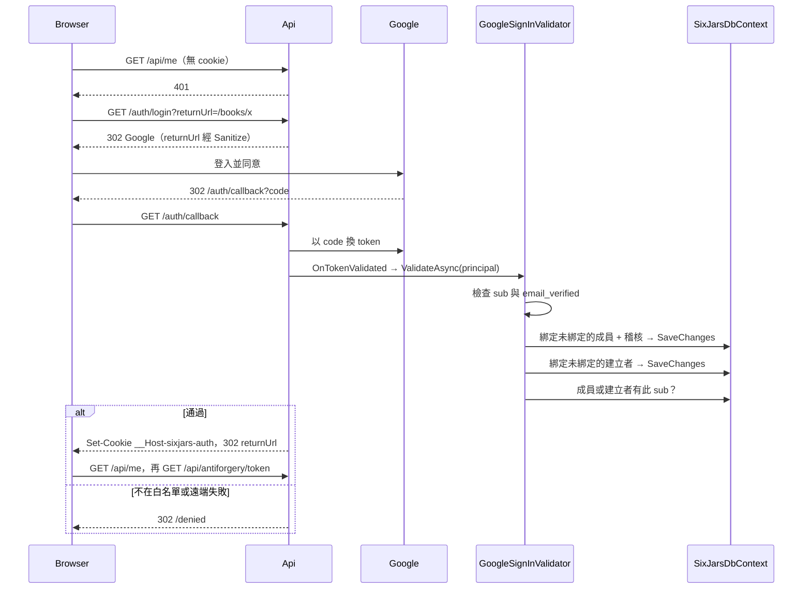
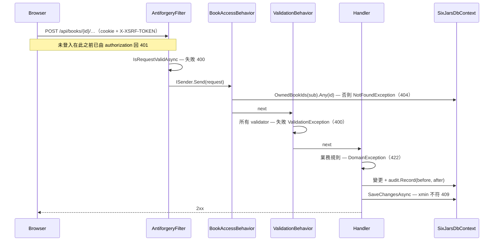
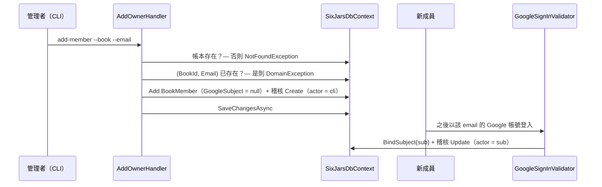

# 模組：identity-access（認證授權、成員、稽核）

> 階段 2 深讀，commit `f181aaf`，2026-11-14。領域用語以 `CONTEXT.md` 為準；`IBookReader` 快取、`xmin` 版本、各 handler 的寫入慣例見 `10-module-ledger-core.md`，本文不重複。
> **深讀範圍**（42 個原始檔）：Api `Program.cs`、`Infrastructure/*`（8 檔全部）、`Endpoints/` 的 `Auth`／`Me`／`Audit`／`Health`／`Antiforgery`；Application `DependencyInjection.cs`、`Common/` 的 `BookAccessBehavior`／`BookMembership`／`IBookScoped`／`ICliOnlyRequest`／`ValidationBehavior`／`ICurrentUser`／`ForbiddenException`、`Members` 全部（7）、`Auditing` 全部（6）；Domain `Members/` 的 `BookMember`／`BookCreator`／`BookRole`；Infrastructure `BookMemberConfiguration`／`BookCreatorConfiguration`／`AuditEntryConfiguration`；`SixJars.Cli/CliCurrentUser.cs`。另讀 ADR 0005／0006／0011、兩個慣例測試（`SecurityConventionTests`、`BookScopeConventionTests`）、前端 6 檔（`app.config.ts`、`session-api.ts`、`session.service.ts`、`auth.guard.ts`、`book.guard.ts`、`error-interceptor.ts`）。
> **只讀片段**：`CliApp.cs`（成員／建立者指令與 `Host.RunAsync` 的例外處理）、`Books/CreateBook.cs`、`Books/DeleteBook.cs`、`Mcp/OAuth/McpBearerHandler.cs`、`Mcp/OAuth/OAuthEndpoints.cs`（第 50–99 行）。
> **未深讀**（相關敘述標【推論】）：`McpGrant` 與 `Mcp/**` 其餘部分（屬 remote-mcp 模組）、`NotFoundException`、`AuditTrailTests` 等其他 tests、前端其餘部分、`docs/deploy.md`。

## 職責

1. **認證（你是誰）**：BFF 模式。Api 自己跑 Google OIDC authorization code flow，成功後發同源 HttpOnly cookie，前端不經手 token（ADR 0005）。證據：`src/SixJars.Api/Infrastructure/AuthenticationSetup.cs` → `AddSixJarsAuthentication`。
2. **登入白名單**：帳本成員（`BookMembers`）加建立者名單（`BookCreators`）。第一次登入以已驗證的 email 比對並綁定 Google `sub`，之後只認 `sub`（ADR 0005、0011）。證據：`Infrastructure/GoogleSignInValidator.cs` → `ValidateAsync`。
3. **授權（你能碰哪本帳）**：所有帶 `BookId` 的 request 經 `BookAccessBehavior`，非擁有者一律 404。「誰能存取哪些帳本」只有一個定義：`BookMembership.OwnedBookIds`。證據：`Application/Common/BookAccessBehavior.cs`、`BookMembership.cs`。
4. **XSRF 防護**：cookie 登入的必要配套，所有非安全方法都要帶 `X-XSRF-TOKEN`。證據：`Infrastructure/AntiforgeryFilter.cs`。
5. **稽核**：寫入用的 handler 明確呼叫 `IAuditTrail`，與業務資料同一次 `SaveChanges` 寫入前後完整快照（ADR 0006）。證據：`Application/Auditing/AuditTrail.cs`。
6. **Api 主機的橫切設定**：例外 → ProblemDetails 對應、forwarded headers、SPA hosting、health probe。

## 對外介面

| Endpoint / 入口 | 授權 | 說明 | 證據 |
|---|---|---|---|
| `GET /auth/login?returnUrl=` | 匿名 | 對 `Google` scheme 發 challenge；`returnUrl` 只接受站內相對路徑，否則回 `/` | `Endpoints/AuthEndpoints.cs`、`Infrastructure/ReturnUrl.cs` → `Sanitize` |
| `/auth/callback` | 匿名 | OIDC callback，由 authentication middleware 處理（不是 endpoint）；白名單拒絕或使用者取消 → 302 `/denied` | `AuthenticationSetup.cs` → `ConfigureGoogle`（`OnTokenValidated`、`OnRemoteFailure`） |
| `POST /auth/logout` | 匿名＋`AntiforgeryFilter` | 清除 cookie，204 | `AuthEndpoints.cs` |
| `GET /api/antiforgery/token` | Cookie | 發 `XSRF-TOKEN`（非 HttpOnly、Strict）與 `__Host-sixjars-af`（HttpOnly、Strict），204 | `Endpoints/AntiforgeryEndpoints.cs`、`AntiforgeryFilter.ConfigureOptions` |
| `GET /api/me` | Cookie | `{ subject, email, books, canCreateBooks, remainingBookQuota }`；不是 `IBookScoped` | `Application/Members/GetMe.cs`、`MeDto.cs` |
| `GET /api/books/{bookId}/audit?entityId=` | Cookie＋成員 | 單一實體的修改歷史，由舊到新；已刪除的資料也查得到；不分頁 | `Endpoints/AuditEndpoints.cs`、`Auditing/GetAuditHistory.cs` |
| `GET /health` | 匿名 | `CanConnectAsync`，連不上 503 | `Endpoints/HealthEndpoints.cs` |
| `GET /health/ready` | 匿名 | Cloud Run startup probe：連不上或有 pending migration → 503 並記 warning | 同上 → `Ready` |
| CLI `add-member --book --email` | 能連 DB 的管理者 | 加為擁有者（未綁定 `sub`），留稽核（操作者 `cli`） | `Members/AddOwner.cs`、`CliApp.cs` → `AddMemberCommand` |
| CLI `add-creator`／`remove-creator --email` | 同上 | 維護建立者名單，不留稽核 | `Members/AddBookCreator.cs`、`RemoveBookCreator.cs` |
| CLI `revoke-mcp-access --email` | 同上 | 撤銷 MCP 授權（細節留給 remote-mcp 模組） | `Members/RevokeMcpAccess.cs` |

**沒有**的入口：成員管理的 Web API（新增／移除／改角色）、CLI 的 `remove-member`、整本帳的稽核時間軸、稽核記錄的修改或刪除 API。證據：`Program.cs` 的 endpoint 對應、`CliApp.cs` 的指令清單（`00-inventory.md`）。

三種身分來源共用同一組 claim 名稱（`sub`、`email`），所以 `ICurrentUser` 之後的程式碼不分來源：

| 來源 | `ICurrentUser` 實作 | `Subject` | 證據 |
|---|---|---|---|
| 瀏覽器 cookie | `HttpCurrentUser`（Scoped） | Google `sub` | `Infrastructure/HttpCurrentUser.cs` |
| MCP bearer | 同上（`McpBearerHandler` 產生同名 claim） | 授權當下的 `sub` | `Mcp/OAuth/McpBearerHandler.cs` 第 45 行 |
| CLI | `CliCurrentUser`（Singleton） | 固定字串 `cli` | `SixJars.Cli/CliCurrentUser.cs` |

## 內部結構

證據：`BookMemberConfiguration.cs`、`BookCreatorConfiguration.cs`、`AuditEntryConfiguration.cs`；「無 FK」沿用 `10-module-ledger-core.md` 風險 #1 的依據（`SixJarsDbContextModelSnapshot.cs` 只有一個非 owned FK）。三張表都**沒有** `xmin` row version。

### 認證設定重點

| 項目 | 設定 | 理由（出自註解） | 證據 |
|---|---|---|---|
| 預設 scheme | Cookie；Google 只在 `/auth/login` 明確 challenge | API 未登入一律 401，不轉址（SPA 的 XHR 跟不了 302） | `AuthenticationSetup.cs` → `ConfigureCookie`（`OnRedirectToLogin`） |
| Cookie | `__Host-sixjars-auth`、HttpOnly、Secure=Always、SameSite=Lax、14 天 sliding | `__Host-` 前綴讓子網域無法覆寫；不沿用框架預設名稱 | 同上 |
| OIDC | Authority Google、`code` flow、scope 加 `email`、`MapInboundClaims = false`、callback `/auth/callback` | claim 維持 `sub`／`email`／`email_verified` 原名 | `ConfigureGoogle` |
| 缺 Google 設定 | Development 不註冊 Google scheme；其他環境啟動即失敗 | remote scheme 的 handler 每個請求都會初始化，缺 ClientId 會讓每個請求 500 | `AddSixJarsAuthentication` 的 remarks |
| DataProtection | `SetApplicationName("SixJars")`＋`PersistKeysToDbContext` | Cloud Run 換 instance 不登出 | 同上 |
| `/mcp` 與 `/api` 隔離 | `/api` 用預設 scheme（cookie）；`/mcp` 的 policy 指定只認 `McpBearer` | 瀏覽器帶 cookie 不能打 MCP，bearer 也不能打 `/api` | `Program.cs` 第 42 行、`McpSetup.cs` 第 52–53 行、`SecurityConventionTests.Every_mcp_endpoint_requires_mcp_bearer_policy` |

### 白名單與 `sub` 綁定規則

`GoogleSignInValidator.ValidateAsync` 的順序是「先綁定、再判斷」：

1. 沒有 `sub` 或 `email_verified` 不是 `true` → 拒絕。
2. 以正規化 email 找出 `GoogleSubject == null` 的成員與建立者，全部綁上這個 `sub`。成員每筆留一筆稽核（`RecordAs`，操作者就是被綁定的 `sub`）；建立者不留。
3. 只要有任何成員或建立者的 `GoogleSubject == sub` 就通過。

兩個刻意的設計：已綁定其他 `sub` 的列不在比對範圍（換 Google 帳號不能沿用 email 取得存取權，也避免 `BindSubject` 擲例外變成 500）；不採「`sub` 已綁定就直接通過」，否則已登入過的人之後被 CLI 加進另一本帳時永遠不會被綁定。證據：`GoogleSignInValidator.cs` 的 summary 與 remarks、`BookMember.BindSubject`。

### 授權模型

- **規則只有一條**：`OwnedBookIds(sub)` ＝ `BookMembers` 中 `GoogleSubject == sub && Role == Owner` 的 `BookId`。`BookAccessBehavior`、`GET /books`、`GET /me`、`CreateBook` 的額度計算都用它。證據：`BookMembership.cs`。
- **角色**：`BookRole` 定義了 `Owner`／`Bookkeeper`／`ReadOnly`，但 `BookMember.Create` 只接受 `Owner`，授權也只認 `Owner`。目前沒有讀／寫權限的區分。證據：`BookRole.cs`、`BookMember.Create`。
- **404 而非 403**：非成員與帳本不存在回同一個訊息；且 `BookAccessBehavior` 註冊在 `ValidationBehavior` 之前，非成員送不合法內容也只拿到 404。`ForbiddenException`（403）只用在不屬於帳本範圍的拒絕，目前兩處都在 `CreateBookHandler`（不在建立者名單、登入身分沒有 email）。證據：`Application/DependencyInjection.cs` 註解、`CreateBook.cs` 第 49–52、68 行。
- **CLI 的例外**：`ICliOnlyRequest` 不經成員檢查（`cli` 不是任何帳本的成員），靠「request 必須是 `internal`、Application 的 `InternalsVisibleTo` 不含 Api」讓 Api 編譯期就參考不到。
- **慣例由測試守住**：

| 測試 | 守住什麼 | 證據 |
|---|---|---|
| `Every_request_with_BookId_is_book_scoped_or_cli_only` | 有 `Guid BookId` 屬性的 request 恰為 `IBookScoped` 或 `ICliOnlyRequest` 其一 | `tests/SixJars.Application.Tests/Common/BookScopeConventionTests.cs` |
| `Cli_only_requests_are_not_public`、`Application_internals_are_not_visible_to_the_api` | CLI 專用 request 無法被 Api 送出 | 同上 |
| `Every_api_endpoint_requires_sign_in` | 列舉實際註冊的 endpoint：`/api/**` 匿名呼叫必為 401；`/api` 以外只允許 `/health*`、`/auth/**`、`/oauth/**`、`/.well-known/**`、`/mcp` | `tests/SixJars.Api.Tests/SecurityConventionTests.cs` |
| `Every_unsafe_api_endpoint_requires_xsrf_token` | `/api/**` 的非 GET／HEAD 不帶 token 必為 400 且標題是 XSRF 錯誤 | 同上 |

`SpaHosting` 用「改寫路徑的 middleware」而不是 `MapFallbackToFile`，就是為了不新增匿名 endpoint 而破壞上表第三個測試。證據：`Infrastructure/SpaHosting.cs` 的 remarks。

### XSRF

- 驗證點：`AntiforgeryFilter` 掛在 `/api` 群組與 `POST /auth/logout`；GET／HEAD／OPTIONS／TRACE 不驗。失敗回 400 ProblemDetails，標題固定（前端據此分類為 `antiforgery`）。
- endpoint filter 在參數綁定之後執行：body 格式錯誤會先回綁定的 400，但 handler 一定不會在驗證通過前執行。證據：`AntiforgeryFilter.cs` 的 remarks。
- 前端：`SessionService.fetch` 在 `/api/me` 成功後呼叫一次 `/api/antiforgery/token`；header 由 Angular `HttpClient` 附加。`app.config.ts` 只有 `provideHttpClient(withInterceptors(...))`，沒有 XSRF 相關設定，【推論】依賴 Angular 預設的 XSRF 行為（cookie `XSRF-TOKEN` → header `X-XSRF-TOKEN`，與後端常數相符）。

### 例外對應（`ApiExceptionHandler`）

| 例外 | 狀態碼 | 內容 |
|---|---|---|
| `ValidationException`（FluentValidation） | 400 | `ValidationProblemDetails`；欄位名去掉 `Input.` 前綴並轉 camelCase，新增與修改回同一套 key |
| `DomainException` | 422 | `detail` ＋ `extensions.code` |
| `NotFoundException` | 404 | `detail` |
| `ForbiddenException` | 403 | `detail` |
| `DbUpdateConcurrencyException` | 409 | 固定訊息 |
| `BadHttpRequestException` | 例外自帶的狀態碼 | 標題「請求格式錯誤」 |
| 其他（含一般的 `DbUpdateException`） | 回 `false`，交給預設處理 → 500 | — |

證據：`Infrastructure/ApiExceptionHandler.cs` → `TryHandleAsync`、`ToBodyFieldName`。這回答了 `11-module-planning.md` 待確認問題 #3：唯一索引／PK／FK 違反目前回 500。

CLI 有自己的一套對應（`CliApp.cs` → `Host.RunAsync`）：validation、`DomainException`／`NotFoundException`、並行衝突各印訊息後 exit 1；其他例外印出例外鏈但遮蔽連線字串；缺連線字串 exit 2。

### 稽核

- **寫入方式**：handler 呼叫 `audit.Record(bookId, action, entityType, entityId, before, after)`，只做 `db.AuditEntries.Add`，不自己存檔；與業務資料同一次 `SaveChangesAsync`，一起成功或失敗。grep `audit.Record|IAuditTrail` 在 `src/SixJars.Application` 命中 30 個檔案（含介面、實作與 DI 註冊）。
- **為什麼不用 `SaveChangesInterceptor`**：分錄是 owned collection，一筆交易的修改會被 change tracker 拆成多筆實體變更，組不回「一筆交易的前後」；且自動行為難以用測試表達（ADR 0006）。
- **快照**：直接重用 API DTO，序列化成 camelCase、enum 為字串、中文不跳脫的 JSON，存 `jsonb`。新增與修改後的快照 `Version` 一律是 0（`xmin` 要存檔後才有，不為它多一次往返）。證據：`AuditSnapshots.cs`。
- **`AuditAction`**：`Create`、`Update`、`Delete`、`Import`、`Restore`、`LockDateChanged`。`EntityType` 取值見 `AuditEntityTypes`（10 種）。
- **操作者**：一般取 `ICurrentUser.Subject`；`RecordAs` 只給「還沒有登入身分」的寫入（OIDC callback 當下 cookie 尚未發出）。
- **讀取**：`GetAuditHistory` 以 `(BookId, EntityId)` 查詢（對應索引），`OrderBy(At).ThenBy(Id)`；`Before`／`After` 轉成 `JsonElement` 輸出為 JSON 物件而非字串。
- **完整性的把關**：ADR 0006 指定由 API 測試負責（「每個寫入 endpoint 恰好留下一筆記錄」）；`tests/SixJars.Api.Tests/AuditTrailTests.cs` 存在但未讀，【推論】即此測試。

### Api 主機的其他設定

- **Forwarded headers**：採用 `X-Forwarded-For`／`X-Forwarded-Proto`，清空 `KnownProxies`／`KnownIPNetworks`（信任任何來源），`ForwardLimit` 維持 1。前提是「container 只能經由 Google 前端連到」；若改成可直連的部署方式必須改回只信任 proxy IP。必須在 authentication 之前，否則 OIDC `redirect_uri` 變成 `http://`、antiforgery 每個請求擲例外。證據：`Infrastructure/ForwardedHeadersSetup.cs`、`Program.cs` 第 33 行。
- **SPA hosting**：未被任何 endpoint 接走的 GET／HEAD、第一段不是後端前綴（`api`、`auth`、`health`、`mcp`、`oauth`、`.well-known`）、最後一段沒有副檔名 → 改寫成 `/index.html`。雜湊檔名 `immutable` 一年，其餘 `no-cache`。證據：`Infrastructure/SpaHosting.cs`。
- **Health**：`/health/ready` 自己開底層連線以保留 Npgsql 錯誤訊息，並在 log 中區分「連不上」「漏跑 migration」「讀不到 migration 歷史」三種原因。

### 前端（只讀登入相關的 6 檔）

- `authGuard`：`await SessionService.load()` 後回 `true`；401 由 interceptor 整頁導向，promise 不會 resolve。
- `apiErrorInterceptor`：401 → `location.assign('/auth/login?returnUrl=…')` 並回 `NEVER`；`antiforgery`、`unavailable` 顯示通知後照樣拋出。
- `bookGuard`：`CurrentBook.load(bookId)` 得到 `notFound` 就導回首頁（對應後端的非成員 404）。
- `SessionService`：`me` 以 signal 保存、並行呼叫共用一個 promise；`reload()` 給成員關係改變後使用（例如刪除帳本）。
- `denied` 路由沒有 guard，對應 OIDC 失敗時的轉址。證據：`web/src/app/app.routes.ts` 第 8–12 行。

## 資料存取

| 資料 | 儲存 | 讀/寫 | 交易邊界 | 證據 |
|---|---|---|---|---|
| `BookMembers` | PostgreSQL | 讀：每個 `IBookScoped` request 一次 `Any`（`GoogleSubject` 索引）；`/me`、`/books` | 無 transaction | `BookAccessBehavior.cs`、`GetMe.cs` |
| `BookMembers`＋`AuditEntries` | PostgreSQL | 寫：首次登入綁定 `sub` | 單次 `SaveChangesAsync`（成員與稽核一起） | `GoogleSignInValidator.BindUnboundMembersAsync` |
| `BookCreators` | PostgreSQL | 寫：首次登入綁定 | 另一次獨立的 `SaveChangesAsync`，與成員綁定不在同一個 transaction | `GoogleSignInValidator.BindUnboundCreatorsAsync` |
| `BookMembers`＋`AuditEntries` | PostgreSQL | 寫：CLI `add-member` | 單次 `SaveChangesAsync`；先查重複再靠唯一索引 `(BookId, Email)` 當最後防線 | `AddOwner.cs` |
| `BookCreators` | PostgreSQL | 寫：CLI `add-creator`／`remove-creator` | 單次 `SaveChangesAsync`；唯一索引 `Email` | `AddBookCreator.cs`、`RemoveBookCreator.cs` |
| `AuditEntries` | PostgreSQL | 寫：隨各 handler 的 `SaveChangesAsync`；讀：`GetAuditHistory`（`AsNoTracking`） | 跟隨呼叫端 | `AuditTrail.cs`、`GetAuditHistory.cs` |
| `AuditEntries`（刪除） | PostgreSQL | `DeleteBook` 以 `ExecuteDeleteAsync` 清掉該帳本全部記錄，再寫一筆刪除摘要 | `DeleteBook` 的明確 transaction | `Books/DeleteBook.cs` 第 46–50 行 |
| `DataProtectionKeys` | PostgreSQL | 讀寫：ASP.NET Core DataProtection | 框架管理 | `AuthenticationSetup.cs` |

- **快取**：本模組沒有快取。成員檢查每次都查 DB，所以移除成員列或刪除帳本後，既有 cookie 對該帳本立即失效（下一個 request 就 404）。
- **DI lifetime**：`HttpCurrentUser`、`AuditTrail`、`GoogleSignInValidator` 皆 Scoped，與 `SixJarsDbContext` 同 scope；`GoogleSignInValidator` 在 OIDC 事件裡由 `HttpContext.RequestServices` 取得，沒有被 Singleton 的 options 捕捉。`CliCurrentUser` 與 `TimeProvider` 為 Singleton 且無狀態。沒有 Singleton 持有 Scoped 的情形。證據：`Program.cs`、`AuthenticationSetup.cs` 第 95 行、`CliApp.cs` 第 304 行。
- **並行**：成員與建立者沒有 row version。同一人同時完成兩次首次登入時，兩邊都會把同一個 `sub` 寫上去，結果相同；【推論】會多留一筆內容相同的稽核 Update 記錄。
- **重試**：沒有 Polly 或重試機制。

## 關鍵流程

### 登入（含首次綁定）

### 帳本範圍的寫入請求

### CLI 加入成員到首次登入

## 風險與觀察

| # | 項目 | 嚴重度 | 證據 | 說明 |
|---|---|---|---|---|
| 1 | DataProtection 金鑰存在資料庫，沒有設定靜態加密 | 中 | `AuthenticationSetup.cs` 第 54–56 行（`AddDataProtection().SetApplicationName().PersistKeysToDbContext()`，沒有 `ProtectKeysWith*`） | 【推論】依 ASP.NET Core DataProtection 的行為，未設定 key encryptor 時金鑰以明文 XML 存放。能讀 `DataProtectionKeys` 表的人（任何拿到 app 角色或唯讀連線的人、資料庫備份）就能偽造任意 `sub` 的登入 cookie，等同取得所有帳本。是否連 MCP token 也受影響，取決於 `McpTokens` 是否使用 DataProtection（未讀，留給 remote-mcp）。這是「金鑰放 DB 才不會被登出」（ADR 0005）的代價，ADR 沒有提到這一點。 |
| 2 | 沒有移除成員的入口 | 中 | `CliApp.cs` 的指令清單只有 `add-member`；`Program.cs` 沒有成員相關 endpoint；`BookMember` 沒有移除或改角色的方法 | 加錯人或要收回權限時，只能直接改資料庫（不會留稽核）或刪掉整本帳。移除列之後授權會立即失效（成員檢查不快取），所以缺的只是入口。若對方是該帳本唯一的白名單來源，他的 cookie 仍可登入到到期，但看不到任何帳本。 |
| 3 | 一般的 `DbUpdateException` 沒有對應，回 500 | 低 | `ApiExceptionHandler.cs`（`switch` 只列 `DbUpdateConcurrencyException`） | 確認 `11-module-planning.md` 風險 #3 的推論。資料正確（約束擋住了），但使用者看到的是伺服器錯誤。本模組內的對應情境：同時執行兩次 `add-member`（CLI 會印出例外鏈）。 |
| 4 | 安全事件沒有稽核，應用程式幾乎不寫 log | 低 | `GoogleSignInValidator.cs`（拒絕時只回 `false`）；`AddBookCreator.cs`／`RemoveBookCreator.cs`／`RevokeMcpAccess.cs`（明寫不留稽核）；`src/**` 中 `ILogger`／`Log*` 只出現在 4 個檔案 | 登入成功、白名單拒絕、建立者名單異動、MCP 授權與撤銷、備份下載（`12-module-reporting-export.md` 風險 #6）都不在 `AuditEntries`，app 也沒有自己記 log。名單不留稽核是 ADR 0011 的明確決定；登入事件則沒有找到相關決策。【推論】白名單拒絕只剩框架自己的 remote failure log。 |
| 5 | Cookie 不重新驗證白名單 | 低 | `AuthenticationSetup.ConfigureCookie`（沒有 `OnValidatePrincipal`）；ADR 0011「不會立即撤銷既有 cookie」 | 被移出白名單的人在 cookie 到期前（14 天 sliding，持續使用就不會到期）仍算已登入。實際影響有限：帳本存取與 `canCreateBooks` 每次都查 DB，他只能呼叫 `/api/me`、`/api/books`（空清單），以及走到 MCP 同意頁（`OAuthEndpoints.cs` 第 53–59 行只檢查已登入；發出的授權同樣看不到任何帳本）。已是刻意取捨。 |
| 6 | `BookScopeConventionTests` 只認屬性名稱 `BookId` | 低 | `BookScopeConventionTests.cs` 第 27 行（`GetProperty("BookId")?.PropertyType == typeof(Guid)`） | 以其他名稱或巢狀物件帶帳本 Id 的 request 不會被掃到。另外 `BookAccessBehavior` 只證明「登入者是 `BookId` 這本帳的擁有者」，「`{id}` 這筆資料屬於這本帳」要靠每個 handler 的查詢自己帶 `BookId` 條件（專案 `CLAUDE.md` 的寫入慣例）；這一點是否有逐 endpoint 的跨帳本測試，未確認。 |
| 7 | 角色已定義但授權只有「擁有者或無」 | 低 | `BookRole.cs`、`BookMembership.OwnedBookIds`、`BookMember.Create` | 目前一致且安全。日後開放 `Bookkeeper`／`ReadOnly` 時，`IBookScoped` 沒有區分讀寫，`OwnedBookIds` 同時被授權、帳本清單、額度計算三處使用（額度應只算擁有者，授權則要放寬），需要拆開。 |
| 8 | 沒有 HSTS、安全標頭與 rate limiting；匿名的 `/health` 每次都連資料庫 | 低 | grep `src/**/*.cs` 找不到 `UseHsts`、`UseHttpsRedirection`、`Content-Security-Policy`、`X-Frame-Options`、`AddRateLimiter`；`HealthEndpoints.cs` 第 12 行 | Cookie 已是 `__Host-`＋Secure，【推論】HTTPS 轉址由 Cloud Run 前端負責。沒有 `frame-ancestors`／`X-Frame-Options` 表示頁面可被嵌入 iframe；對 MCP 同意頁的影響留給 remote-mcp 模組評估。`/health` 可被任何人反覆呼叫，【推論】會讓 Neon compute 無法休眠而增加費用。 |
| 9 | 稽核歷史在刪除帳本時一併清除，留下的摘要從 API 讀不到 | 低 | `DeleteBook.cs` 第 46–50 行（註解「留著就等於沒刪」）；`GetAuditHistory` 是 `IBookScoped`，而成員列已刪 | ADR 0006 的「append-only」因此有一個例外（ADR 0010 的決定）。刪除摘要的 `BookId` 是已不存在的帳本，只能直接查資料庫。 |
| 10 | 登入時的資料庫錯誤會顯示成「被拒絕」 | 低 | `AuthenticationSetup.cs` → `OnTokenValidated`（await `ValidateAsync`）、`OnRemoteFailure`（一律轉 `/denied`） | 【推論】`ValidateAsync` 擲出的例外（例如連不上資料庫）會被 remote authentication handler 轉成 remote failure，使用者看到的是白名單拒絕頁，搭配風險 #4 沒有 log，難以分辨。未以測試驗證。 |
| 11 | 信任任何來源的 forwarded headers | 低 | `ForwardedHeadersSetup.cs` | 取捨與翻轉條件都已寫在 remarks（改成可直連的部署就必須收緊）。列出是因為這個前提不在程式碼能檢查的範圍內，換部署平台時要記得。 |
| 12 | 稽核記錄的可讀性限制 | 低 | `AuditEntryDto`（`ActorSubject` 為原始 `sub`）、`AuditSnapshots.UnknownVersion`、`GetAuditHistory`（不分頁、只能依單一實體查） | API 只回 `sub`，要顯示「誰改的」得另外對應成員 email（前端如何顯示未讀）。修改後快照的 `Version` 恆為 0。沒有整本帳的時間軸，無法回答「某天誰動過這本帳」。同一實體被修改很多次時回傳全部歷史，每筆含完整快照。 |
| 13 | Development 未設定 Google 時 `/auth/login` 會失敗 | 低 | `AuthEndpoints.cs`（一律 challenge `Google` scheme）對照 `AuthenticationSetup.cs`（未設定時不註冊該 scheme） | 【推論】對未註冊的 scheme 發 challenge 會擲 `InvalidOperationException` → 500。只影響本機開發；測試以 `TestAuthHandler` 登入（`tests/Shared`，未讀）。 |
| 14 | 綁定後 `Email` 欄位不再更新 | 低 | `BookMember.BindSubject`（只寫 `GoogleSubject`）、`BookMembership.OwnedBookIdsByEmail`（CLI 以 email 認擁有者） | Web 以 `sub` 認人所以不受影響；但使用者日後更改 Google 帳號的 email 時，CLI 的 `--owner-email` 同名檢查、`revoke-mcp-access --email` 仍要用當初登記的 email。 |

## 待確認問題

1. #1：正式環境的 DataProtection 金鑰是否需要靜態加密（例如以 Secret Manager／KMS 的金鑰保護）？目前有哪些人或工具持有可讀 `DataProtectionKeys` 的資料庫連線？
2. #2：移除成員是刻意不做（家庭帳本不需要），還是尚未排入？若要做，應走 CLI 還是 Web，是否留稽核？
3. #3：`DbUpdateException`（唯一索引／FK 違反）是否要統一對應成 409 或 422？
4. #4：是否需要記錄登入成功／被拒絕的事件（至少寫 log）？
5. #6：是否有測試逐一驗證「A 帳本的成員以 A 的 `bookId` 搭配 B 帳本的實體 Id」會得到 404？（需讀 `tests/SixJars.Api.Tests`）
6. #8：正式網域是否由 Cloud Run 或前面的 load balancer 強制 HTTPS 與 HSTS？`/health` 是否有外部監控在打、頻率多少？（留待 deployment-ops 或階段 3）
7. #10、#13：兩項【推論】依賴 ASP.NET Core 的框架行為，未實際執行驗證；若要列入 `90-tech-debt.md`，建議先以測試確認。
8. `McpTokens` 是否依賴 DataProtection、MCP 同意頁是否需要防 clickjacking，留待 remote-mcp 模組。
