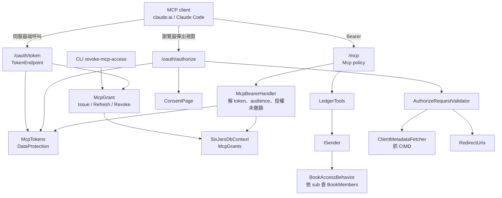
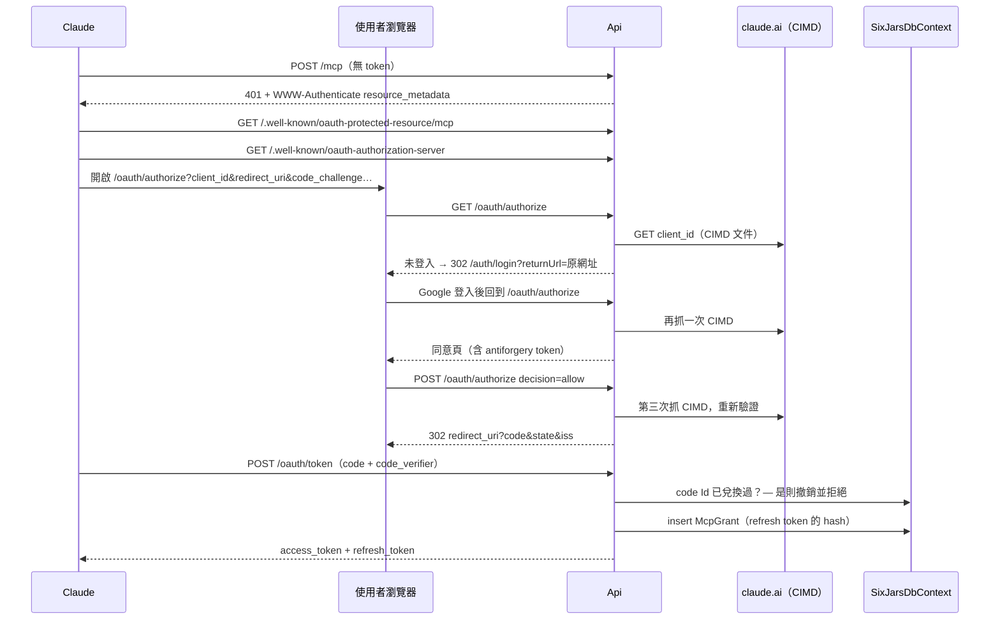
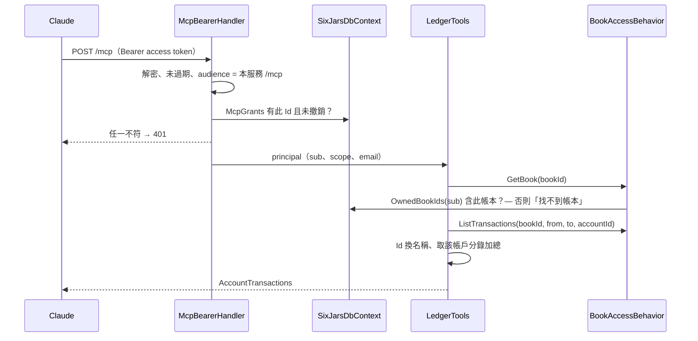
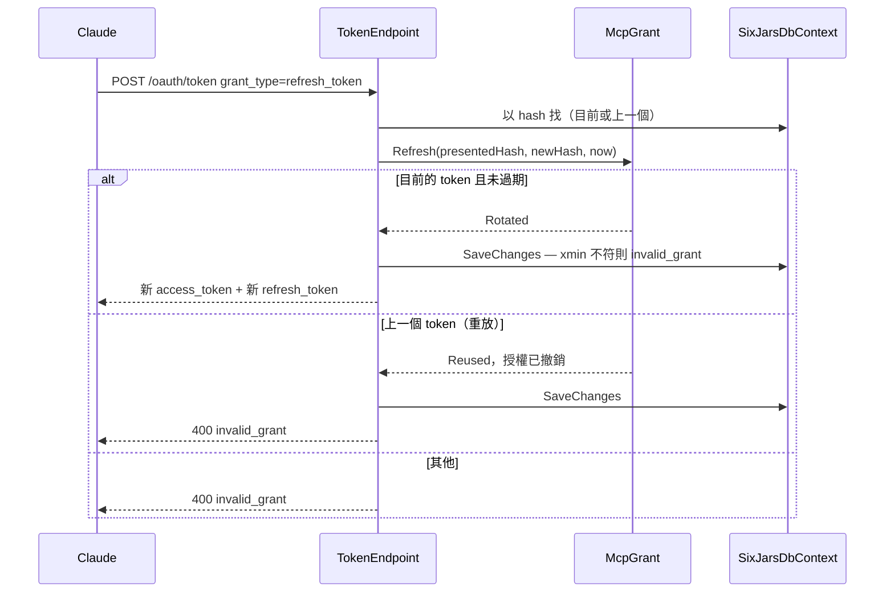

# 模組：remote-mcp（遠端 MCP＋內建 OAuth 授權伺服器）

> 階段 2 深讀，commit `f181aaf`，2026-11-14。領域用語以 `CONTEXT.md` 為準；cookie 登入、白名單、`BookAccessBehavior`、`AntiforgeryFilter`、DataProtection 設定見 `13-module-identity-access.md`，本文不重複。
> **深讀範圍**（16 個原始檔）：Api `Mcp/` 全部 12 檔（`McpSetup`、`LedgerTools`、`ReconcilePrompt`、`OAuth/` 的 `McpOAuth`／`OAuthEndpoints`／`TokenEndpoint`／`McpTokens`／`McpBearerHandler`／`AuthorizeRequestValidator`／`ClientMetadataFetcher`／`RedirectUris`／`ConsentPage`）；Domain `Members/McpGrant`；Infrastructure `McpGrantConfiguration`；Application `Members/RevokeMcpAccess`、`Transactions/ListTransactions`。另讀 ADR 0013。
> **未深讀**（相關敘述標【推論】）：ModelContextProtocol SDK 的內部行為、`tests/SixJars.Api.Tests/Mcp/*`（只確認存在 8 檔）、`docs/deploy.md` 第 13 節（只看 grep 命中的行）、`Books/ListBooks`、`Books/GetBook`。

## 職責

1. **唯讀 MCP server**：在既有 Api 的 `/mcp` 以 Streamable HTTP（stateless）提供 3 個查詢 tool 與 1 個 prompt，主要用途是讓使用者自己的 Claude 做信用卡帳單對帳，系統本身不串 LLM API（ADR 0013）。證據：`src/SixJars.Api/Mcp/McpSetup.cs` → `AddSixJarsMcp`、`Mcp/LedgerTools.cs`。
2. **最小 OAuth 授權伺服器**：只有 `authorization_code`（S256 PKCE 必填）與 `refresh_token` 兩種 grant、只支援 public client、client 只以 CIMD 辨識。證據：`Mcp/OAuth/OAuthEndpoints.cs`、`TokenEndpoint.cs`、`AuthorizeRequestValidator.cs`。
3. **授權記錄與撤銷**：每次授權一列 `McpGrant`，refresh token 每次輪替、舊 token 重現即撤銷整筆；管理者以 CLI 撤銷。證據：`src/SixJars.Domain/Members/McpGrant.cs`、`Application/Members/RevokeMcpAccess.cs`。

使用者身分沿用 Google cookie 登入；token 只代表「這個 `sub` 同意過」，能讀哪些帳本仍由 `BookAccessBehavior` 每次查 `BookMembers` 決定。

## 對外介面

| Endpoint / 入口 | 授權 | 說明 | 證據 |
|---|---|---|---|
| `/mcp` | `Mcp` policy：只認 `McpBearer` scheme，且 `scope` claim 為 `ledger:read` | Streamable HTTP，stateless | `McpSetup.cs` → `MapSixJarsMcp`、第 52–55 行 |
| `GET /.well-known/oauth-protected-resource/mcp` | 匿名 | RFC 9728 resource metadata，由 SDK 的 MCP scheme 提供；`authorization_servers` 依請求填入 | `McpSetup.cs`（`AddMcp`、`OnResourceMetadataRequest`） |
| `GET /.well-known/oauth-authorization-server` | 匿名 | RFC 8414 metadata；宣告 `client_id_metadata_document_supported`、auth method `none`、`S256`、`authorization_response_iss_parameter_supported` | `OAuthEndpoints.cs` → `MapOAuthEndpoints` |
| `GET /oauth/authorize` | 匿名（未登入轉 `/auth/login`） | 先驗 client，再要求登入，最後顯示同意頁 | `OAuthEndpoints.AuthorizeAsync` |
| `POST /oauth/authorize` | Cookie＋antiforgery（表單欄位） | 同意頁送出；重新驗證全部參數，同意才發 code | `OAuthEndpoints.ConsentAsync` |
| `POST /oauth/token` | 匿名（靠 PKCE／refresh token） | form-urlencoded；失敗一律 400＋RFC 6749 錯誤碼；`Cache-Control: no-store` | `TokenEndpoint.HandleAsync` |
| CLI `revoke-mcp-access --email` | 能連 DB 的管理者 | 撤銷該 email 的所有有效授權，回傳筆數 | `RevokeMcpAccess.cs` |

沒有的端點：`registration_endpoint`（DCR，ADR 0013 否決、留作後備）、`revocation_endpoint`（RFC 7009）、使用者在 Web 檢視或撤銷自己授權的介面。

### Tools 與 prompt

| 名稱 | 輸入 | 輸出 | 底層 request |
|---|---|---|---|
| `list_books` | — | `{ id, name }[]` | `ListBooks` |
| `list_accounts` | `bookId` | `{ id, name, type, archived }[]`（含已封存） | `GetBook` |
| `list_account_transactions` | `bookId`、`accountId`、`from`、`to`（含頭尾，最多 120 天） | 帳戶名、期間、筆數、`total`、每筆 `{ date, kind, amount, mainCategory, subCategory, counterAccount, note, tags }` | `GetBook`＋`ListTransactions` |
| prompt `reconcile_credit_card_statement` | `account?`、`period?` | 對帳指引文字（與 server instructions 同一份） | — |

- 三個 tool 都標 `ReadOnly = true, Destructive = false`，全部經 `ISender`，沒有自己的資料存取。
- 回傳的是解析好的名稱與「這個帳戶上」的帶號金額（該帳戶的分錄加總），不回 Id 與交易金額，理由是讓 Claude 自己對照 Id、推正負號最容易出錯。證據：`LedgerTools.cs` 的 remarks、第 80 行。
- `counterAccount`：查詢的帳戶是交易主帳戶時取 `CounterAccountId`，否則取主帳戶（例如從信用卡看繳卡費）。
- 非成員與不存在的帳本回同一句「找不到帳本」（`McpException`，tool error、HTTP 仍 200）。證據：`LedgerTools.GetBookAsync`。

## 內部結構

### Authentication scheme 的分工

| Scheme | 角色 | 證據 |
|---|---|---|
| `McpBearer`（`McpBearerHandler`） | authenticate：解開 access token、比對 audience、查授權未撤銷；challenge 轉給 SDK scheme | `McpSetup.cs` 第 38–39 行、`McpBearerHandler.cs` |
| SDK 的 MCP scheme（`AddMcp`） | challenge：401 加 `resource_metadata`；提供 protected-resource metadata。自己永遠回 `NoResult`，不能驗 token | `McpSetup.cs` 的 remarks |
| Cookie（預設） | 只用於 `/oauth/authorize` 判斷是否登入；`/mcp` 的 policy 明確排除它 | 同上；`SecurityConventionTests.Every_mcp_endpoint_requires_mcp_bearer_policy` |

### Token 與憑證

| 憑證 | 形式 | 效期 | 儲存 | 證據 |
|---|---|---|---|---|
| authorization code | DataProtection 加密的自包含 payload（purpose `SixJars.Mcp.AuthorizationCode`）：code Id、`sub`、email、client、redirect URI、code challenge、scope、resource、到期時間 | 60 秒 | 不存 DB；兌換後 code Id 寫進 `McpGrant.AuthorizationCodeId`（唯一索引）防重複兌換 | `McpTokens.cs`、`McpOAuth.cs` |
| access token | 同上（purpose `SixJars.Mcp.AccessToken`）：grant Id、`sub`、email、scope、audience、到期時間 | 1 小時 | 不存 DB；每次請求以 grant Id 查一次是否撤銷 | `McpTokens.CreateAccessToken`、`McpBearerHandler.cs` 第 39 行 |
| refresh token | 256 位元亂數（base64url） | 30 天，每次使用後重新起算 | DB 只存 SHA-256 hex；另留上一個 hash 偵測重放 | `McpTokens.NewRefreshToken`／`Hash`、`McpGrant.Refresh` |

到期時間寫在 payload 裡、以注入的 `TimeProvider` 判斷（time-limited protector 讀系統時鐘，測試無法讓 code 過期）。不用 JWT：沒有第三方要驗證（ADR 0013）。

`issuer` 與 `resource`（audience）都取自請求本身（`scheme://host`），不另設組態；`McpBearerHandler` 要求 token 的 audience 等於當下請求推得的 `{issuer}/mcp`。證據：`McpOAuth.Issuer`／`Resource`。

### authorize 的參數驗證（`AuthorizeRequestValidator`）

GET（顯示同意頁前）與 POST（發 code 前）各跑一次，因為表單的 hidden 欄位可被竄改。順序與結果：

| 步驟 | 檢查 | 失敗時 |
|---|---|---|
| 1 | `client_id` 是 HTTPS 絕對 URL、無 fragment、host 完全等於白名單之一（預設 `claude.ai`，不含子網域） | 錯誤頁，不轉址，也不對外連線 |
| 2 | 抓 CIMD 文件，文件的 `client_id` 必須等於網址本身 | 錯誤頁 |
| 3 | `redirect_uri` 逐字等於文件登記值；登記值是 http loopback 時只忽略 port | 錯誤頁 |
| 4 | `response_type = code` | 帶 `unsupported_response_type` 轉回 client |
| 5 | 有 `code_challenge` 且 method 為 `S256` | `invalid_request` |
| 6 | scope 省略或只有 `ledger:read` | `invalid_scope` |
| 7 | `resource` 省略或等於本服務的 `/mcp` | `invalid_target` |

轉回 client 一律帶 `iss`（RFC 9207）。證據：`AuthorizeRequestValidator.ValidateAsync`、`RedirectUris.IsRegistered`、`OAuthEndpoints.RedirectToClient`。

CIMD 抓取的限制：typed `HttpClient`、timeout 5 秒、不跟隨 redirect、最多讀 64 KB、失敗一律回 null 並記 warning。證據：`McpSetup.cs` 第 34–35 行、`ClientMetadataFetcher.cs`。

### 同意頁（`ConsentPage`）

- 伺服器端組的純 HTML，不經 Angular；所有動態值經 `HtmlEncoder`。
- 顯示 `client_id` 的 host 而非文件自稱的 `client_name`，並列出轉址目的地的 host。
- 回應標頭：`Content-Security-Policy: default-src 'none'; style-src 'unsafe-inline'; frame-ancestors 'none'`、`Cache-Control: no-store`。這回答了 `13-module-identity-access.md` 待確認問題 #8 的後半：同意頁自己有防 clickjacking。
- 頁面上有紅框警語：只有自己剛從 Claude 按下 Connect 才允許（授權釣魚在技術上無法分辨，只能提醒）。

### `McpGrant` 狀態轉移

| 事件 | 條件 | 結果 |
|---|---|---|
| `Issue` | code 首次兌換成功 | 新增一列 |
| `Refresh` → `Rotated` | 有效、hash 等於目前值、未過期 | 目前 hash 移到 `Previous`，寫入新 hash，效期重新起算 |
| `Refresh` → `Reused` | hash 等於上一個（已輪替掉的） | 撤銷整筆 |
| `Refresh` → `Invalid` | 已撤銷、過期或 hash 不符 | 不改狀態 |
| `Revoke` | CLI、重放偵測、code 重複兌換 | `RevokedAt ??= now`，不刪列 |

## 資料存取

| 資料 | 儲存 | 讀/寫 | 交易邊界 | 證據 |
|---|---|---|---|---|
| `McpGrants` | PostgreSQL | 寫：code 兌換（insert） | 單次 `SaveChangesAsync`；唯一索引 `AuthorizationCodeId` 擋同時兌換 | `TokenEndpoint.ExchangeCodeAsync` |
| `McpGrants` | PostgreSQL | 寫：refresh 輪替或重放撤銷 | 單次 `SaveChangesAsync`；`xmin` 樂觀並行，衝突者回 `invalid_grant` | `TokenEndpoint.RefreshAsync`、`McpGrantConfiguration.cs` |
| `McpGrants` | PostgreSQL | 讀：每個 `/mcp` 請求一次 `AnyAsync`（主鍵、`AsNoTracking`） | 無 | `McpBearerHandler.cs` |
| `McpGrants`＋`BookMembers`＋`BookCreators` | PostgreSQL | CLI 撤銷：以 email 找出已綁定的 `sub`，再撤銷 `sub` 或 email 相符的有效授權 | 單次 `SaveChangesAsync` | `RevokeMcpAccess.cs` |
| `DataProtectionKeys` | PostgreSQL | 讀：加解密 code 與 access token | 框架管理 | `McpTokens.cs` |
| 帳本、交易 | PostgreSQL＋帳本快取 | 讀：經既有 query | 無 | `LedgerTools.cs` |
| CIMD 文件 | 外部 HTTPS | 讀：每次 authorize GET 與 POST 各抓一次，**不快取** | — | `AuthorizeRequestValidator.cs` 第 52 行 |

- **每個 tool 呼叫的 DB 往返**：授權檢查 1 次，加上既有的成員檢查與帳本版本檢查（見 ledger-core 風險 #11）。
- **DI lifetime**：`McpTokens` 為 Singleton，只依賴 `IDataProtectionProvider` 與 `TimeProvider`（皆 Singleton）；`AuthorizeRequestValidator` 為 Scoped，持有 typed client（Transient）與 `IOptions`；`McpBearerHandler` 每個請求建立，注入 Scoped 的 `ISixJarsDbContext`。沒有 Singleton 持有 Scoped。
- **並行**：refresh 的競態由 `xmin` 處理（少了它兩邊都會 `Rotated`、重放偵測失效，見 `McpGrantConfiguration.cs` 註解）；code 的競態由唯一索引處理。
- **稽核**：授權的建立、輪替、撤銷與 tool 呼叫都不寫 `AuditEntries`（ADR 0013：授權不屬於任何帳本）。`RevokedAt` 保留在列上可事後追查。
- **重試／錯誤處理**：沒有 Polly。OAuth 端點自己把失敗轉成 RFC 6749 的錯誤回應；`ClientMetadataFetcher` 攔 `HttpRequestException`／`TaskCanceledException`／`JsonException`。

## 關鍵流程

### 首次連線與授權

### Tool 呼叫

### Refresh token 輪替

## 風險與觀察

| # | 項目 | 嚴重度 | 證據 | 說明 |
|---|---|---|---|---|
| 1 | client 的信任單位是整個 host，不是特定的 `client_id` URL | 中 | `AuthorizeRequestValidator.cs` 第 43–56 行（只比對 host，再要求文件的 `client_id` 等於網址本身）；`McpOAuthOptions.AllowedClientIdHosts` | 只要白名單 host 底下任何一個路徑能回出一份「`client_id` 等於自己網址」的 JSON，就會被當成可信 client，且 `redirect_uris` 由該文件自行宣稱。安全性因此取決於 `claude.ai` 上有沒有使用者可控、能以 200 回傳任意 JSON 的路徑；這一點從程式碼無法判斷。同意頁只顯示 host，使用者也分辨不出是哪一份文件。`docs/deploy.md` 第 755 行顯示正式環境可能再加入其他 host，每加一個都擴大這個信任範圍。 |
| 2 | 授權與 access token 的完整性都繫於 DataProtection 金鑰 | 中 | `McpTokens.cs`（code 與 access token 皆以 DataProtection 保護）；`McpBearerHandler.cs` 第 39–45 行（只查 grant Id 是否有效，`sub` 取自 token 本身） | 確認 `13-module-identity-access.md` 風險 #1 的延伸：能讀到金鑰的人可自行產生 access token。另外 handler 查授權時沒有比對 token 的 `sub` 與 `McpGrant.Subject` 是否一致；正常情況下兩者必然相同，但少了這層 defense-in-depth，偽造 token 只需要任何一個有效的 grant Id。 |
| 3 | 使用者無法自己檢視或撤銷授權，client 端也沒有撤銷端點 | 中 | `Program.cs`／`OAuthEndpoints.cs`（沒有相關 endpoint）；`RevokeMcpAccess.cs`（CLI，一次撤銷該 email 全部授權） | 在 Claude 那邊移除連接器不會通知本服務，授權會一直有效到 refresh token 30 天沒被使用為止。使用者想確認「現在有哪些 Claude 能讀我的帳」只能請管理者查資料庫；撤銷也無法只撤一筆。 |
| 4 | 匿名的 `/oauth/authorize` 每次都對外抓 CIMD，沒有快取也沒有 rate limiting | 低 | `OAuthEndpoints.AuthorizeAsync`（驗證在登入檢查之前）；`AuthorizeRequestValidator.cs` 第 52 行；`13-module-identity-access.md` 風險 #8 | 任何人不必登入就能讓服務對白名單 host 發出請求（每個請求最多占用 5 秒）。目標只限白名單 host，不構成 SSRF；影響是可被用來消耗 Cloud Run 的並行額度，或對該 host 造成不必要的流量。一次正常授權流程也會抓 2～3 次同一份文件。 |
| 5 | 嚴格的 refresh token 輪替沒有寬限期 | 低 | `McpGrant.Refresh`（上一個 hash 重現即 `Revoke`） | client 送出 refresh 後若沒收到回應（網路中斷、Cloud Run 冷啟動逾時）而以原 token 重試，會被判定為重放並撤銷整筆授權，使用者必須重新連線。這是 OAuth 2.1 對 public client 的要求與可用性之間的取捨；實際發生頻率需要看正式環境。 |
| 6 | refresh token 沒有絕對效期 | 低 | `McpGrant.Refresh`（`RefreshTokenExpiresAt = now + refreshLifetime`） | 只要 30 天內用過一次就無限延長。搭配風險 #3，一筆授權可能長期存在而無人察覺。是否刻意，ADR 0013 沒有寫。 |
| 7 | `McpGrants` 只增不減 | 低 | grep `McpGrants`：`src/` 內沒有刪除；撤銷只寫 `RevokedAt` | 每次重新連線新增一列，過期與已撤銷的列永遠保留（保留是為了事後追查）。【推論】量很小，短期不是問題；沒有清理機制。 |
| 8 | code 兌換時把所有 `DbUpdateException` 都當成「重複兌換」 | 低 | `TokenEndpoint.cs` 第 71–75 行 | 權限不足、連線中斷等寫入失敗也回 `invalid_grant`，client 會以為授權碼無效。`docs/deploy.md` 第 783 行的疑難排解（app 角色沒有 `McpGrants` 權限時 log 有 500）描述的是另一條路徑（第 55 行的查詢），兩者表現不同，排查時要注意。 |
| 9 | `LedgerTools` 的註解「錯誤一律轉成 `McpException`」只涵蓋部分路徑 | 低 | `LedgerTools.cs`：只有 `GetBookAsync` 攔 `NotFoundException`；`ListTransactions` 的呼叫沒有 try-catch | 目前 `GetBook` 先執行，所以非成員走不到 `ListTransactions`。其他例外（資料庫錯誤等）會直接往外拋，【推論】由 SDK 轉成一般的 tool error，訊息內容取決於 SDK。 |
| 10 | tool 重用為 Web 設計的 query，帶入不需要的成本 | 低 | `ListTransactions.cs`（追蹤查詢以讀取 `xmin`）；`LedgerTools.cs`（每次呼叫先 `GetBook` 取完整設定） | 與 ledger-core 風險 #8 同源；有 120 天上限所以量有限。`list_account_transactions` 每次都載入整本帳的設定來換名稱，走的是帳本快取，成本主要是版本檢查那一次往返。 |
| 11 | issuer 與 audience 取自請求的 Host | 低 | `McpOAuth.Issuer`；`ForwardedHeadersSetup.cs`（不採用 `X-Forwarded-Host`）；grep `src/` 找不到 `AllowedHosts` 設定 | 好處是不必設定網址。代價是服務同時有多個網域（例如 run.app 網址與自訂網域）時，各網域發出的 token 不能互用，metadata 也各自一套。安全性依賴「只有平台認得的 Host 才進得來」，【推論】Cloud Run 符合；換部署方式時要和 identity-access 風險 #11 一起檢查。 |
| 12 | 讀取帳本不留任何記錄 | 低 | `LedgerTools.cs`、`McpBearerHandler.cs`（沒有 logging 或稽核） | 事後無法得知某個授權在什麼時候讀了哪本帳的哪段期間。與 identity-access 風險 #4 同類。 |
| 13 | `ClientMetadataFetcher.HttpClientName` 未被使用 | 低 | grep `HttpClientName`：`src/` 內只有定義 | typed client 以型別註冊，這個常數沒有作用，可能是改寫後留下的。 |

## 待確認問題

1. #1：是否要把白名單從 host 收緊成「完整的 `client_id` URL」？實際觀察到的 Claude CIMD URL 記在 `docs/superpowers/plans/2026-10-30-mcp-server.md` 的「手動驗證」一節（未讀）；正式環境目前設定了哪些 host？
2. #2：`McpBearerHandler` 是否補上 token `sub` 與 `McpGrant.Subject` 的比對？金鑰保護方式沿用 identity-access 待確認問題 #1。
3. #3：是否需要讓使用者在 Web 看到並撤銷自己的授權，或提供 RFC 7009 的 `revocation_endpoint`？
4. #5：正式環境是否出現過「Claude 無預警要求重新連線」？可用來判斷嚴格輪替是否需要寬限期。
5. #6：refresh token 無絕對效期是刻意的嗎？
6. #9：SDK 對 tool 內未處理例外的實際回應內容（是否帶出例外訊息），需要讀 SDK 或以 `LedgerToolsTests` 確認。
7. `tests/SixJars.Api.Tests/Mcp/` 的 8 個測試檔涵蓋哪些情境（重放、並行輪替、redirect 比對、端到端）未讀；階段 3 整理技術債前建議確認。
