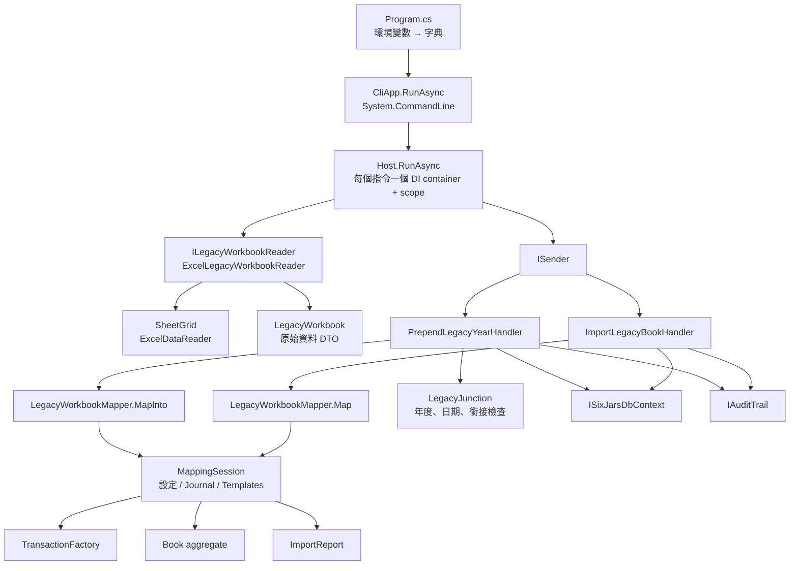
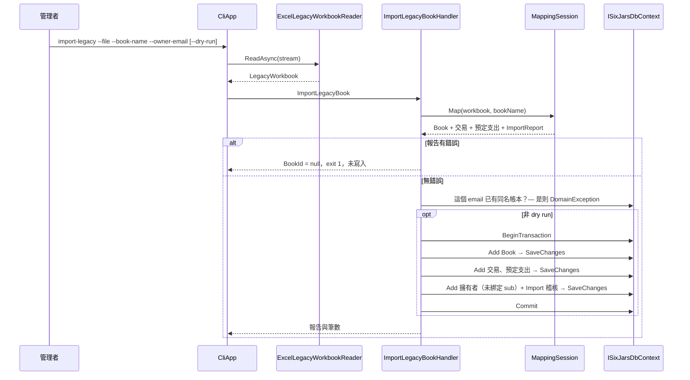
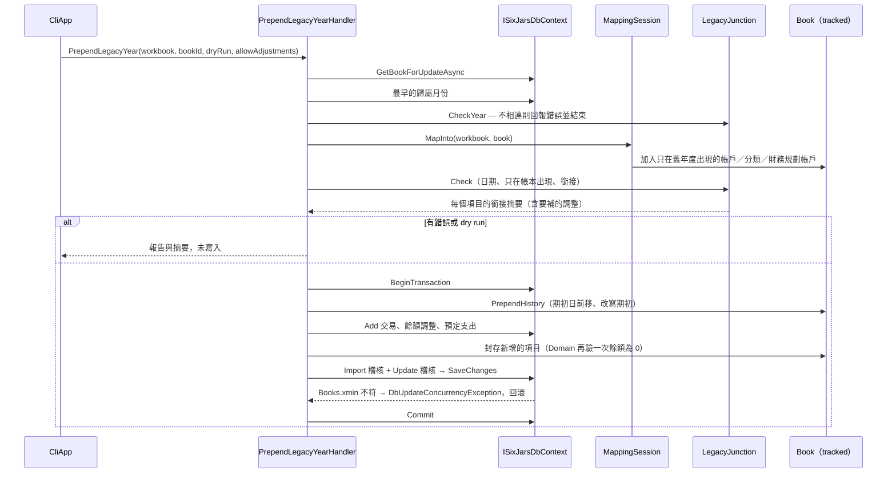

# 模組：legacy-import-cli（舊帳本匯入與 CLI）

> 階段 2 深讀，commit `f181aaf`，2026-11-14。領域用語以 `CONTEXT.md` 為準；`TransactionFactory`、`Book` aggregate、`xmin` 版本與帳本快取見 `10-module-ledger-core.md`，預定支出見 `11-module-planning.md`，`restore-backup` 的還原邏輯見 `12-module-reporting-export.md`，成員／建立者／MCP 撤銷指令與 `ICliOnlyRequest` 見 `13`、`14`。本文只寫匯入與 CLI 主機本身。
> **深讀範圍**（19 個原始檔）：Application `LegacyImport/` 全部 13 檔、`Books/BookLoading.cs`；Infrastructure `LegacyExcel/` 的 `ExcelLegacyWorkbookReader`、`SheetGrid`；`SixJars.Cli` 的 `Program.cs`、`CliApp.cs`、`CliCurrentUser.cs`（另讀 `SixJars.Cli.csproj`）。
> **只讀片段**：`Domain/Books/Book.cs`（`PrependHistory`、`Archive*`、`Find*`）、`Domain/Transactions/TransactionFactory.cs`（`AccountAdjustment`、`FundAdjustment`）、`Application/Planning/PayPlannedExpense.cs`（`BuildPayment`）。
> **未深讀**（相關敘述標【推論】）：`tests/` 中的匯入、CLI 與驗收測試（只確認檔案存在）、`docs/superpowers/` 的 spec／plan（程式碼註解引用的 R2-Q4、M3、D1…等代號出處）、`docs/deploy.md`、ExcelDataReader 與 System.CommandLine 的內部行為。

## 職責

1. **CLI 主機**：第二個 composition root。直接連資料庫、沒有登入身分，與 Api 共用同一組 Application command，不另寫寫入邏輯。證據：`src/SixJars.Cli/CliApp.cs` 類別註解與 `Host.RunAsync`。
2. **讀舊 Excel**：把「富朋友理財記帳本」`.xlsm` 的固定儲存格讀成不含語意的 `LegacyWorkbook`。證據：`src/SixJars.Infrastructure/LegacyExcel/ExcelLegacyWorkbookReader.cs`。
3. **轉換**：把 `LegacyWorkbook` 轉成 Domain 物件（帳本設定、交易、預定支出），逐列收集錯誤／警告／修正。純函式、無 I/O。證據：`Application/LegacyImport/LegacyWorkbookMapper.cs`、`MappingSession*.cs`。
4. **匯入成新帳本**（`ImportLegacyBook`）與**補匯舊年度到既有帳本最前面**（`PrependLegacyYear`，含銜接檢查與餘額調整）。證據：`ImportLegacyBook.cs`、`PrependLegacyYear.cs`、`LegacyJunction.cs`。

匯入只走 CLI，不提供 API 上傳（`ImportLegacyBook.cs` 註解：spec §8.1 已否決）。

## 對外介面

CLI 沒有 HTTP 入口。全部指令（System.CommandLine）：

| 指令 | 參數 | 送出的 request | 本文是否深讀 |
|---|---|---|---|
| `import-legacy`（新帳本） | `--file`、`--book-name`、`--owner-email`、`--dry-run` | `ImportLegacyBook` | 是 |
| `import-legacy --into`（補匯） | `--file`、`--into <bookId>`、`--dry-run`、`--adjust` | `PrependLegacyYear` | 是 |
| `add-member` | `--book`、`--email` | `AddOwner` | 見 `13` |
| `add-creator`／`remove-creator` | `--email` | `AddBookCreator`／`RemoveBookCreator` | 見 `13` |
| `revoke-mcp-access` | `--email` | `RevokeMcpAccess` | 見 `14` |
| `restore-backup` | `--file` | `RestoreBackup` | 見 `12` |

證據：`CliApp.RunAsync`（指令清單）與各 `*Command` 方法。

- **兩種匯入模式互斥**：`--into` 與 `--book-name`＋`--owner-email` 擇一，在 action 內檢查（不需要連線字串就能判斷）；`--adjust` 只能搭配 `--into`。證據：`CliApp.ImportLegacyCommand` 第 76–91 行。
- **exit code**：0 成功；1 業務或輸入錯誤（含報告有錯誤、資料庫錯誤）；2 未設定連線字串。證據：`CliApp` 的 remarks、`Host.RunAsync`。
- **設定**：只讀環境變數 `ConnectionStrings__SixJars`（`<REDACTED>`）與 `MediatR__LicenseKey`（`<REDACTED>`）；沒有設定檔。`Program.cs` 把整個 process 的環境變數轉成字典交給 `CliApp`，測試因此可以在 process 內直接呼叫。
- **輸出**：`import-legacy` 逐條印出 `[錯誤]`／`[警告]`／`[修正]`（工作表＋列號）；補匯另外印期初日變化與每個帳戶／財務規劃帳戶的銜接摘要。證據：`CliApp.WriteReportAsync`、`PrependAsync`。

所有 request 都是 `internal` 的 `ICliOnlyRequest`，不經 `BookAccessBehavior`，但仍經 `ValidationBehavior`。稽核的操作者是固定字串 `cli`（`CliCurrentUser`）。

## 內部結構

### 三層分工

| 層 | 做什麼 | 不做什麼 | 證據 |
|---|---|---|---|
| `ExcelLegacyWorkbookReader`＋`SheetGrid` | 儲存格 → DTO；整個檔案先讀進 `MemoryStream`，再把每張工作表載成二維陣列，以 A1 位址取值 | 任何語意判斷 | `ExcelLegacyWorkbookReader.cs` 類別註解 |
| `MappingSession`（partial 三檔） | 名稱 → 帳戶／分類／財務規劃帳戶；列 → 交易或預定支出；日期修正；逐列收集問題 | I/O、資料庫 | `LegacyWorkbookMapper.cs`（「純函式、無 I/O」） |
| Handler | 同名檢查、dry run、銜接檢查、交易邊界、稽核 | 轉換規則 | `ImportLegacyBook.cs`、`PrependLegacyYear.cs` |

### Excel 讀取（位址寫死）

| 工作表 | 讀取內容 | 範圍 |
|---|---|---|
| `設定` | 年度 `J4`、手上現金期初 `E54`、銀行 `B/D 70–79`、信用卡 `G/I 70–79`、電子錢包 `G/I 59–66`、貸款 `B/D 83–90`、財務規劃帳戶 `B/D 59–66`、收入項目 `B 11–18`、固定支出項目 `B 22–41` | 必要，缺表會擲例外 |
| `清單` | 其它收入子項 `AU 4–120`、浮動支出主分類 `AV..BT` 第 2 列與子分類 `4–120` | 必要 |
| `1月`～`12月` | 流水帳 `AH:AM` 第 7–172 列（金額欄 `AL` 是數字才讀）；制式表格：固定 50–69、貸款 74–81、特別 86–91（金額 `N` 非 0 才讀）；本月還本金 `E/N 124–131` | 有哪幾張讀哪幾張 |
| `預算`、`總表` 與各月的 `LegacyMonthFigures` | Excel 自己算出的數字 | 只供驗收測試比對，不參與匯入；缺表不影響 |

證據：`ExcelLegacyWorkbookReader.ReadSettings`、`ReadJournal`、`ReadTemplates`、`ReadFigures`；類別註解「儲存格位址依 2026 年版記帳本查證」。`SheetGrid.Number` 對非數字儲存格回 0、`Date` 對非日期回 null、`Text` 會 trim。

### 轉換規則

**設定 → 帳本**（`MappingSession.AddAccounts`／`AddPlanningFunds`／`AddCategories`）

- 固定建立「現金」與「外幣現鈔」（後者期初取自財務規劃帳戶「外幣現金」、不計入可用現金）；信用卡與貸款的期初取負號。
- 名稱符合 `自定浮支NN`／`固定支出NN`／`貸款備用NN` 的預留項目不匯入（`LegacyNames.IsPlaceholder`）。
- 分類：收入項目各一個主分類（「其它收入」帶子項）；浮動主分類與子分類來自 `清單`；另建「固定支出」「貸款支出」（子分類＝各貸款名稱）「特別支出」。

**流水帳列 → 交易**（`MappingSession.Journal.cs` → `MapJournalRow`），歸屬月份一律是工作表月份：

| 主選單 | 產生的交易 |
|---|---|
| 轉帳 | `Transfer`，方向依金額正負 |
| 提款／現金存入／加值／繳信用卡款／新增貸款 | 對應的雙分錄類型，金額取絕對值 |
| 貸款支出 | `LoanPayment`，本金＝繳款全額（視為提前還本） |
| 手續費 | `Expense`，分類「金融交易／手續費」 |
| 名稱等於某個財務規劃帳戶 | 依副選單與正負號分派為 `FundWithdrawal`／`FundReturn`／`FundAllocation`；無法辨識或「以現金撥入」→ 該列錯誤 |
| 其他 | 找主分類 → `Income` 或 `Expense`；子分類不在清單時自動新增並警告 |

金額 0 的列略過並警告；缺日期、未知的方式或主選單 → 該列錯誤。

**制式表格列 → 預定支出**（`MappingSession.Templates.cs` → `MapTemplateRow`），必須在同月流水帳之後處理：

- 沒有支出日 → 未付的預定支出；有支出日但沒有方式 → 視為未付並警告。
- 有支出日與方式 → 另建付款交易並 `MarkPaid`：貸款區是 `LoanPayment`（利息分類＝該列的分類），其餘是 `Expense`。
- 貸款本金＝當月「本月還本金」− 流水帳中同貸款同月已還的本金；結果為負或超過繳款額、或同月同貸款有多筆已付列 → 該列錯誤。

這回答了 `11-module-planning.md` 待確認問題 #5：付款規則與 `PayPlannedExpenseHandler.BuildPayment` 一致（貸款 → `LoanPayment`、利息記在預定支出的分類；否則 `Expense`）。差別只在判斷依據：匯入看制式表格的區塊，付款看分類的 `Nature`；兩者只有在補匯時主分類性質「以帳本為準」而與舊年度不同的情況下才會分歧。

**日期修正**（`LegacyDateNormalizer`）：日期與工作表月份相差超過 6 個月時，在前一年／當年／後一年中選最接近的年份，並記一筆「修正」。期初日＝修正後最早日期的前一天。

**錯誤收集**：每一列各自 try-catch `DomainException` 與 `RowRejected`，目的是一次回報全部錯誤（`MappingSession.cs` 類別註解）。只要報告有任何錯誤，整本都不寫入。

### 補匯舊年度的檢查（`LegacyJunction`）

| 檢查 | 規則 | 不通過時 |
|---|---|---|
| 年度 | Excel 年度必須等於「帳本開始年度 − 1」；開始年度取最早一筆交易的**歸屬月份**的年度（沒有交易時取期初日隔天） | 錯誤，不往下對應 |
| 名稱對應 | 同名項目沿用帳本既有的（不改期初）；只在舊年度出現的項目加入帳本，寫入後封存 | 帳戶類型不同、主分類種類不同 → 錯誤；支出性質不同 → 警告、以帳本為準 |
| 日期 | 舊年度交易的日期不可晚於帳本第一天（期初日隔天） | 該列錯誤 |
| 只在帳本出現的項目 | 舊年度不可有它的異動 | 錯誤 |
| 銜接 | 既有項目：舊年度期初＋異動＝帳本目前期初；只在舊年度出現的項目：期末＝0。`decimal` 精確相等，不設容差 | 錯誤；加 `--adjust` 時改為補一筆 `BalanceAdjustment` |

通過後 `Book.PrependHistory` 把期初日往前移、把既有項目的期初改成舊年度期初；因為舊年度的異動加回來剛好等於原期初，帳本第一天起每天的餘額不變。餘額調整的日期是補匯前的期初日、歸屬舊年度 12 月；財務規劃帳戶的調整掛在現金帳戶、不產生分錄。鎖帳日不檢查也不變動，只記警告。證據：`LegacyJunction.Check`、`PrependLegacyYearHandler.Handle`／`Adjustments`／`ArchiveAdded`、`Book.PrependHistory`、`TransactionFactory.FundAdjustment`。

## 資料存取

| 資料 | 儲存 | 讀/寫 | 交易邊界 | 證據 |
|---|---|---|---|---|
| 舊 Excel 檔 | 本機檔案 | 讀：整檔進記憶體 | — | `CliApp.ImportLegacyCommand`、`ExcelLegacyWorkbookReader.ReadAsync` |
| 新帳本：`Books` → `Transactions`／`PlannedExpenses` → `BookMembers`／`AuditEntries` | PostgreSQL | 寫 | 一個明確的 DB transaction，內含 3 次 `SaveChangesAsync`（依相依順序），任一段失敗整個回滾 | `ImportLegacyBookHandler.Handle` |
| 補匯：`Books`（期初、新增並封存的設定）＋`Transactions`（含餘額調整）＋`PlannedExpenses`＋2 筆 `AuditEntries` | PostgreSQL | 寫 | 一個明確的 DB transaction，單次 `SaveChangesAsync` | `PrependLegacyYearHandler.Handle` |
| `Books`（補匯前載入） | PostgreSQL | 讀：`GetBookForUpdateAsync`，追蹤、不經快取 | — | `BookLoading.cs` |
| `Transactions`（最早歸屬月份）、`BookMembers`／`Books`（同名檢查） | PostgreSQL | 讀 | 在 transaction 開始之前 | `PrependLegacyYearHandler.Handle` 第 50–55 行、`ImportLegacyBookHandler.Handle` 第 53 行 |

- **並行**：補匯靠 `Books` 的 `xmin`。`PrependHistory` 一定會改期初日，所以存檔時一定會檢查；期間有人在 Web 改設定 → `DbUpdateConcurrencyException` → 整筆回滾，CLI 提示重跑。刻意不加鎖（`CliApp.cs` 第 331 行註解）。新帳本匯入沒有 advisory lock（對照 Web 的 `CreateBook`）。
- **快取**：CLI 不使用帳本快取寫入；補匯改了 `Books` 列，Api 各 instance 的 `CachedBookReader` 下次比對版本時自動重新載入（見 ledger-core「快取策略」）。
- **dry run 與報告有錯誤時**：`MapInto` 已經把舊年度的項目加進追蹤中的 `Book`，但不呼叫 `SaveChanges`，修改隨 DbContext 丟棄。
- **稽核**：新帳本匯入只寫一筆 `Import` 摘要（檔名、筆數、警告數）；補匯寫一筆 `Import`（多了補匯前期初日與餘額調整明細）加一筆 `Update`（期初日與有變動的期初餘額前後值）。匯入的交易不逐筆留稽核。檔名只留最後一段，不留路徑。
- **DI lifetime**：每個指令各建一個 `ServiceCollection`、`ServiceProvider`（`ValidateScopes = true`）與一個 scope，執行完釋放。`CliCurrentUser`、`TimeProvider`、`ExcelLegacyWorkbookReader` 為 Singleton 且無狀態。
- **logging**：`AddLogging()` 但不加任何 provider，理由是 EF Core 的記錄可能帶出連線資訊。
- **錯誤處理**：`Host.RunAsync` 集中處理（對應表見 `13-module-identity-access.md`「例外對應」）。未預期的例外印出例外鏈的型別與訊息，先遮蔽整串連線字串與其中的 `password`／`pwd` 值，不印 stack trace。沒有重試。

## 關鍵流程

### 匯入成新帳本

### 補匯舊年度

## 風險與觀察

| # | 項目 | 嚴重度 | 證據 | 說明 |
|---|---|---|---|---|
| 1 | Excel 讀取範圍寫死，超出範圍或版面不同的資料會被靜默忽略 | 中 | `ExcelLegacyWorkbookReader.cs`：流水帳固定讀第 7–172 列、各區塊固定列號與欄位；類別註解「依 2026 年版記帳本查證」；`SheetGrid.Number`（非數字回 0）、`ReadJournal`（`AL` 不是數字的列直接不讀） | 補匯功能的對象正是 2026 年以前的檔案。若舊年度的版面與 2026 年版不同（列數、欄位位置、流水帳超過 166 列），資料會被漏讀或讀錯而沒有任何警告；金額欄是文字格式的列也會整列消失。補匯有銜接檢查可以間接發現（餘額對不起來），但加了 `--adjust` 就會被調整掩蓋；新帳本匯入則沒有對應的把關（見 #2）。舊年度檔案的版面是否與 2026 年版相同，從程式碼無法判斷。 |
| 2 | 匯入時不拿 Excel 自己算出的數字做自我驗證 | 中 | `LegacyWorkbook.cs`（`LegacyMonthFigures`、`LegacyYearFigures` 註解「只供驗收比對，不參與匯入」）；`ImportLegacyBookHandler.Handle`（沒有使用 `Figures`） | 讀檔時已經取得每月的可用現金、各帳戶餘額、財務規劃帳戶餘額等 Excel 計算結果，但只有驗收測試用它比對（`tests/SixJars.AcceptanceTests`，針對 `reference/2026帳本v3.xlsm` 一個檔案，未讀）。實際匯入其他檔案時，轉換結果是否與 Excel 一致沒有執行期的檢查，`--dry-run` 也只回報逐列錯誤與筆數。 |
| 3 | `--adjust` 會把「名稱對不上」的問題變成合法的餘額調整 | 中 | `MappingSession.AddAccount`（以名稱 `FindAccount`，找不到就新增）；`LegacyJunction.Line`（新增項目期末應為 0）與 `Check`（`allowAdjustments` 時差額改填 `Adjustment`） | 【推論】帳戶或財務規劃帳戶在系統裡改過名之後補匯：舊名稱被當成「只在舊年度出現」的新項目，原帳戶被當成「只在帳本出現」而不檢查。不加 `--adjust` 會因期末不為 0 被擋下；加了之後，舊名稱帳戶的期末被一筆調整歸零並封存，歷史就斷成兩個帳戶。帳本第一天起的餘額仍正確，但舊年度的帳戶歷史與報表不連續。dry run 的銜接摘要看得出來（同一筆金額出現在兩列），但程式不會提示。未以測試驗證。 |
| 4 | 缺少必要工作表時的錯誤訊息是原始例外 | 低 | `ExcelLegacyWorkbookReader.ReadAsync`（`sheets[SettingsSheet]`、`sheets[ListSheet]` 直接索引）；`Host.RunAsync` 的最後一個 catch | 檔案不是預期的記帳本（或工作表改名）時，【推論】使用者看到的是 `KeyNotFoundException` 的訊息，而不是「找不到『設定』工作表」。年度儲存格 `J4` 不是數字時 `Year` 會是 0，後續行為取決於 `BudgetMonth` 的驗證（未讀）。 |
| 5 | 逐列的 catch 只攔 `DomainException` 與 `RowRejected` | 低 | `MappingSession.Journal.cs` 第 25 行、`MappingSession.Templates.cs` 第 19 行 | 其他例外（例如 `ArgumentException`、`InvalidOperationException`）會中斷整個轉換，使用者只看到一個例外訊息而不是「第幾列」。目前讀到的轉換路徑都以這兩種例外表達錯誤；是否有漏網的情況需要測試確認。 |
| 6 | `MapInto` 直接修改追蹤中的 `Book`，「不寫入」靠丟棄 DbContext | 低 | `PrependLegacyYearHandler.Handle` 第 64 行註解；`MappingSession.RunInto` | 在 CLI「每個指令一個 scope」的前提下安全。這個 handler 若被放進較長壽命的 scope（同一個 DbContext 之後又 `SaveChanges`），dry run 或失敗的補匯就會把半套設定寫進去。屬於隱含前提。 |
| 7 | 新帳本匯入的同名檢查沒有鎖 | 低 | `ImportLegacyBookHandler.Handle`（先查 `OwnerHasBookNamedAsync`，之後才開 transaction）；對照 `CreateBook.cs` 的 advisory lock | 同時執行兩次同一個匯入會產生兩本同名帳本。CLI 由單一管理者操作，機率極低；`Books` 也沒有 DB 層的名稱唯一約束可當最後防線（名稱唯一是「每位擁有者」的範圍）。 |
| 8 | CLI 直接寫入連線字串指到的資料庫，執行前沒有環境提示或確認 | 低 | `CliApp.cs`（`RootCommand` 描述「直接寫入 ConnectionStrings__SixJars 指定的資料庫」）；各指令沒有確認步驟 | 匯入有 `--dry-run`、還原會擋同 Id 帳本；`add-member`、`remove-creator`、`revoke-mcp-access` 則是送出即生效。輸出不顯示目前連到哪個資料庫（刻意不印連線資訊），操作者要自己確定環境變數指向正確的環境。 |
| 9 | 找不到檔案時，`import-legacy` 印完整路徑、`restore-backup` 只印檔名 | 低 | `CliApp.cs` 第 99 行（`source.FullName`）對照第 255 行（`source.Name`）與第 241 行註解（「不印完整路徑，本機路徑可能含使用者名稱等個資」） | 兩個指令對同一個隱私考量的處理不一致。輸出只到操作者自己的終端機，影響很小。 |
| 10 | 匯入的交易沒有逐筆稽核，補匯略過鎖帳日 | 低 | `ImportLegacyBookHandler.Handle`（「匯入只寫一筆摘要記錄」）；`PrependLegacyYearHandler.Handle` 第 68–72 行 | 都是明確的設計決定（註解引用 spec §7、R3-Q2）。影響：匯入的交易在 `GET /audit` 查不到建立記錄，第一筆歷史是之後的修改；已鎖帳的帳本仍可被補匯改動期初與新增更早的交易（不改變鎖帳日之後的餘額）。 |
| 11 | 轉換規則綁定特定中文名稱 | 低 | `LegacyNames.cs`（「現金」「轉帳」「繳信用卡款」「固定支出」等常數與預留名稱的 regex）；`MappingSession.Journal.cs` 第 65 行（主選單等於財務規劃帳戶名稱時優先於分類） | 使用者在 Excel 裡改過這些內建名稱、或把財務規劃帳戶取了與分類相同的名字時，該列會被歸到不同的交易類型或變成錯誤。對單一來源的搬家工具是合理的取捨。 |
| 12 | 依賴 Excel 檔內的公式快取值 | 低 | `SheetGrid.LoadAll`（ExcelDataReader 逐格取值）；`設定` 的期初與 `本月還本金` 等欄位 | 【推論】ExcelDataReader 不計算公式，讀到的是上次在 Excel 存檔時的計算結果；檔案若由其他工具產生或未重新計算，數字可能是舊的。 |

## 待確認問題

1. #1：2026 年以前的舊帳本檔案，版面（列數、欄位位置）是否與 2026 年版完全相同？實際補匯過哪些年度？流水帳是否有超過第 172 列的月份？
2. #2：是否考慮在 `--dry-run` 時把轉換後算出的各帳戶期末與 Excel 自己的數字（`LegacyMonthFigures`）一併比對並印出差異？
3. #3：補匯前若在系統裡改過帳戶或財務規劃帳戶名稱，預期的處理方式是什麼（先改回原名、或接受歷史分成兩個帳戶）？是否需要在 dry run 提示疑似改名的配對？
4. #8：CLI 連正式資料庫時使用哪個資料庫角色（`docs/deploy.md` 的 DDL／DML 角色分離）？留待 deployment-ops 或階段 3 確認。
5. `tests/` 中的 `CliAppTests`、`CliImportLegacyIntoTests`、`PrependLegacyYearTests`、`LegacyJunctionTests`、各 `LegacyWorkbookMapper*Tests` 與驗收測試涵蓋哪些情境未讀；#3、#5 的推論建議以這些測試確認。
6. 程式碼註解大量引用 spec 的決策代號（R2-Q4、R3-Q1、M3-1、D4…），對應文件在 `docs/superpowers/`（未讀）；階段 3 是否需要把這些決策整理進架構文件？
