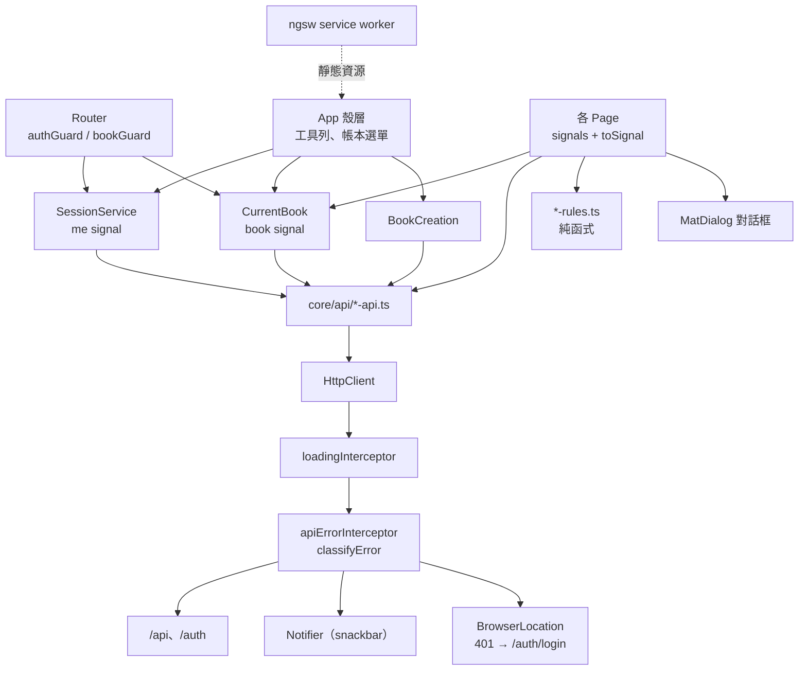
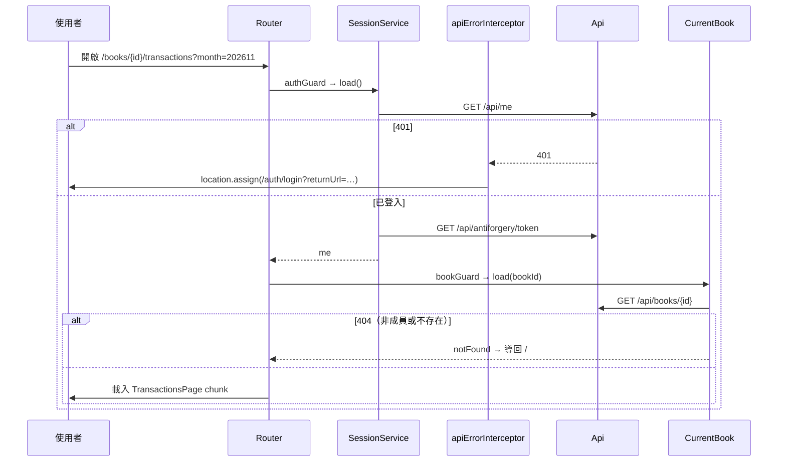
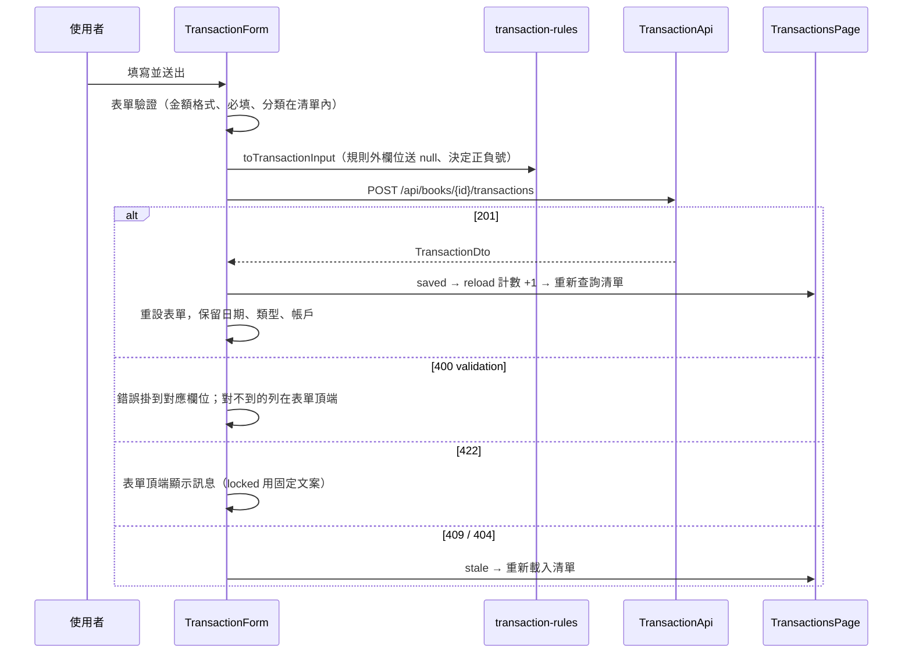
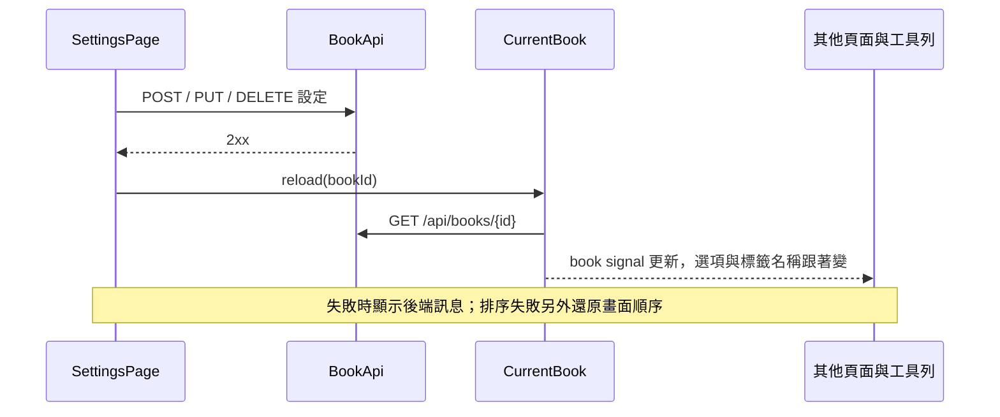

# 模組：web-frontend（Angular SPA）

> 階段 2 深讀，commit `f181aaf`，2026-11-14。領域用語以 `CONTEXT.md` 為準；後端的認證、XSRF、例外對應見 `13-module-identity-access.md`，各 API 的行為見 `10`～`12`。
> **深讀範圍**（48 檔，含 `13` 已讀的 6 檔）：
> - 設定：`web/package.json`、`angular.json`、`ngsw-config.json`、`proxy.conf.json`
> - 殼層：`app.config.ts`、`app.routes.ts`、`app.ts`、`app.html`
> - `core/`：`api/` 全部 9 檔（含 `dto.ts`）、`auth/auth.guard.ts`、`auth/session.service.ts`、`book/` 的 `book.guard`／`current-book`／`book-creation`／`create-book-dialog`、`errors/` 全部 4 檔、`loading/loading-indicator.ts`、`browser-location.ts`
> - `features/`：`home.page`；`transactions/` 的 `transactions.page`／`transaction-form`／`transaction-list`／`transaction-rules`／`edit-transaction-dialog`；`planned-expenses/` 的 `planned-expenses.page`／`planned-expense-rules`／`pay-dialog`；`budgets.page`；`settings/` 的 `settings.page`／`settings-rules`／`delete-book-dialog`；`summary.page`；`reports/` 的 `monthly-report.page`／`yearly-report.page`
> - `shared/`：`month-nav`、`dates`、`chart`
> **未深讀**（相關敘述標【推論】）：所有 `.html` 樣板（`app.html` 除外）與 `.scss`、`planned-expense-dialog`、`recurring-dialog`、`setting-dialog`、`setting-list`、`budget-rules`、`report-rules`、`shared/` 的 `tags`／`tag-chip`／`money`／`confirm-dialog`、`denied.page`、`index.html`、`main.ts`、全部 `*.spec.ts` 與 `web/e2e/`（11 個 spec 加 `fixtures.ts`）、`playwright.config.ts`。這是為了把單一模組的讀檔數控制在 51 個以內而做的取捨。
> 後端 DTO 只以搜尋比對 record 宣告的前幾行，沒有逐欄位全數核對。

## 職責

記帳本唯一的使用者介面：登入後選帳本，在六個分頁（記帳、總覽、預定支出、預算、報表、設定）操作；所有資料來自同源的 `/api`，本身不保存任何業務資料。以 PWA 形式提供（service worker 只快取靜態資源）。

技術組成：Angular 22（standalone、全部 `OnPush`）、Angular Material／CDK、RxJS 7.8、chart.js 4.5、TypeScript 6.0；測試為 Vitest＋Playwright。證據：`web/package.json`、各元件的 `changeDetection: ChangeDetectionStrategy.OnPush`。

## 對外介面

### 路由

| 路徑 | 元件 | 載入方式 | Guard |
|---|---|---|---|
| `''` | `HomePage` | eager | `authGuard` |
| `denied` | `DeniedPage` | eager | 無 |
| `books/:bookId` | —（父層） | — | `authGuard`、`bookGuard` |
| `books/:bookId/transactions` | `TransactionsPage` | `loadComponent` | 繼承父層 |
| `…/summary` | `SummaryPage` | `loadComponent` | 同上 |
| `…/planned-expenses` | `PlannedExpensesPage` | `loadComponent` | 同上 |
| `…/budgets` | `BudgetsPage` | `loadComponent` | 同上 |
| `…/reports` → `reports/monthly` | `MonthlyReportPage` | `loadComponent` | 同上 |
| `…/reports/yearly` | `YearlyReportPage` | `loadComponent` | 同上 |
| `…/settings` | `SettingsPage` | `loadComponent` | 同上 |
| `books/:bookId`（空子路徑） | 轉到 `transactions` | — | — |
| `**` | 轉到 `''` | — | — |

證據：`web/src/app/app.routes.ts`。建立帳本的對話框另外以動態 `import()` 載入（`BookCreation.loadDialog`），chart.js 只被 lazy 的報表頁引用（`shared/chart.ts` 註解）。

### 網址上的狀態（query params）

| 參數 | 用在 | 說明 |
|---|---|---|
| `month`（`yyyymm`） | 記帳、總覽、預定支出、預算、月報、年報（取年份） | 不合法時退回今天所在月份；工具列的連結以 `queryParamsHandling="preserve"` 在分頁間保留 |
| `tag`／`category`／`account` | 記帳 | 篩選；對不到帳本選項的值視為沒有這個條件 |
| `tab` | 設定 | 只讀不寫；決定初始分頁 |

證據：各 page 的 `toSignal(route.queryParamMap…)`、`transactions.page.ts`、`settings.page.ts` → `TAB_KEYS`、`app.html`。

### 呼叫的後端端點

| API service | 端點 |
|---|---|
| `SessionApi` | `GET /api/me`、`GET /api/antiforgery/token`、`POST /auth/logout` |
| `BookApi` | `POST /api/books`、`GET`／`DELETE /api/books/{id}`、`GET …/deletion-preview`、四種設定的新增／修改／封存／解除封存／刪除／排序、`PUT …/lock-date` |
| `TransactionApi` | `GET`／`POST …/transactions`、`PUT`／`DELETE …/transactions/{id}` |
| `PlannedExpenseApi` | `GET`／`POST …/planned-expenses`、`PUT`／`DELETE …/{id}`、`POST …/{id}/pay`、`POST …/generate`、`POST …/refresh` |
| `RecurringPlannedExpenseApi` | `GET`／`POST …/recurring-planned-expenses`、`PUT`／`DELETE …/{id}` |
| `BudgetApi` | `GET …/budgets`、`PUT`／`DELETE …/{categoryId}/default`、`PUT`／`DELETE …/{categoryId}/overrides/{month}` |
| `SummaryApi`、`ReportApi` | `GET …/summary`、`GET …/reports/monthly`、`GET …/reports/yearly` |
| 純連結（`<a href>`） | `…/export/backup.json`、`…/export/<file>`（設定頁與刪除帳本對話框） |
| 整頁導向 | `/auth/login?returnUrl=`（401 時） |

證據：`core/api/*.ts`、`settings.page.ts` → `exportUrl`、`delete-book-dialog.ts` → `backupUrl`、`error-interceptor.ts`。

**前端沒有使用的後端端點**：`GET /api/books`（帳本清單改用 `/api/me` 的 `books`）、`GET …/transactions/{id}`、`GET …/planned-expenses/{id}`、`GET …/audit`。搜尋 `web/src`（排除 spec）找不到 `/audit`，所以稽核歷史目前沒有畫面。

- `GET …/transactions` 一律帶 `budgetMonth`（`TransactionApi.list` 的必要參數），回答了 `10-module-ledger-core.md` 待確認問題 #5。
- 所有 URL 都是 `/` 開頭的相對路徑；各 API 檔頭註解說明這是 Angular XSRF 機制的前提。

## 內部結構

### 分層慣例

| 位置 | 內容 | 慣例 |
|---|---|---|
| `core/api` | 每個資源一個 `@Injectable({ providedIn: 'root' })`，只包 `HttpClient` 呼叫，回 `Observable` | 不含商業邏輯、不處理錯誤 |
| `core/api/dto.ts` | 全部 DTO 與 enum 的 TypeScript 型別 | 手寫對照後端 record（`Guid`→`string`、`DateOnly`→`'yyyy-MM-dd'`、`decimal`→`number`） |
| `core/auth`、`core/book` | 跨頁面的狀態 service | 以 signal 對外，內部用 promise 去重 |
| `features/<name>/*.page.ts` | 頁面元件 | 網址參數 → signal → 資料流；寫入後遞增 reload 計數 |
| `features/<name>/*-rules.ts` | 顯示與表單規則 | 純函式，各自有 spec；註解聲明「只是 UX 篩選，後端 422 才是最終判定」 |
| `shared/` | 日期、金額、月份切換、圖表、確認對話框、標籤 | 無狀態 |

### 狀態管理

沒有 NgRx 或其他 store。三種狀態來源：

1. **全域 service 的 signal**
   - `SessionService.me`：`/api/me` 的結果。`load()` 讓並行呼叫共用同一個 promise，失敗時清掉以便重試；`reload()` 給成員關係改變後使用（建立、刪除帳本、403）。
   - `CurrentBook.book`：目前這本帳的完整設定（帳戶、分類、財務規劃帳戶、標籤、鎖帳日）。只快取一本；`load()` 以 `cached.promise === promise` 防止較慢的舊回應蓋掉新的；`reload()` 給設定寫入後使用；`clear()` 給刪除帳本後使用。
2. **網址 query params**（見上表）：月份與篩選條件是可分享、可用返回鍵回復的狀態。
3. **元件內的 signal**：清單資料採同一個寫法——`toSignal(toObservable(computed(參數 + reload 計數)).pipe(switchMap(呼叫 API)))`，`switchMap` 會取消過期的請求；行內編輯與展開狀態用 `signal`／`linkedSignal`。

證據：`session.service.ts`、`current-book.ts`、`transactions.page.ts`（`transactions`）、`budgets.page.ts`（`rows`、`editing`）。

### HTTP 與錯誤處理

- Interceptor 順序：`loadingInterceptor`（計數進行中的請求，超過 300ms 才顯示進度條）→ `apiErrorInterceptor`。證據：`app.config.ts`、`loading-indicator.ts`。
- `classifyError` 把 `HttpErrorResponse` 轉成 `ApiError` 聯集；之後所有呼叫端收到的錯誤都是這個型別：

| HTTP | `ApiError.kind` | 誰處理 |
|---|---|---|
| 400＋`errors` | `validation`（`fieldErrors`） | 呼叫端：記帳表單對應到欄位，其他頁面顯示第一則訊息 |
| 400＋XSRF 標題 | `antiforgery` | interceptor：提示重新整理頁面 |
| 400 其他、5xx、網路錯誤 | `unavailable` | interceptor：「暫時無法連線，請稍後再試」 |
| 401 | `unauthorized` | interceptor：整頁導向 `/auth/login?returnUrl=目前路徑`，回 `NEVER` |
| 403 | `forbidden` | 呼叫端（目前只有建立帳本） |
| 404 | `notFound` | 呼叫端：提示已不存在並重新載入；`bookGuard` 導回首頁 |
| 409 | `conflict` | 呼叫端：提示已在其他裝置修改並重新載入 |
| 422 | `domain`（`code`、`message`） | 呼叫端：`code === 'locked'` 用固定文案，其餘顯示後端訊息 |

證據：`core/errors/api-error.ts`、`error-interceptor.ts`、各 page 的 `run`／`onSaveFailed`／`onDeleteFailed`。

- **XSRF**：`app.config.ts` 沒有 XSRF 設定，【推論】使用 Angular `HttpClient` 預設行為（讀 `XSRF-TOKEN` cookie、對相對 URL 的非 GET 請求加 `X-XSRF-TOKEN`）。token 在 `SessionService.fetch` 取得 `/api/me` 之後呼叫一次 `/api/antiforgery/token` 取得。
- **樂觀並行**：交易、預定支出、週期項目的修改與刪除都帶回讀到的 `version`；預算與帳本設定不帶（與後端一致，見 `10` 風險 #4、`11`「並行控制」）。

### 記帳表單的規則表

`transaction-rules.ts` 的 `KIND_RULES` 為 13 種 `TransactionKind` 各定義一列：標籤、主帳戶與對方帳戶可選的帳戶類型、是否需要分類／財務規劃帳戶／本金、金額是否帶正負號、清單上的方向、是否能在 Web 編輯（`BalanceAdjustment` 為否）。`TransactionForm.applyKindRule` 在切換類型時依規則清掉不允許的選擇並調整必填；`toTransactionInput` 把規則外的欄位一律送 `null`。

封存的帳戶、分類、財務規劃帳戶、標籤不出現在選項中，除非正在編輯的那筆交易已經用到（`selectable`、`keepIdsOf`）。這證實了 `11-module-planning.md` 風險 #6 的推論：封存項目的排除在記帳表單是由前端負責。

### 日期與金額

- 日期一律以本機時間組字串或直接切字串，不經 `toISOString`（UTC+8 的 00:00–08:00 會得到前一天）。證據：`shared/dates.ts`。
- 「今天」與「本月」取自瀏覽器時鐘（`new Date()`）；總覽頁在本月不帶 `asOf`，交給後端以台北時間決定。證據：`summary.page.ts` → `balanceAsOf`。
- 金額在前端是 JavaScript `number`；總覽頁加總後四捨五入到分。證據：`summary.page.ts` → `sumBalances`。

### PWA

- `provideServiceWorker('ngsw-worker.js')`，非 dev mode 啟用，`registerWhenStable:30000`。
- `ngsw-config.json`：`app` 群組 prefetch `index.html`、所有 `*.js`／`*.css`；`assets` 群組 lazy。沒有 `dataGroups`，API 回應不快取。`navigationUrls` 排除 `/auth/**`、`/api/**`、`/health`、`/oauth/**`。
- 搜尋 `web/src` 找不到 `SwUpdate`：沒有自訂的版本更新流程。
- Production build 的 budget：initial 700kB 警告／1MB 錯誤，單一元件樣式 4kB／8kB。證據：`angular.json`。

### 開發環境

`ng serve` 以 SSL 跑在 4300，`/api` 與 `/auth` 代理到 `https://localhost:5001`（`secure: false`）。沒有 `environments/`。證據：`angular.json`、`proxy.conf.json`。

## 資料存取

| 資料 | 儲存 | 讀/寫 | 交易邊界 | 證據 |
|---|---|---|---|---|
| 登入身分與所屬帳本 | 記憶體（`SessionService`） | 每次整頁載入讀一次；成員關係改變時重讀 | — | `session.service.ts` |
| 目前帳本的設定 | 記憶體（`CurrentBook`） | 進入帳本時讀一次；本頁寫入設定後重讀 | — | `current-book.ts` |
| 各頁清單與報表 | 元件內 signal | 隨月份、篩選、reload 計數重讀 | — | 各 page |
| 靜態資源 | service worker cache | 由 ngsw 管理 | — | `ngsw-config.json` |
| `localStorage`／`sessionStorage`／IndexedDB | 未使用 | — | — | 搜尋 `web/src`（排除 spec）無命中 |

前端沒有跨請求的交易概念：每個使用者動作對應一個 API 請求，一致性由後端的單次 `SaveChanges` 負責。唯一的例外是「建立帳本後重讀 `me` 再導頁」「刪除帳本後重讀 `me`、導頁、清掉 `CurrentBook`」這類連續步驟，順序在註解中說明（`book-creation.ts` → `enter`、`settings.page.ts` → `leaveDeletedBook`）。

## 關鍵流程

### 進入應用程式

### 新增交易

### 修改設定後的同步

## 風險與觀察

| # | 項目 | 嚴重度 | 證據 | 說明 |
|---|---|---|---|---|
| 1 | 換月份後，載入中或載入失敗時，新月份標題下仍顯示上個月的資料 | 中 | `transactions.page.ts`（「載入失敗時 interceptor 已通知，保留上一次的清單」、`catchError(() => EMPTY)`）、`planned-expenses.page.ts`、`budgets.page.ts`、`summary.page.ts` 同樣寫法；對照 `monthly-report.page.ts`／`yearly-report.page.ts`（回應標上月份，「不能在新月份的標題下留著上個月的數字」） | 報表兩頁已經把這個問題當成缺陷修掉，其餘四頁還是舊寫法。失敗時有 snackbar 提示，但 4 秒後消失，畫面上留著的是標題與內容不一致的財務數字（總覽頁是餘額與月可用餘額）。預算頁只處理了「編輯狀態」的部分（換月即取消編輯）。 |
| 2 | DTO 與後端規則靠手寫同步，沒有產生或契約檢查 | 中 | `dto.ts` 檔頭註解「手寫對照後端 record」；repo 內沒有 OpenAPI／產生工具的設定（`package.json` 無相關相依）；重複的常數見下列 | 抽查的 record（`BookDto` 系列、`LedgerSummaryDto`、`BookDeletionPreview`、報表與預算 DTO）目前一致。重複定義且只靠註解提醒要一起改的有：每人 5 本上限（`app.html` 寫死在文案裡，對照 `CreateBook.MaxOwnedBooks`）、每筆交易 4 個標籤（`shared/tags.ts` 對照 `Transaction.MaxTags`）、歸屬月份年份範圍（`dates.ts` 對照 `BudgetMonth.MinYear`／`MaxYear`）、帳本名稱長度 100、XSRF 錯誤標題字串（`api-error.ts` 對照 `AntiforgeryFilter.InvalidTokenTitle`）、13 種交易類型可用的帳戶類型（`KIND_RULES` 對照 `TransactionFactory`）、付款帳戶類型（`pay-dialog.ts`）。後端改了而前端沒跟上時，TypeScript 編譯不會報錯；是否有測試能抓到，取決於未讀的 e2e。 |
| 3 | 伺服器錯誤一律顯示成「暫時無法連線」 | 低 | `api-error.ts` → `classifyError`（非 validation、非 XSRF 的 400，以及 `default` 分支都回 `unavailable`） | 500（包含 `13` 風險 #3 的唯一索引違反）、參數格式錯誤的 400、網路中斷在使用者眼中是同一句話，會讓人以為重試就好。 |
| 4 | 帳本設定只在本頁寫入後重讀，其他裝置的變更要整頁重新載入才看得到 | 低 | `current-book.ts`（「只快取目前這一本；同一個 bookId 不重複請求」）；`settings.page.ts` → `run`（成功後 `reload`） | 另一位成員新增分類或帳戶後，這一端的清單會出現空白的分類或帳戶名稱（`transaction-list.ts` 找不到時回空字串），下拉選單也沒有新選項。鎖帳日同理：這一端仍允許點開編輯，送出後才被後端 422 擋下。 |
| 5 | 金額輸入有三種做法，小數位數的限制不一致 | 低 | `transaction-form.ts`（文字框＋`AMOUNT_PATTERN`，最多兩位小數）；`budget-rules.ts` 註解（文字框、`inputmode="decimal"`）；`pay-dialog.ts`、`planned-expense-dialog.ts`、`recurring-dialog.ts`、`setting-dialog.ts`（`type="number"`，其中期初餘額沒有 `step`） | 【推論】`type="number"` 的 `step` 不會讓 Angular 表單變成 invalid，所以對話框可以送出超過兩位小數的金額；後端也沒有小數位數驗證（`10` 風險 #10）。記帳表單的註解說明了改用文字框的理由，但其他表單沒有跟進。 |
| 6 | 「今天」取自瀏覽器時區，後端一律用台北時間 | 低 | `shared/dates.ts`、`summary.page.ts` → `balanceAsOf`、各 page 的 `budgetMonthOf(new Date())`；後端 `TaipeiTime` | 在台灣以外的時區使用時，預設月份、預設交易日期、總覽頁判斷「是不是本月」可能與後端差一天（月底月初差一個月）。`web/src/app/timezone.spec.ts` 存在但未讀，【推論】測試環境有固定時區。 |
| 7 | 沒有版本更新流程 | 低 | 搜尋無 `SwUpdate`；`ngsw-config.json`（`app` 群組 prefetch）；`book-creation.ts`（註解「chunk 載入失敗（離線、部署換版後舊檔不存在）」） | 【推論】service worker 下載新版後要等下一次重新載入才生效，長時間開著的分頁會繼續跑舊版前端去呼叫新版 API；DTO 有變動時（風險 #2）會出現無法解釋的錯誤。動態載入失敗只有建立帳本對話框有處理，路由的 lazy chunk 沒有看到對應的處理。 |
| 8 | 401 以整頁導向處理，未送出的輸入會遺失 | 低 | `error-interceptor.ts`（`location.assign` 後回 `NEVER`） | Cookie 是 14 天 sliding，正常使用不易遇到；遇到時（例如記帳表單填到一半）回來後表單是空的。`returnUrl` 會帶回原頁面與月份。 |
| 9 | `/api/me` 因非 401 的原因失敗時沒有對應的畫面 | 低 | `auth.guard.ts`（只 `await load()`，註解「只需處理成功路徑」）；`session.service.ts` → `load`（失敗時重新擲出） | 【推論】離線或後端 5xx 時 guard 的 promise reject，導覽失敗，使用者只看到 snackbar 與空白的殼層（工具列也不顯示，因為 `me` 還沒有值）。PWA 雖然能離線開啟殼層，但沒有離線可用的功能，也沒有重試入口。 |
| 10 | 頁面之間重複的樣板程式碼 | 低 | 六個 page 各自一份相同的 `bookId`／`month` signal；三個 page 各自一份幾乎相同的 `run`（成功通知＋依 `ApiError.kind` 分派）；`categoryLabel` 與「自己與主分類都未封存」的判斷在 `transaction-rules.ts` 與 `planned-expense-rules.ts` 各有一份（分隔符號還不同：` / ` 與 ` › `） | 目前行為一致。風險 #1 就是這種複製貼上的後果：修正只套用在其中兩頁。 |
| 11 | service worker 的導覽排除清單與後端路徑不完全對應 | 低 | `ngsw-config.json`（排除 `/auth/**`、`/api/**`、`/health`、`/oauth/**`）對照 `SpaHosting.BackendPrefixes`（另有 `mcp`、`.well-known`，且 `health` 底下還有 `/health/ready`） | 已安裝 service worker 的瀏覽器直接開 `/health/ready`、`/mcp`、`/.well-known/…` 時，【推論】會拿到 SPA 的 `index.html` 而不是後端回應。這些路徑平常不是給瀏覽器導覽用的，只影響人工排查。 |
| 12 | 稽核歷史與部分後端端點沒有前端入口 | 低 | 搜尋 `web/src` 無 `/audit`；`core/api` 沒有對應 `GET /books`、單筆查詢的呼叫 | 稽核記錄只能透過備份檔或直接查資料庫閱讀（補充 `13` 風險 #12）。是否刻意延後，程式碼看不出來。 |
| 13 | `PlannedExpenseApi.pay` 的回傳型別是 `unknown` | 低 | `planned-expense-api.ts` 第 29–31 行；後端回 `{ plannedExpense, transaction }`（`11`「對外介面」） | 目前呼叫端不使用回傳值（付款後重新載入清單），所以沒有實際影響；`dto.ts` 也沒有對應的型別。 |

## 待確認問題

1. #1：記帳、總覽、預定支出、預算四頁在換月後載入失敗時保留舊資料，是刻意的（避免畫面清空）還是尚未比照報表頁修正？
2. #2：是否考慮由後端產生 OpenAPI 再產生前端型別，或至少加一個契約測試？`web/e2e/` 的 11 個 spec 目前能涵蓋多少 DTO 欄位（未讀）？
3. #5：預定支出、週期項目、付款、期初餘額是否允許超過兩位小數？若不允許，應在前端還是後端擋（對應 `10` 風險 #10）？
4. #6：是否需要支援在台灣以外的時區使用？
5. #7：部署新版後，是否需要提示使用者重新載入（`SwUpdate`）？目前是否遇過舊分頁呼叫新 API 出錯的情況？
6. #12：稽核歷史的畫面是否在規劃中？
7. 未讀的樣板、對話框、`*-rules.ts` 與全部測試檔若要納入，建議另開一次補讀；本文對它們的敘述都標了【推論】。
