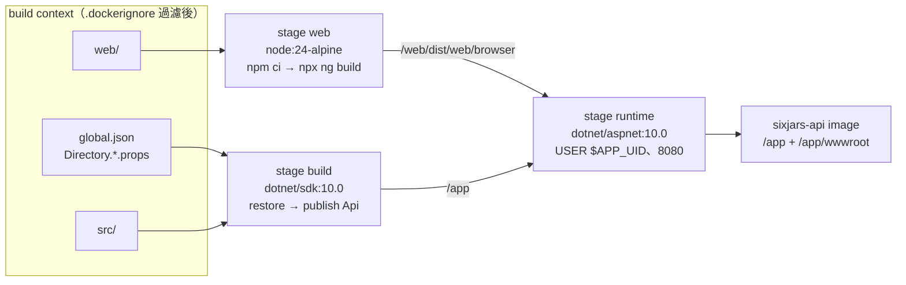
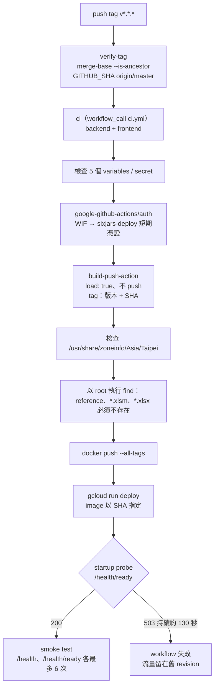
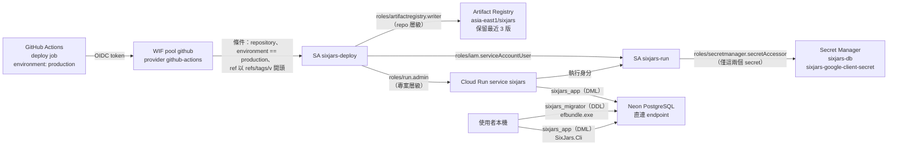
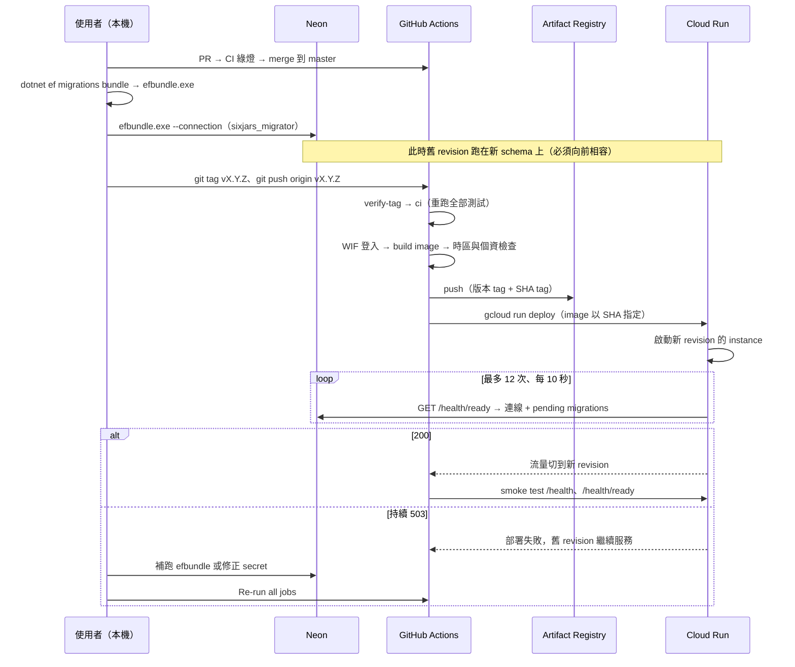
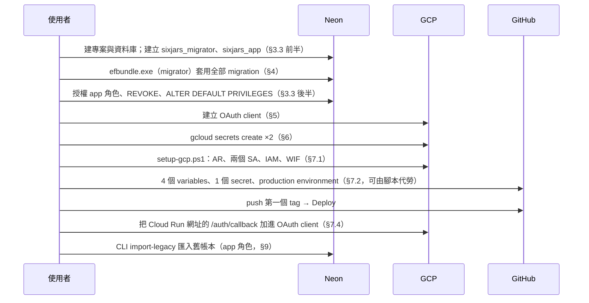
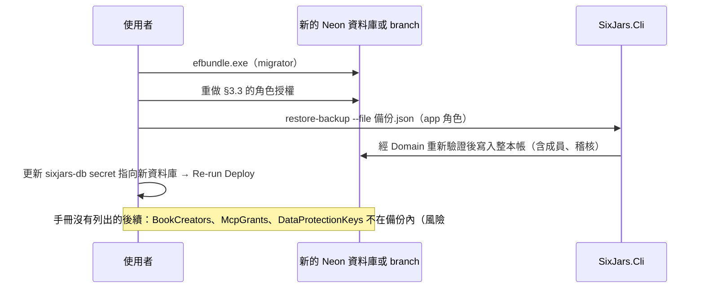

# 模組：deployment-ops（建置、CI/CD、GCP 設定、維運手冊）

> 階段 2 深讀，commit `f181aaf`，2026-11-14。領域用語以 `CONTEXT.md` 為準；認證、forwarded headers、SPA hosting 的程式面見 `13-module-identity-access.md`，MCP 見 `14-module-remote-mcp.md`，CLI 指令見 `15-module-legacy-import-cli.md`，本文不重複。
> **深讀範圍**（全文）：`Dockerfile`、`.dockerignore`、`.github/workflows/ci.yml`、`.github/workflows/deploy.yml`、`scripts/setup-gcp.ps1`、`docs/deploy.md`、`docs/adr/0012-…`、`docs/adr/0010-…`、`global.json`、`.env.example`、`web/playwright.config.ts`、`src/SixJars.Api/Program.cs`、`Endpoints/HealthEndpoints.cs`、`Persistence/DesignTimeDbContextFactory.cs`、`Persistence/SixJarsConnectionString.cs`。
> **只讀片段**（grep 命中的行）：`.gitignore`、`Application/Common/TaipeiTime.cs`、`Application/Books/DeleteBook.cs`、`docs/superpowers/plans/2026-10-04-p2-backend-api.md`、`docs/superpowers/specs/2026-10-19-create-book-backend-design.md`。
> **未讀／無法從 repo 確認**（相關敘述標【推論】）：GCP 專案、Neon、GitHub repository 的**實際設定**（IAM、environment、branch protection、資料庫角色授權的現況）；ADR 0004／0007 全文；`tests/Shared/PostgresFixture.cs`；`web/angular.json` 的 build configuration。Cloud Run、Artifact Registry、Workload Identity Federation 的平台行為皆依一般認知，未以官方文件逐項查證。
> `docs/deploy.md` 是手冊不是程式碼：本文把它當作「預期的操作方式」的證據，不代表正式環境確實如此設定。

## 職責

1. **把 repo 變成可執行的 image**：三階段 Docker build，前端與後端合成一個 container。證據：`Dockerfile`。
2. **合併前的品質關卡**：PR 與 push `master` 時跑後端與前端的全部測試。證據：`.github/workflows/ci.yml`。
3. **發版**：push `v*.*.*` tag → 驗證 → 重跑 CI → build／檢查／push image → `gcloud run deploy` → smoke test（ADR 0012）。證據：`.github/workflows/deploy.yml`。
4. **一次性雲端設定**：Artifact Registry、兩個 service account、IAM、Workload Identity Federation、GitHub variables 與 environment。證據：`scripts/setup-gcp.ps1`。
5. **仍由人在本機做的事**（刻意不自動化）：資料庫角色與授權、migration bundle、Secret Manager 的值、OAuth client、舊帳本匯入、成員管理、備份與還原、回滾。證據：`docs/deploy.md` §3–§6、§9–§11、§7.5。

**不在本模組、也不存在的東西**：`docker-compose*.yml`、staging 環境、自訂網域、IaC（Terraform 等）、排程工作、監控與告警設定、Dependabot／image 掃描。證據：`00-inventory.md`「設定管理」；Glob `.github/**` 只有兩個 workflow；ADR 0012「Considered Options」（staging 與自訂網域已否決）。

## 對外介面

本模組沒有 HTTP endpoint，入口是「觸發條件」與「人工指令」。

| 入口 | 觸發者 | 說明 | 證據 |
|---|---|---|---|
| `CI` workflow | `pull_request`、push `master`、`workflow_call` | `backend`、`frontend` 兩個 job 平行；同一個 ref 的舊 run 會被取消 | `ci.yml` 第 3–12 行 |
| `Deploy` workflow | push 符合 `v*.*.*` 的 tag | `verify-tag` → `ci` → `deploy` 依序；全域只允許一個部署在跑，排隊中的不取消 | `deploy.yml` 第 7–14 行 |
| Deploy 的 **Re-run all jobs** | 人（GitHub UI） | 同一個 tag 重新部署：補跑 migration 後、更新 secret 值後 | `docs/deploy.md` §7.3 |
| `scripts/setup-gcp.ps1 -ProjectId …` | 人（本機，需 `gcloud auth login`） | 冪等；`-SetGitHubVariables`、`-RemoveComputeSecretAccess` 為選用 | `setup-gcp.ps1` 第 37–45 行 |
| `dotnet ef migrations bundle` → `efbundle.exe --connection` | 人（本機，migrator 角色） | 每次含 schema 變更的發版，在 merge 之後、push tag 之前 | `docs/deploy.md` §4、§7.3 |
| `gcloud secrets create`／`versions add` | 人（本機） | `sixjars-db`、`sixjars-google-client-secret` | `docs/deploy.md` §6 |
| `gcloud run services update-traffic` | 人（本機） | 回滾到舊 revision；migration 不回滾 | `docs/deploy.md` §7.5 |
| `GET /health`、`GET /health/ready` | Cloud Run startup probe、Deploy 的 smoke test | 實作屬 identity-access；本模組是唯一的呼叫者 | `HealthEndpoints.cs`、`deploy.yml` 第 128、132–145 行 |

### 設定項的來源與去向

| 設定鍵 | 正式環境的來源 | 交給 app 的方式 | 證據 |
|---|---|---|---|
| `ConnectionStrings__SixJars` | Secret Manager `sixjars-db`（值 `<REDACTED>`，app 角色） | `--set-secrets …:latest` | `deploy.yml` 第 127 行 |
| `Authentication__Google__ClientSecret` | Secret Manager `sixjars-google-client-secret`（`<REDACTED>`） | `--set-secrets …:latest` | 同上 |
| `Authentication__Google__ClientId` | GitHub repository variable `GOOGLE_CLIENT_ID`（非機密） | `--set-env-vars` | `deploy.yml` 第 126 行 |
| `MediatR__LicenseKey` | GitHub Actions secret `MEDIATR_LICENSE_KEY`（`<REDACTED>`） | `--set-env-vars`（在 revision 設定中為明碼，ADR 0012 的已知取捨） | `deploy.yml` 第 110、126 行 |
| `ASPNETCORE_ENVIRONMENT` | workflow 寫死 `Production` | `--set-env-vars` | 同上 |
| `ASPNETCORE_HTTP_PORTS` | image 內寫死 `8080` | `Dockerfile` 的 `ENV` | `Dockerfile` 第 39 行 |
| `Mcp__AllowedClientIdHosts__N` | **目前沒有設定** → 預設只有 `claude.ai` | 要加必須改 `deploy.yml`（`--set-env-vars` 每次整組覆寫） | `deploy.yml` 第 126 行；`docs/deploy.md` §13.4 |
| `GCP_PROJECT_ID`、`GCP_WIF_PROVIDER`、`GCP_DEPLOYER_SA` | GitHub repository variables | 只給 workflow 用，不進 container | `deploy.yml` 第 55–67 行 |
| migrator 角色的連線字串 | 只存在使用者本機的 shell 變數 | 不進 Secret Manager、GitHub、Cloud Run | `docs/deploy.md` §4、§12 |

repo 內沒有任何真實值：`.env.example` 全是 placeholder，`.gitignore` 排除 `.env`、`.env.*`（保留 `.env.example`）、`reference/`、`efbundle.exe`。

## 內部結構

### 建置：三階段 image

| 設計 | 理由（出自註解） | 證據 |
|---|---|---|
| 前後端合一個 image、同源提供 | 前端輸出複製到 `/app/wwwroot`，由 `UseSpaHosting` 提供；`dotnet build`／`dotnet test` 不依賴 Node | `Dockerfile` 第 2、35–36 行 |
| 先複製 `package*.json`／`*.csproj` 再複製原始碼 | 原始碼改動時 npm 與 NuGet 的 layer 可重用 | `Dockerfile` 第 9、19 行 |
| 只 restore／publish `SixJars.Api`（連帶 Domain、Application、Infrastructure） | `SixJars.Cli` 與 tests 不進 image；CLI 只在本機以 `dotnet run` 執行 | `Dockerfile` 第 21–25、29 行 |
| `-p:UseAppHost=false`、`ENTRYPOINT ["dotnet", "SixJars.Api.dll"]` | 只發佈 framework-dependent 的 dll | `Dockerfile` 第 29、44 行 |
| 非 root（`USER $APP_UID`） | `.NET` 官方 image 內建的 `app` 使用者 | `Dockerfile` 第 42–43 行 |
| 固定監聽 8080，部署時不指定 `--port` | 與 Cloud Run 預設注入的 `PORT=8080` 一致 | `Dockerfile` 第 38–40 行；`docs/deploy.md` §7.4 |
| 個資隔離兩道：`.dockerignore` 排除 `reference/`、`**/*.xlsm`、`**/*.xlsx`、`**/.env*`；`Dockerfile` 只 `COPY src/` 與 `web/` | 舊 Excel 帳本絕不可進 image | `.dockerignore` 第 2–7 行；`Dockerfile` 第 27 行 |

image 沒有 `HEALTHCHECK`，也沒有安裝 `tzdata` 的步驟；`Asia/Taipei` 時區檔是否存在取決於 base image，由 deploy 的檢查步驟把關（見下）。`TaipeiTime` 以 static 欄位呼叫 `TimeZoneInfo.FindSystemTimeZoneById("Asia/Taipei")`（`Application/Common/TaipeiTime.cs` 第 6 行），找不到時區時第一次使用就會失敗。

### CI

| Job | 步驟 | 需要的外部資源 | 證據 |
|---|---|---|---|
| `backend` | `setup-dotnet`（讀 `global.json`）→ `dotnet build SixJars.slnx -c Release` → `dotnet test --solution … --no-build` | runner 內建的 Docker（Testcontainers 起 `postgres:17-alpine`）；不需要任何 secret | `ci.yml` 第 15–24 行 |
| `frontend` | `setup-node` 24（npm 快取）→ `npm ci` → `npx ng build` → `npx ng test --watch=false` → 安裝 chromium → `npx playwright test` | 無；Playwright 自己起 `ng serve --port 4301 --ssl false`，API 全部 mock | `ci.yml` 第 26–45 行；`web/playwright.config.ts` |

- Acceptance 測試讀的舊帳本是個資、不在 repo，CI 上一律 skip（`ci.yml` 第 23 行註解）。所以「真實舊帳本匯入後數字與 Excel 一致」只在使用者本機驗證過。
- Node 版本在 `ci.yml`（`node-version: 24`）與 `Dockerfile`（`node:24-alpine`）各寫一次，靠註解提醒同步。.NET SDK 則由 `global.json` 單一來源決定 CI 的版本，但 `Dockerfile` 用的是 `dotnet/sdk:10.0` 浮動 tag（見風險 #6）。
- `concurrency: ci-${{ github.ref }}` 加 `cancel-in-progress: true`：同一個 PR 連續 push 只跑最後一次。

### Deploy pipeline

| 步驟 | 重點 | 證據 |
|---|---|---|
| `verify-tag` | tag 指向的 commit 必須是 `origin/master` 的祖先；否則報錯要求先 merge | `deploy.yml` 第 20–32 行 |
| `ci` | 以 `workflow_call` 重跑整份 `ci.yml`，不沿用 PR 當時的結果 | `deploy.yml` 第 34–36 行 |
| `deploy` 的權限 | workflow 預設 `contents: read`；只有 `deploy` job 加 `id-token: write`；綁定 `production` environment | `deploy.yml` 第 16–17、42–47 行 |
| 先檢查再推送 | image 先 `load` 到 runner，通過時區與個資兩項檢查才 `docker push`；不合格的 image 不會出現在 Artifact Registry | `deploy.yml` 第 82–106 行 |
| build 快取 | `cache-from`／`cache-to: type=gha,mode=max`；`provenance: false`（單一 linux/amd64 manifest） | `deploy.yml` 第 87–93 行 |
| Cloud Run 參數 | `asia-east1`、service `sixjars`、runtime SA `sixjars-run`、`--allow-unauthenticated`、min 0／max 2、512Mi | `deploy.yml` 第 118–129 行 |
| startup probe | `httpGet /health/ready:8080`，`initialDelaySeconds=10`、`periodSeconds=10`、`timeoutSeconds=8`、`failureThreshold=12`（最長約 130 秒，涵蓋 Neon 喚醒） | `deploy.yml` 第 128 行；ADR 0012 |
| smoke test | 對服務網址打 `/health`、`/health/ready`，每個路徑最多 6 次、間隔 10 秒、單次 30 秒逾時 | `deploy.yml` 第 132–145 行 |

沒有指定的 Cloud Run 參數：`--cpu`、`--concurrency`、`--timeout`、`--execution-environment`、`--cpu-boost`、liveness probe。【推論】`gcloud run deploy` 對沒帶的旗標會沿用服務目前的值，所以這些設定的實際值不在 repo 裡。

### 身分與信任邊界

證據：`setup-gcp.ps1` 第 127–176 行；`docs/deploy.md` §3.3、§9、§12。

| 邊界 | 內容 | 證據 |
|---|---|---|
| GitHub → GCP | 不存 service account key。WIF provider 的 `attribute-condition` 要求三項同時成立：指定 repo、`environment == 'production'`、`ref` 以 `refs/tags/v` 開頭 | `setup-gcp.ps1` 第 159–166 行 |
| GitHub 端的第二道 | `production` environment 的 deployment policy 只允許 tag 規則 `v*`。兩道缺一不可：沒有 environment，OIDC token 就沒有 `environment` claim，GCP 會拒絕 | `setup-gcp.ps1` 第 192–201 行；`docs/deploy.md` §7.2 |
| 重跑以腳本為準 | provider 已存在時仍執行 `update-oidc` 覆寫 mapping 與 condition，避免 console 手改放寬信任範圍 | `setup-gcp.ps1` 第 167–172 行 |
| deployer 不能讀 secret | `sixjars-deploy` 沒有 `secretAccessor`；只有 `sixjars-run` 有，且範圍是兩個具名 secret | `setup-gcp.ps1` 第 127–131、147–153 行 |
| 資料庫角色分離 | `sixjars_migrator`（擁有物件、可 DDL）只在本機；`sixjars_app`（DML）給 Cloud Run 與 CLI。`AuditEntries` 撤銷 UPDATE／DELETE、`__EFMigrationsHistory` 只給讀 | `docs/deploy.md` §3.3 |
| 新表的授權 | `ALTER DEFAULT PRIVILEGES FOR ROLE sixjars_migrator` 讓之後 migration 建的表與 sequence 自動給 app DML 權限 | `docs/deploy.md` §3.3 第 235–239 行 |
| 腳本不經手機密 | `setup-gcp.ps1` 只確認 secret 存在（`secrets describe`），不讀寫值；`MEDIATR_LICENSE_KEY` 只提示使用者自己 `gh secret set` | `setup-gcp.ps1` 第 13、91–96、213–215 行 |

### Migration 與 schema 檢查

- **不在 app 啟動時 migrate，也不在 pipeline 裡 migrate**。理由：多個 instance 同時啟動會競爭；app 角色沒有 DDL 權限；DDL 憑證不離開本機。證據：`docs/deploy.md` §4、ADR 0012（否決「pipeline 跑 migration」與「pipeline 直接比對 `__EFMigrationsHistory`」）。
- **補償機制**：`/health/ready` 以 `GetPendingMigrationsAsync` 檢查「這個版本的 assembly 認得、但資料庫還沒套用」的 migration，有就回 503。新 revision 因此起不來，流量留在舊版。證據：`HealthEndpoints.cs` → `Ready`。
- **可診斷性**：`Ready` 自己開底層連線，在 log 區分「連不上資料庫」「有 N 個 migration 未套用（列出名稱）」「讀不到 migration 歷史」三種原因。這是 `v1.0.1` 部署事故（secret 裡的密碼打錯，症狀與漏跑 migration 相同）之後在 `v1.0.2` 加的。證據：`HealthEndpoints.cs` 的 remarks；`docs/deploy.md` §7.3。
- **bundle 的產生**：`--project` 與 `--startup-project` 都指向 `SixJars.Infrastructure`，靠 `DesignTimeDbContextFactory`（寫死一個不會連線的 localhost 字串）建立 DbContext，真正的連線字串以 `--connection` 在執行時傳入。證據：`DesignTimeDbContextFactory.cs`；`docs/deploy.md` §4。
- **向前相容是紀律，不是檢查**：順序固定為「merge → 本機 migrate → push tag」，中間舊版仍在服務；刪欄位或改名要分兩次發版。證據：ADR 0012「Consequences」。

### 回滾與映像保留

- 新 revision 起不來：Cloud Run 不切流量，不需要動作。
- 上線後才發現問題：`gcloud run services update-traffic --to-revisions <舊>=100` 手動切回；之後最新 revision 不會自動拿回流量，要打新 tag 重新部署。migration 不回滾。
- Artifact Registry 的 cleanup policy 是「全部符合刪除、但保留最近 3 個版本」，由 GCP 每天背景執行；更舊的 revision 會因 image 被刪而無法再啟動。同一次部署的版本 tag 與 SHA tag 指向同一個 image。

證據：`docs/deploy.md` §7.5；`setup-gcp.ps1` 第 98–117 行；`deploy.yml` 第 89–91 行。

### 閒置策略

min instances 0 加上 Neon 自動暫停，**刻意不設定定時 ping**（ADR 0007，使用者 2026-10-04 確認）：閒置後第一個請求要等 Cloud Run 冷啟動加 Neon 喚醒約數秒，換取兩邊都留在免費額度內。受影響的地方：startup probe 的 130 秒上限、MCP client 對 token 端點的 10 秒逾時（`docs/deploy.md` §13.6 建議先打 `/health/ready` 暖機）。證據：`docs/deploy.md` §8。

## 資料存取

本模組不透過 EF Core 讀寫業務資料，但它決定了「誰能以什麼權限碰資料庫與機密」。

| 資料 | 儲存 | 讀/寫 | 交易邊界 | 證據 |
|---|---|---|---|---|
| schema（DDL）＋`__EFMigrationsHistory` | Neon PostgreSQL | 寫：`efbundle.exe`（migrator 角色，本機） | 【推論】EF Core 逐個 migration 套用；已套用的略過，可重複執行 | `docs/deploy.md` §4 |
| `__EFMigrationsHistory` | Neon PostgreSQL | 讀：`/health/ready`（app 角色） | 單次查詢；連線由 endpoint 自己開、`finally` 關 | `HealthEndpoints.cs` → `Ready` |
| 角色與授權（`GRANT`／`REVOKE`／`ALTER DEFAULT PRIVILEGES`） | Neon PostgreSQL | 寫：使用者手動在 SQL Editor／`psql` 執行 | 無；不在 migration 裡，也沒有版本記錄 | `docs/deploy.md` §3.3 |
| 兩個 secret 的值 | Secret Manager | 寫：使用者以 `gcloud` 加版本；讀：`sixjars-run`（Cloud Run 啟動 instance 時） | — | `docs/deploy.md` §6；`deploy.yml` 第 127 行 |
| image | Artifact Registry | 寫：`sixjars-deploy`；刪：cleanup policy | — | `deploy.yml` 第 106 行；`setup-gcp.ps1` 第 98–117 行 |
| 全部業務資料（匯入、成員、還原、撤銷 MCP） | Neon PostgreSQL | 寫：本機 CLI（app 角色） | 各 command 自己的邊界，見 `15-module-legacy-import-cli.md` | `docs/deploy.md` §9–§11、§13.5 |
| 帳本備份 JSON | 使用者自己的儲存位置 | 寫：使用者以瀏覽器下載 `/export/backup.json` | — | `docs/deploy.md` §11 |

- **連線**：app 與 migration 都用 Neon 的直連 endpoint（不含 `-pooler`），靠 Npgsql 自己的連線池；`SixJarsConnectionString.ForNpgsql` 一律關閉 GSS 加密（Neon 不支援，aspnet image 沒有 `libgssapi_krb5` 會印出誤導的錯誤）。證據：`docs/deploy.md` §3.2；`SixJarsConnectionString.cs`。
- **並發**：`deploy.yml` 的 `concurrency: deploy-production`（不取消進行中的）保證同時只有一個部署；migration 由單一使用者手動執行，沒有鎖。Cloud Run 最多 2 個 instance，各自持有 process 內的帳本快取（靠 `xmin` 版本比對失效，見 `10-module-ledger-core.md`）。
- **重試**：pipeline 內只有 smoke test 有重試迴圈；startup probe 的 12 次即是對 Neon 喚醒的容忍。應用程式本身沒有連線重試（各模組文件已記）。

## 關鍵流程

### 發版（含 schema 變更）

### 一次性設定（新環境從零開始）

### 災難復原（依 `docs/deploy.md` §11，未實際演練）

最後兩步是【推論】：`docs/deploy.md` §11 只寫到 `restore-backup`，沒有寫如何把正式服務切到還原後的資料庫。

## 風險與觀察

| # | 項目 | 嚴重度 | 證據 | 說明 |
|---|---|---|---|---|
| 1 | 手冊撤銷了 app 角色對 `AuditEntries` 的 DELETE，但「刪除帳本」會刪這張表 | 高（2026-11-14 使用者已確認正式環境沒有這個權限，見 `90-tech-debt.md` TD-01） | `docs/deploy.md` 第 231 行（`REVOKE UPDATE, DELETE ON "AuditEntries" FROM sixjars_app`）；`Application/Books/DeleteBook.cs` 第 47 行（`db.AuditEntries.Where(…).ExecuteDeleteAsync`）；ADR 0010；`docs/superpowers/plans/2026-10-04-p2-backend-api.md` 第 2034 行（「日後若要清理稽核記錄，要調整這條授權」） | REVOKE 是 P2（2026-10）加的強化，刪除帳本（ADR 0010、issue #6）在之後才做，手冊沒有跟著調整；全 repo 搜尋 `GRANT`／`REVOKE` 找不到後續修正。【推論】正式環境若照 §3.3 授權，`DELETE /api/books/{id}` 會在這一行得到 PostgreSQL 的 permission denied；該例外不是 `DbUpdateConcurrencyException`，`ApiExceptionHandler` 不處理，回 500，而 `DeleteBook` 的明確 transaction 會整個 rollback（資料不受損）。【推論】CI 抓不到，因為 Testcontainers 的測試以容器的超級使用者連線，不經角色分離（`PostgresFixture` 未讀）。正式環境的實際授權無法從 repo 判斷。 |
| 2 | 資料庫角色與授權不在版本控制內，也沒有任何自動驗證 | 中 | `docs/deploy.md` §3.3（手動 SQL）、§13.1（上線 MCP 時要人工 `has_table_privilege`）；`ci.yml`（測試不使用 `sixjars_app`） | 風險 #1 是這個結構性問題的第一個實例。`ALTER DEFAULT PRIVILEGES` 只涵蓋「新表自動給 DML」，涵蓋不到「某張表要收緊或放寬」的變更。app 需要的權限隨程式碼改變，但授權的變更只存在手冊的 SQL 片段與使用者的記憶裡；`/health/ready` 只檢查 migration，不檢查權限。 |
| 3 | Secret 以 `:latest` 參照，值的變更不經過部署關卡 | 中 | `deploy.yml` 第 127 行；`docs/deploy.md` §6（「Cloud Run 只在 instance 啟動時讀 secret」）、§7.3（`v1.0.1` 密碼打錯的事故） | 【推論】`:latest` 在每個 instance 啟動時解析。min instances 為 0，所以新增 secret version 後，下一次冷啟動就會用新值，不必重新部署（手冊 §6「要讓新值生效，重跑 Deploy」因此不精確）。若新值是錯的，沒有舊 revision 可退：所有 revision 都參照 `latest`，新 instance 全部卡在 startup probe，服務中斷到修正為止。`v1.0.1` 那次是在部署當下被 probe 擋住；在兩次部署之間輪替密碼則沒有這層保護。 |
| 4 | schema 相容性只靠紀律；`/health/ready` 只檢查單一方向 | 中 | `HealthEndpoints.cs` → `Ready`（`GetPendingMigrationsAsync`）；ADR 0012「Consequences」；`docs/deploy.md` §7.3、§7.5 | 檢查的是「程式比資料庫新」。反方向不檢查：(a) migrate 之後、部署之前，舊 revision 跑在新 schema 上；(b) 回滾到舊 revision 時 migration 不回滾。兩者都要求每個 migration 對前一版程式向前相容，目前沒有測試或工具驗證，也沒有 down migration 的操作說明。另外 bundle 是從使用者本機的 working tree 產生，沒有機制保證它與被 tag 的 commit 一致。 |
| 5 | 災難復原只涵蓋「單一帳本的 JSON」，且完全手動 | 中 | `docs/deploy.md` §11（備份由使用者以瀏覽器下載；「建議定期…做一次還原演練」）；`12-module-reporting-export.md` 待確認問題 #5；ADR 0010（否決伺服器端自動備份） | 沒有排程備份，資料庫層級只靠 Neon 內建的時間點還原（保留期限未記錄）。備份不含 `BookCreators`、`McpGrants`、`DataProtectionKeys`：還原到新資料庫後，建立者名單要用 CLI 重加、MCP 要重新 Connect、所有人要重新登入，這些後續步驟與「把正式服務切到新資料庫」的方法手冊都沒有寫。多本帳本要逐本下載、逐本還原。是否做過還原演練未記錄。 |
| 6 | 建置輸入不固定版本 | 低 | `Dockerfile` 第 7、16、32 行（`node:24-alpine`、`dotnet/sdk:10.0`、`dotnet/aspnet:10.0`）；`ci.yml`／`deploy.yml` 的 `actions/checkout@v7`、`google-github-actions/auth@v3`、`docker/build-push-action@v7` 等 | base image 是浮動 tag：同一個 commit 在不同時間 build 出不同內容；**Re-run all jobs** 會重新 build，所以「同一版本重新部署」不保證是同一個 image。base image 換發行版時，時區檔有 deploy 的檢查把關，其他差異（例如 ICU、`libgssapi`）沒有。Actions 以 major tag 參照而非 commit SHA，其中 `deploy` job 持有 `id-token: write`。`global.json` 鎖 SDK `10.0.401`（`rollForward: latestFeature`），但 image 內的 SDK 版本由浮動 tag 決定。 |
| 7 | `verify-tag` 是防呆，不是安全邊界 | 低 | `deploy.yml` 第 20–32 行；`setup-gcp.ps1` 第 159 行（WIF 條件不含「commit 在 master 上」） | tag push 執行的是 tag 所指 commit 內的 workflow 檔。【推論】有 push 權限的人可以對不在 `master` 的 commit 打 `v*` tag，並在該 commit 裡拿掉 `verify-tag` 與 `ci`；GCP 端只檢查 repo、environment 與 ref 前綴，仍會發憑證。`production` environment 也沒有設定 required reviewers（`setup-gcp.ps1` 第 193 行只設 deployment policy）。單人 repo 下影響有限；tag 保護規則與 `master` 的 branch protection 是否存在，無法從 repo 判斷。 |
| 8 | deployer 的 `roles/run.admin` 授予在專案層級 | 低 | `setup-gcp.ps1` 第 148–149 行 | 可管理專案內所有 Cloud Run 服務並修改其 IAM。【推論】每次部署都帶 `--allow-unauthenticated` 需要設定服務的 IAM policy，所以確實需要比 developer 更高的角色；專案內目前只有一個服務時與服務層級授權等效。專案若日後放入其他服務，這個身分的範圍會跟著擴大。 |
| 9 | Cloud Run 的服務設定沒有完整宣告在 repo | 低 | `deploy.yml` 第 118–129 行（只帶 image、SA、instances、memory、env、secrets、probe） | 【推論】CPU、concurrency、request timeout、execution environment 等沿用服務現值或平台預設，在 console 改動後不會被下次部署還原，也不會留在 git 歷史。環境變數與 secret 則相反：每次整組覆寫，console 手改的會消失（手冊 §7.4 已提醒）。兩種行為並存，排查設定問題時容易誤判。 |
| 10 | 部署後的驗證只到「資料庫連得上、migration 齊全」 | 低 | `deploy.yml` 第 132–145 行；`docs/deploy.md` §7.4、§13.1（登入、service worker、MCP 都是人工檢查清單） | smoke test 不檢查 `/` 是否回得出 SPA、`/auth/login` 是否能 challenge、`/mcp` 是否回 401。這類錯誤（例如前端 build 輸出路徑改變、Google 設定失效）部署會顯示成功。真實的 Google 登入確實無法自動化，但前幾項是匿名可測的。 |
| 11 | 沒有監控與告警 | 低 | Glob `.github/**`、`scripts/**` 與 `docs/deploy.md` 全文皆無 uptime check、log-based alert、錯誤通報的設定；`13-module-identity-access.md` 風險 #4（app 幾乎不寫 log） | 服務掛掉或 500 增加時，只能靠使用者自己發現。min instances 0 的服務做外部 uptime check 會與「不 ping」的決定（ADR 0007）衝突，所以這是連動的取捨，不是單純遺漏。`/health` 匿名且每次連資料庫（identity-access 風險 #8），任何外部探測都會喚醒 Neon。 |
| 12 | 沒有相依套件與 image 的弱點掃描 | 低 | Glob 找不到 `.github/dependabot.yml`；`ci.yml`／`deploy.yml` 沒有 `npm audit`、`dotnet list package --vulnerable` 或 image 掃描步驟 | NuGet、npm、base image 的安全更新全靠人工留意。搭配風險 #6：base image 浮動 tag 反而讓每次部署自動帶到 OS 層的修補，兩者是同一個取捨的兩面。 |
| 13 | `docs/deploy.md` 有幾處與程式碼不同步 | 低 | §4「預期：依序套用 `InitialLedger` 到 `AddDataProtectionKeys`」對照 `00-inventory.md`（15 個 migration，最後是 `BookConcurrencyToken`）；§3.3 註解列的資料表少了 `RecurringPlannedExpenses`、`CategoryBudgets`、`BookCreators`、`Tags`、`McpGrants` 等；§1 `dotnet-ef 10.0.12` 對照 EF Core `10.0.13`；§2.3 本機的個資檢查只找 `*.xlsm`，`deploy.yml` 第 103 行還找 `*.xlsx` | 都不影響執行（SQL 用的是 `ALL TABLES`，bundle 自己知道有哪些 migration），但手冊是新環境建置與災難復原的唯一依據，風險 #1 就是同一類漂移造成的。 |
| 14 | 個資檢查以檔名為準 | 低 | `deploy.yml` 第 99–104 行（`find / -xdev -name reference -o -name '*.xlsm' -o -name '*.xlsx'`）；`.dockerignore` 第 2–7 行 | 真正的保護是 `.dockerignore` 加上 `Dockerfile` 只複製 `src/` 與 `web/`；這個檢查是第三道。它擋不住改了副檔名或放在 `src/`、`web/` 底下其他名稱的檔案（例如測試用的 CSV 匯出），也會被 base image 內任何名為 `reference` 的目錄誤判而讓部署失敗。 |
| 15 | Acceptance 測試不在任何自動化關卡內 | 低 | `ci.yml` 第 23 行；專案 `CLAUDE.md`（檔案不存在時 skip 而非 fail） | 「舊帳本匯入結果與 Excel 一致」是這個專案正確性的最終依據，但發版流程不會執行它；skip 在 CI 輸出中也不顯眼。這是個資不進 repo 的必然代價，列出是為了讓接手的人知道 CI 綠燈不包含這一項。 |

### 對資料庫的唯讀查證（2026-11-14）

使用者同意後，以唯讀的 Neon MCP 連線（固定為 `sixjars_app` 角色）查詢目前可見的唯一一個 Neon 專案。只查中繼資料與筆數，沒有讀取帳本內容。**這個專案是否就是 Cloud Run 連的正式資料庫，需要使用者確認**（依據：有 1 本帳本、稽核記錄最新一筆在查詢當天）。

| 查詢 | 結果 | 對應 |
|---|---|---|
| `has_table_privilege('sixjars_app', '"AuditEntries"', …)` | SELECT、INSERT 為 true；UPDATE、**DELETE 為 false** | **風險 #1 成立**：以這個角色執行 `DeleteBook` 會在刪 `AuditEntries` 時被拒絕 |
| `AuditEntries` 中 `Action = 'Delete'`、`EntityType = 'Book'` 的筆數 | 0 | 這個資料庫沒有成功刪除過帳本，所以問題還沒被實際撞到 |
| 其餘資料表對 `sixjars_app` 的 DELETE／INSERT | 只有 `AuditEntries`（無 DELETE）與 `__EFMigrationsHistory`（無 INSERT、DELETE）受限 | 與手冊 §3.3 一致，沒有其他缺漏 |
| `pg_roles` 中的相關角色；`public` 資料表的擁有者 | 只有 `neondb_owner` 與 `sixjars_app`，**沒有 `sixjars_migrator`**；資料表全部屬於 `neondb_owner` | 與手冊 §3.3 不符：migration 是以擁有者角色執行的。手冊的 `ALTER DEFAULT PRIVILEGES FOR ROLE sixjars_migrator` 在這裡不適用（`pg_default_acl` 有 `neondb_owner` 的項目，內容未查） |
| 資料庫名稱、PostgreSQL 版本 | `neondb`、18.7 | 手冊 §3.1 寫的是 `sixjars`、17；CI 的 Testcontainers 用 `postgres:17-alpine` |
| `__EFMigrationsHistory` | 16 筆，比 `master` 多一筆 `20261101161200_McpBookkeeping` | 該 migration 只存在於未合併的分支 `feat/mcp-write`（commit `94ed702`，2026-11-02）；最新 tag `v1.1.4` 指向 `6a0d2e9`，不含它。**風險 #4 的實例**：線上程式不認得這個 migration，`/health/ready` 照樣回 200 |

第 4～6 列是新的觀察，尚未編入上方的風險表；整合時建議併入風險 #2（授權與角色的實際狀態和手冊脫節）與風險 #4。

### 對其他模組待確認問題的回應

| 來源 | 問題 | 本模組找到的答案 |
|---|---|---|
| `13-module-identity-access.md` 待確認 #6 | 是否由 Cloud Run 或 load balancer 強制 HTTPS／HSTS？`/health` 是否有外部監控？ | 沒有 load balancer 與自訂網域，只用 `*.run.app`（ADR 0012）。repo 內沒有任何 HSTS 或 HTTPS 轉址的設定；【推論】TLS 由 Cloud Run 前端終結，HSTS 是否由平台提供未查證。`/health` 沒有排程監控（`docs/deploy.md` §8 明確不設定 Cloud Scheduler），自動呼叫者只有部署時的 smoke test。 |
| `15-module-legacy-import-cli.md` 待確認 #4 | CLI 連正式資料庫用哪個角色？ | app 角色（`sixjars_app`，DML）。`import-legacy`、`add-member`、`add-creator`、`restore-backup`、`revoke-mcp-access` 在手冊中都用 app 連線字串（§9、§10、§11、§13.5）。注意風險 #1：`AuditEntries` 被撤銷 DELETE 不影響這些指令（都只新增稽核）。 |
| `12-module-reporting-export.md` 待確認 #5 | 災難復原的完整步驟是否記錄？ | 只記錄到 `restore-backup`；`BookCreators`、`McpGrants`、`DataProtectionKeys` 的後續與切換正式服務的方法沒有寫（風險 #5）。 |
| `14-module-remote-mcp.md` 風險 #1 | 正式環境的 `AllowedClientIdHosts` 是否加了其他 host？ | 以目前的 `deploy.yml` 而言沒有：`--set-env-vars` 不含 `Mcp__AllowedClientIdHosts__*`，且每次部署整組覆寫，所以生效的是程式預設值（只有 `claude.ai`）。 |
| `12-module-reporting-export.md` 風險 #3 | 記憶體上限 | 確認為 `--memory 512Mi`、最多 2 個 instance（`deploy.yml` 第 124–125 行）。 |
| `16-module-web-frontend.md` 風險 #7 | 部署換版對舊分頁的影響 | image 只含當次 build 的前端輸出（`Dockerfile` 第 36 行），新 revision 接手後舊版的雜湊檔名即不存在；【推論】舊分頁的 lazy chunk 請求會得到 404（有副檔名，`UseSpaHosting` 不會改寫成 `index.html`）。 |

## 待確認問題

1. **#1（優先，已查證）**：查到的資料庫中 `sixjars_app` 對 `AuditEntries` 沒有 DELETE 權限，也沒有刪除帳本的記錄（見「對資料庫的唯讀查證」）。(a) 已解答：2026-11-14 使用者確認正式環境的 `sixjars_app` 確實沒有這個權限。仍待決定：(b) 要放寬授權（`GRANT DELETE`，稽核不再是資料庫層級的 append-only），還是改變刪除帳本的做法；兩者都要同步更新 `docs/deploy.md` §3.3。
1a. 資料庫已套用未合併分支 `feat/mcp-write` 的 migration `McpBookkeeping`：是刻意先套用（準備發版），還是測試時誤套到這個資料庫？目前線上的 `v1.1.4` 與它是否相容，需要看該 migration 的內容（未讀）。
1b. 實際上沒有 `sixjars_migrator` 角色、migration 以 `neondb_owner` 執行、PostgreSQL 是 18 而非 17：是手冊過時，還是這個資料庫是重建過的另一套？CI 是否要跟著改用 PostgreSQL 18？
2. #2：是否要把角色授權納入可重複執行的腳本或測試（例如 Api 測試改用只有 DML 的角色連線），讓這類落差在 CI 就被擋下？
3. #3：secret 要不要改成固定版本號（部署時明確指定），讓密碼輪替也經過 startup probe？目前輪替密碼的實際做法是什麼？
4. #4：是否接受「向前相容只靠紀律」？至今有沒有發生過 migrate 之後舊版出錯，或回滾後舊版與新 schema 不相容的情況？
5. #5：備份實際多久下載一次、存在哪裡？是否做過還原演練？Neon 方案的時間點還原保留幾天？
6. #7：GitHub 上 `master` 是否有 branch protection（必須經 PR、必須通過 CI）？是否有 tag protection 或 ruleset 限制誰能 push `v*` tag？
7. #9：Cloud Run 服務目前的 CPU、concurrency、request timeout、execution environment 實際值是多少？是否曾在 console 手動調整過？
8. #11：是否需要最低限度的告警（例如 Cloud Run 5xx 比例的 log-based alert），或維持「使用者自己發現」？
9. `docs/deploy.md` §2.4 留有未完成的記錄：「Cloud Run 是否自動壓縮靜態檔」的實測結果尚未填入；§2.1 的 image 大小「尚未實測」。是否已經量過？
10. 本文標【推論】的平台行為（`:latest` 的解析時機、未帶旗標沿用現值、對非 `master` commit 打 tag 可繞過 `verify-tag`）若要列入 `90-tech-debt.md`，建議先對照 GCP／GitHub 官方文件確認。
